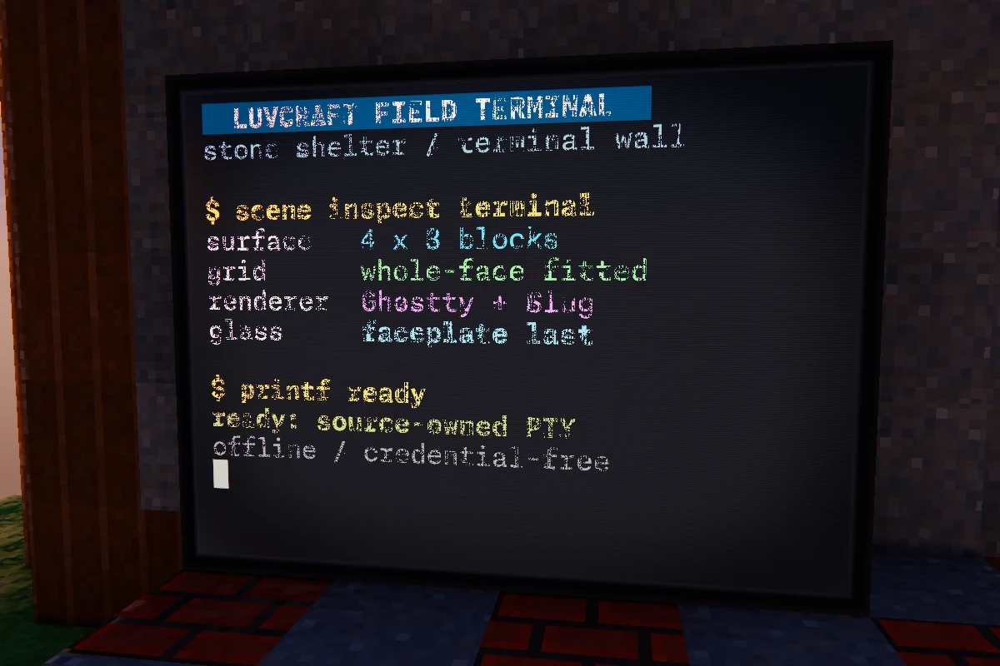
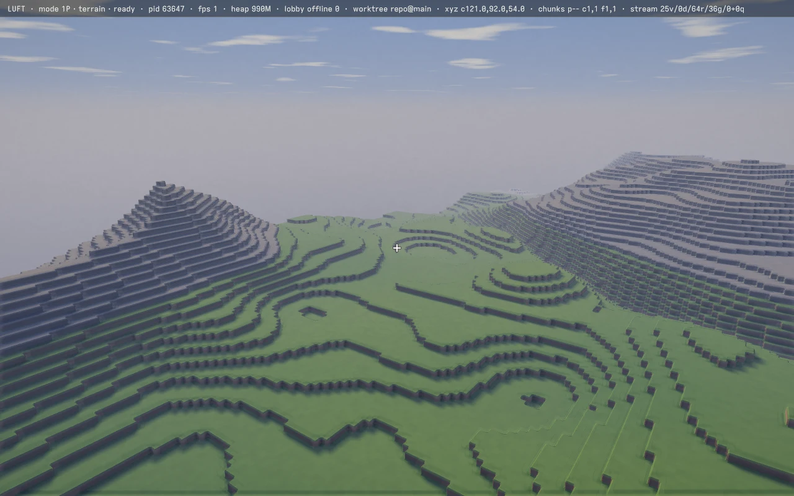
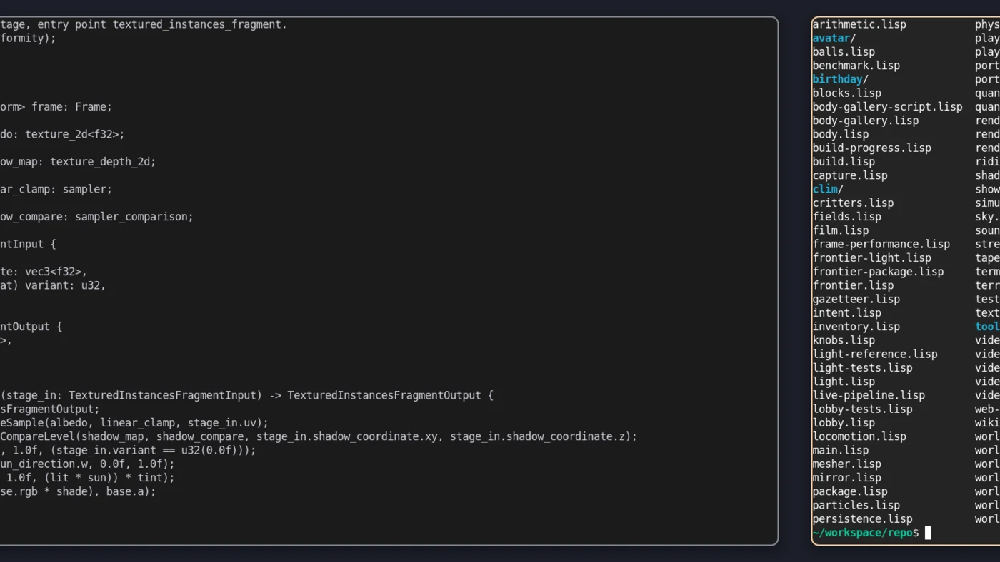

# luv


Luv is an experimental Common Lisp GPU workshop: a small WebGPU-shaped
hardware layer with hand-built Vulkan and native Metal 4 backends, an SDL3
canvas host, a Lisp shader language that lowers to SPIR-V, MSL, HLSL, and WGSL,
and a McCLIM backend for live tools on GPU surfaces. The aim is not a
general-purpose engine; it is graphics machinery small enough to inspect and
redefine while it is running.

Three applications grow out of it:

- **Luvcraft**, the original procedural block world, with streaming,
  simulation, persistence, and tools that live inside the world — including
  terminals you build out of blocks.
- **Luft**, the second-generation experiment: canonical cubical topology,
  packed integer manifold-sheet meshes, and a playable McCLIM atelier.
- **Luvland**, the newest: a Wayland compositor written in Lisp, whose world is
  nothing but other programs' windows.

## Try it with Nix

Run any of them straight from GitHub, without cloning the repository:

```sh
nix run --accept-flake-config github:mbrock/luv            # Luvcraft
nix run --accept-flake-config github:mbrock/luv#luft       # Luft
nix run --accept-flake-config github:mbrock/luv#luvland    # Luvland (Linux)
nix run --accept-flake-config github:mbrock/luv#luv-shaderc -- --help
```

The flake supports x86-64 and ARM64 Linux and Apple Silicon macOS; Luvland
is Linux only. The first run downloads or builds the program and its
dependencies, and later runs reuse the Nix store. Luvcraft keeps its world
under `$XDG_DATA_HOME/luvcraft` (or `~/.local/share/luvcraft`) rather than
inside the immutable package.

## Luvcraft


A procedural block world with HDR sky and sun, shadows, fog, bloom, and light
shafts; blocks that stream, simulate, and persist; and inhabitants you can
talk to.

<p>


</p>

**Terminal walls.** Terminal is a placeable block material. Build a rectangle
of it and the exposed faces join into one display; look at it and press `Tab`
to start a real Bash in a PTY and step into it, `Shift-Tab` to step back out.
[Ghostty](https://ghostty.org)'s `libghostty-vt` owns the terminal state, and
every glyph is drawn as a resolution-independent Slug curve in world space,
sharing the depth buffer with the terrain, so the screen stays sharp at any
distance and snow can drift in front of it. The same display can play video
or ride along in your hand as a phone.

<p>


</p>

## Luft

<p>


</p>

Luft treats a block world as algebra rather than as voxels with decorations.
Every vertex, edge, face, and cell of the cubical lattice is one fixnum, and
the surface falls out of chain arithmetic on those sites. The mesher turns
occupancy into manifold sheets with exact integer bevels and miters, packed so
that shaders draw them straight from a GPU buffer by vertex pulling; there are
no textures. The atelier around it streams large highland regions, lights them
with a stylized sun, voxel-propagated torch and crystal light, and a
reconstructed temporal frame, and lets you walk, fly, edit, and inspect any
site under the pointer.

## Luvland



Luvland speaks `libwayland-server` over CFFI, with every protocol interface —
core, `xdg-shell`, the seat, `linux-dmabuf` — implemented in Lisp from the
protocol XML. Clients draw through `wl_shm` or hand over dmabufs that are
imported into Vulkan without a copy. Windows are quads on a strip in a
perspective space, and a critically damped spring borrowed from
[niri](https://github.com/YaLTeR/niri) carries the camera from one to the next,
landing each focused window exactly one client pixel per screen pixel.

It runs as a window inside your current desktop and opens a
[foot](https://codeberg.org/dnkl/foot) terminal as its first client; Wayland
programs started from it join the strip, as far as the protocols implemented so
far carry them. `Ctrl-Alt-←`/`→` move focus,
`Ctrl-Alt-Return` opens another foot, and `Ctrl-Alt-Backspace` closes the
focused window.

## The shader language

Shaders are written in Lisp as typed expression graphs, not strings. The same
source lowers to SPIR-V for Vulkan, MSL for Metal, HLSL for Direct3D 12, and
WGSL for WebGPU, and the lowering remembers which source expression each
generated line came from. Here is a complete full-screen sky:

```lisp
(define-shader sky-vertex
    (:stage :vertex
     :inputs ((corner :uint :built-in :vertex-index))
     :outputs ((clip-position :vec4 :built-in :position)
               (uv :vec2 :location 0)))
  (let* ((st (vec2 (float (* (uint 2) (logand corner (uint 1))))
                   (float (logand corner (uint 2))))))
    (set-output clip-position (vec4 (- (* st 2.0) (vec2 1.0 1.0)) 0.0 1.0))
    (set-output uv st)))

(define-shader sky-fragment
    (:stage :fragment
     :inputs ((uv :vec2 :location 0))
     :outputs ((color :vec4 :location 0))
     :resources ((sky :uniform-block :binding 0
                  :members ((horizon :vec4) (zenith :vec4) (sun :vec4)))))
  (let* ((height (clamp (- 1.0 (swizzle uv :y)) 0.0 1.0))
         (offset (- uv (swizzle sun :xy)))
         (base (mix (swizzle horizon :rgb) (swizzle zenith :rgb)
                    (smoothstep 0.0 0.8 height)))
         (glow (- 1.0 (smoothstep 0.0 (swizzle sun :z)
                                  (sqrt (dot offset offset))))))
    (set-output color (vec4 (+ base (* glow (vec3 1.0 0.85 0.6))) 1.0))))

(define-shader-program sky
  :vertex sky-vertex
  :fragment sky-fragment)
```

Inside Luv a shader is a live object: redefine it in the running image and the
next frame uses it. Outside Luv, `luv-shaderc` compiles the same files ahead of
time, so a renderer in any language can use them as portable shaders:

```text
$ nix run github:mbrock/luv#luv-shaderc -- --out shaders hal/shaderc/examples/sky.lisp
luv-shaderc: 1 program, 10 files in shaders/
$ ls shaders
sky.fragment.hlsl   sky.fragment.spv    sky.hh              sky.vertex.hlsl     sky.vertex.spv
sky.fragment.metal  sky.fragment.wgsl   sky.json            sky.vertex.metal    sky.vertex.wgsl
```

Each stage comes out as one module per target, and the program's reflection
comes out twice: as JSON, and as a C++ header with the uniform structures laid
out and their sizes asserted. The fragment stage in WGSL:

```wgsl
@fragment
fn sky_fragment(stage_in: SkyFragmentInput) -> SkyFragmentOutput {
  var result: SkyFragmentOutput;
  let height: f32 = clamp((1.0f - stage_in.uv.y), 0.0f, 1.0f);
  let offset: vec2<f32> = (stage_in.uv - sky.sun.xy);
  let base: vec3<f32> = mix(sky.horizon.rgb, sky.zenith.rgb, smoothstep(0.0f, 0.8f, height));
  let glow: f32 = (1.0f - smoothstep(0.0f, sky.sun.z, sqrt(dot(offset, offset))));
  result.color = vec4<f32>((base + (glow * vec3<f32>(1.0f, 0.85f, 0.6f))), 1.0f);
  return result;
}
```

[Moppe](https://github.com/mbrock/moppe), a C++ game, builds its renderer's
pipelines this way: one Lisp source for Metal 4 on Apple platforms, Direct3D 12
on an Xbox, Vulkan, and WebGPU in a browser. The language also covers compute
stages, structured storage buffers, textures of every dimension, workgroup
memory, atomics, and wave operations; see
[`hal/shaderc/examples`](hal/shaderc/examples) and
[HLSL, shader programs, and luv-shaderc](wiki/hlsl-and-shaderc.org).

## Develop in the live image

Development happens in a durable SBCL image supervised by
[Swash](https://github.com/lessrest/swash):

```sh
./sly play luft                     # start the image and open the Luft atelier
./sly status                        # identify the image, target, and canvas health
./sly screenshot build/frame.png    # capture the next rendered frame
./sly stop-playing                  # close the window; keep the Lisp
```

`./sly play` opens Luvcraft, and `./sly play luvland` the compositor. The same
command also provides `eval`, `inspect`, `describe`, `apropos`, `edit`, and
`xref` against the live image. See [AGENTS.md](AGENTS.md) for the concise
development workflow and concrete output examples.

`./sly` and `make` enter the checkout's Nix environment automatically. For an
arbitrary command, use `./env COMMAND`; `./env --slim COMMAND` provides just
SBCL, Sly/Swash, Python, and Bash. The slim managed image loads the `luft`
mesher rather than the graphical workbench; use the full environment for
rendering and game features.

Standalone executables are available for release-style testing:

```sh
make
./build/luft-atelier                # Luft
./build/luvcraft                    # Luvcraft
make luvland && ./build/luvland     # Luvland (Linux)
```

`make help` lists the build workflows. `make LUV_DEV_SHELL=slim` builds only
non-graphical Luft; add `test` to run its checks. Specialized targets live in
`make/graphics.mk`, `make/benchmarks.mk`, and `make/publishing.mk` and are
invoked from the checkout root as usual. `scripts/captures list` names the
source-defined camera recipes behind many of the pictures above.

Metal 4 is used natively on macOS; Vulkan is used elsewhere and remains
available on macOS for comparison.

## Explore

- [The workshop wiki](https://mbrock.github.io/luv/) is the design notebook and
  rendered source browser.
- [Luft](wiki/luft.org), [Luft sites](wiki/luft-sites.org),
  [Luvcraft](wiki/block-world.org), [world terminals](wiki/world-terminal.org),
  and [Luvland](wiki/compositor.org) introduce the applications.
- [GPU architecture](wiki/gpu-architecture.org),
  [mathematical shaders](wiki/mathematical-shaders.org), and
  [quantities and measurement](wiki/quantities-and-measurement.org) describe
  the machinery beneath them.

Everything here is experimental and under active construction.
