# luv

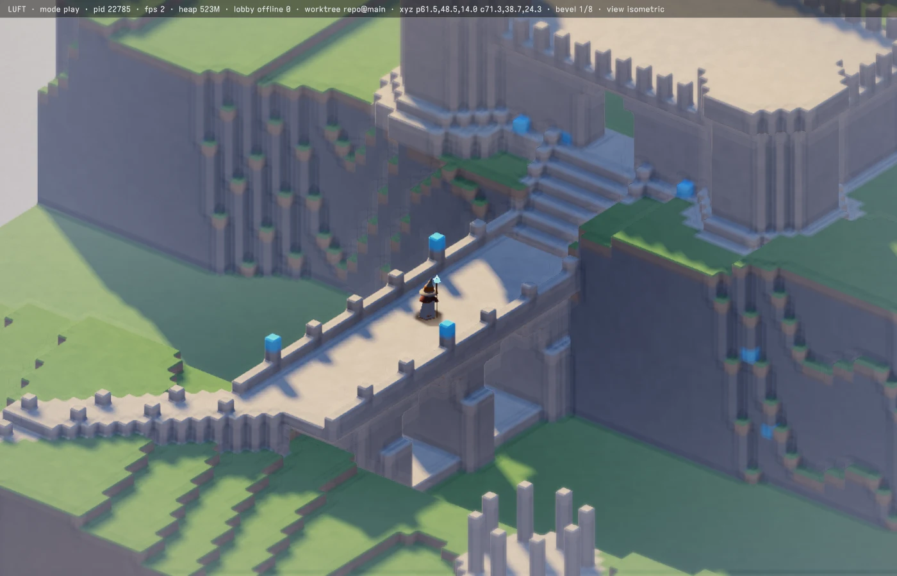

Luv is a graphics workshop written in Common Lisp. It draws with the GPU
through its own small Vulkan and Metal 4 backends, has its own shader language,
and runs inside a Lisp image that stays alive while you work on it: you can
redefine a function, a class, or a shader and see the next frame change,
without restarting anything.

It isn't a general-purpose engine. It's a place to build graphics machinery
that is small enough to read, poke at, and change while it runs, and three
programs have grown up in it:

- **Luvcraft**, a block world in the spirit of Minecraft, with terminals you
  can build out of blocks and type into.
- **Luft**, a second, more mathematical take on the block world, with carved,
  bevelled terrain instead of textured cubes.
- **Luvland**, a Wayland compositor: other programs open their windows in it.

## Try it with Nix

Run any of them straight from GitHub, without cloning:

```sh
nix run --accept-flake-config github:mbrock/luv            # Luvcraft
nix run --accept-flake-config github:mbrock/luv#luft       # Luft
nix run --accept-flake-config github:mbrock/luv#luvland    # Luvland (Linux)
nix run --accept-flake-config github:mbrock/luv#luv-shaderc -- --help
```

This works on x86-64 and ARM64 Linux and on Apple Silicon Macs; Luvland is
Linux only. The first run downloads or builds everything it needs, and later
runs start straight from the Nix store. Luvcraft saves its world under
`~/.local/share/luvcraft` (or `$XDG_DATA_HOME/luvcraft`).

For the experimental single-file Linux download and the macOS/Windows
packaging status, see [downloadable builds](deploy/releases.md).

## Luvcraft

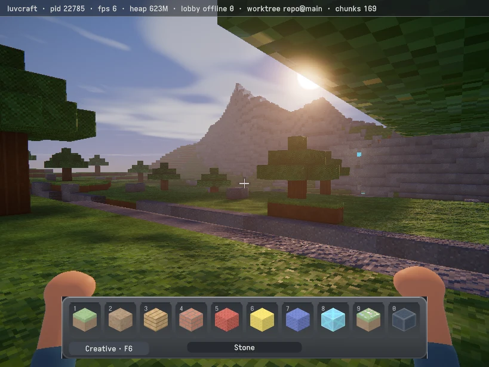

Luvcraft is the original experiment, and the one most of the renderer grew
out of. It has generated terrain, a day with a moving sun, shadows, fog, bloom
and light shafts, blocks you can mine and place, simple physics, a world that
is saved as you play, and a few inhabitants you can talk to.

The ordinary game now runs on Luft's terrain renderer, with plain cube faces
by default. Press `Enter` to open the metabar, expand **geometry**, and toggle
**terrain bevels** while playing. Adaptive resolution targets 60 FPS without
reducing view distance. `./sly play` and `build/luvcraft` use this host;
`./sly play luvcraft-old` keeps the original renderer available.

Press `I` for the picture-first inventory: arrow keys browse six large material
cards, `Enter` adds to your six-block building kit, and `Esc` returns to play.
Move up from the first row to choose a category, or use the wheel and page
arrows to see more blocks. `Tab` selects your kit; `Backspace` removes a kit
entry. A full kit asks which block to replace. Nothing is removed from the
material collection.

`Full inventory` (`F3`) restores the dense grid, inspector, and ten-slot hotbar.
The player button (`F2`) switches between two local players. Each remembers
its kit, full hotbar, and inventory mode in `luvcraft/inventory-players.sexp`
under the same data directory as the saved worlds.

### Terminals made of blocks

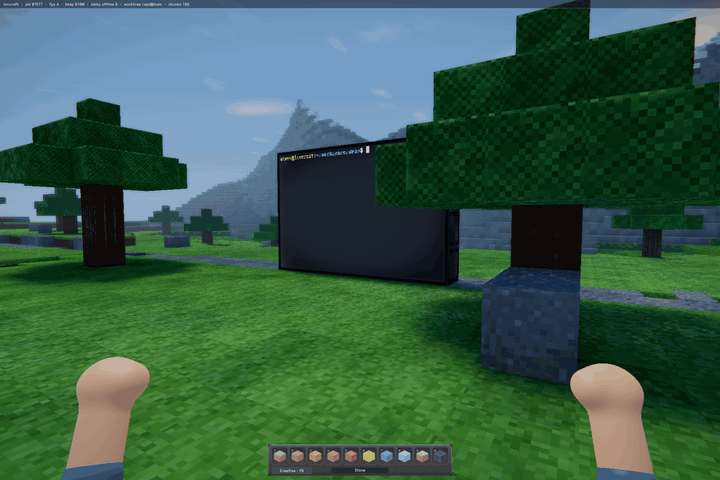

Terminal is a block material. Build a wall of it, look at the wall, and press
`Tab`: the wall turns into one screen running a real Bash, and the camera
settles in front of it so you can type. `Shift-Tab` steps back into the game.
Everything above is live: `ls`, Vim and the shell are real programs talking to
a real pseudo-terminal.

The terminal emulation is [Ghostty](https://ghostty.org)'s, through its
`libghostty-vt` library. Luvcraft draws the text itself, as glyph outlines
rendered directly on the GPU, so the screen stays sharp from any distance and
is part of the world rather than pasted over it: trees can stand in front of it
and the light falls on its glass.

<p>
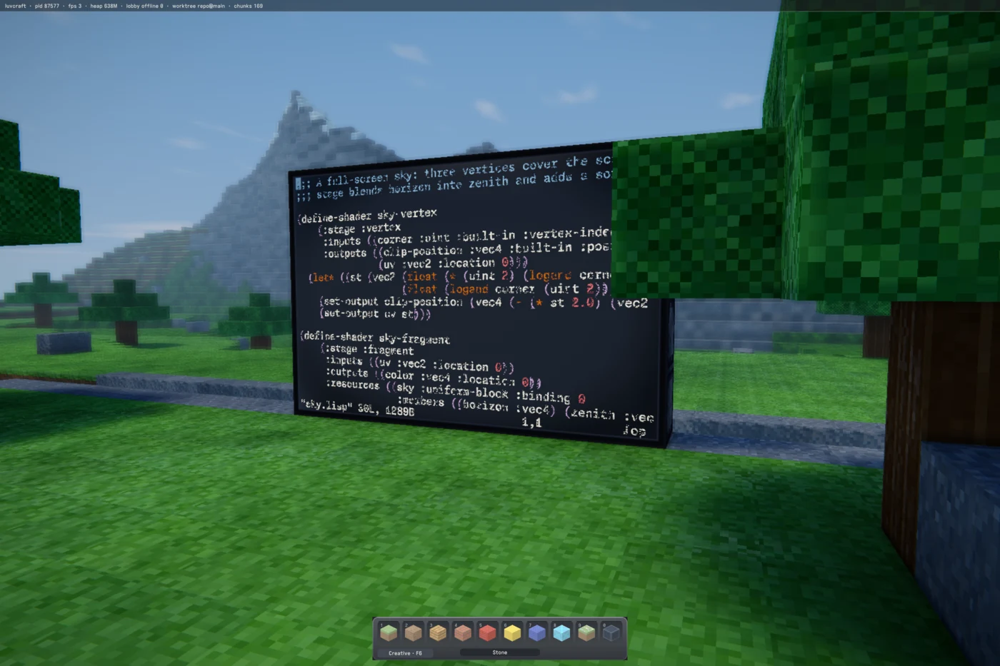
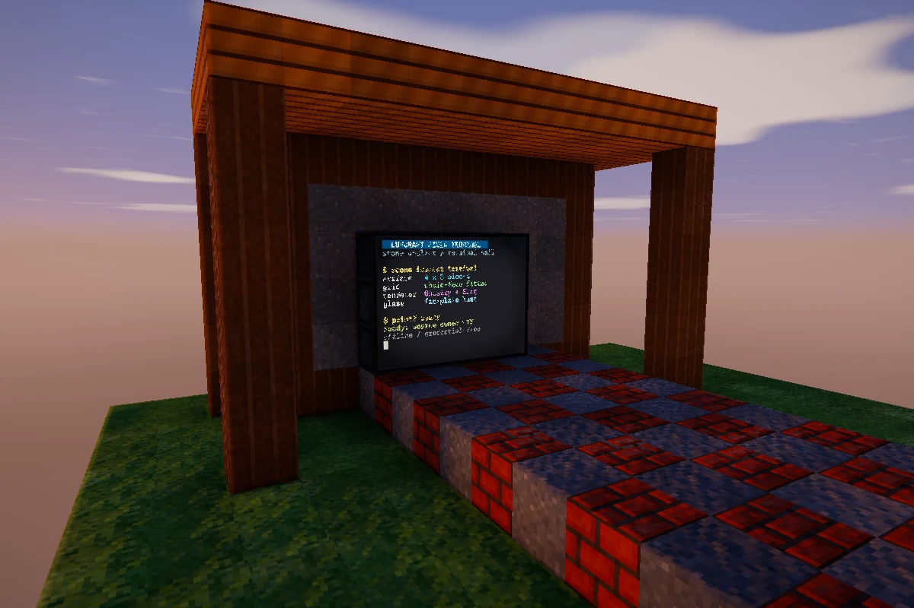
</p>
<p>
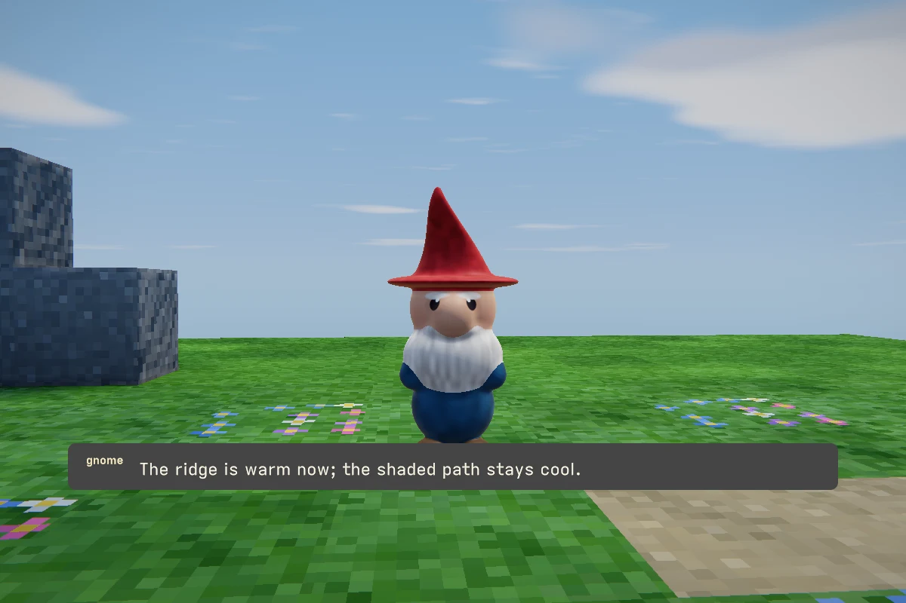
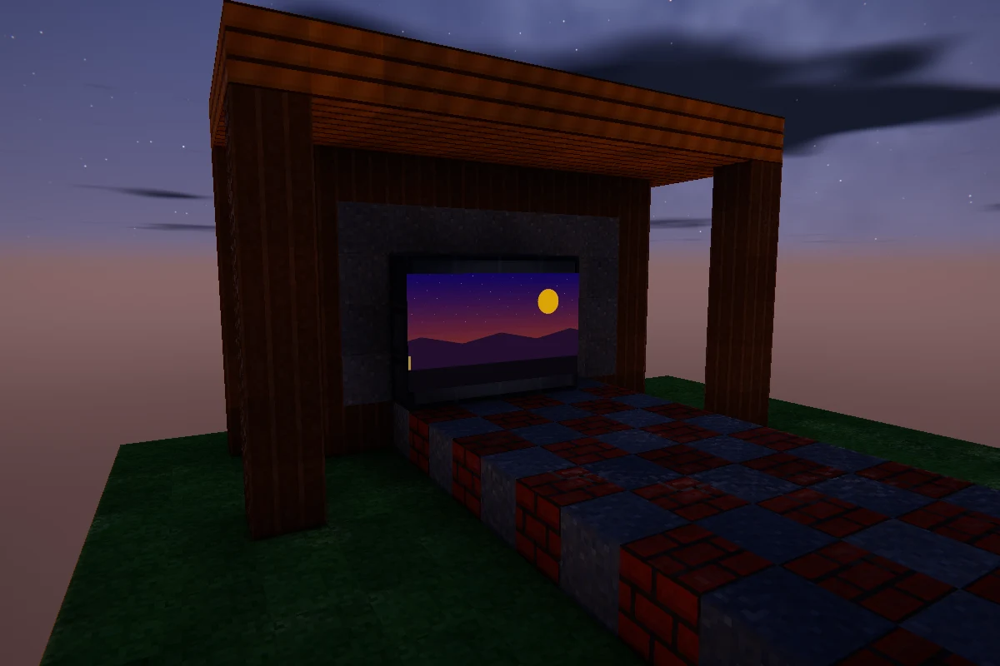
</p>

The same screens can play video, or come with you as a phone in your hand.

## Luft

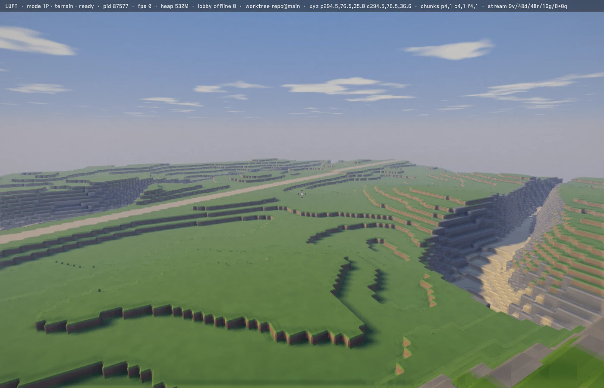

Luft starts the block world over. The world is still made of cells on a grid,
but instead of drawing each block as a textured cube, Luft works out the actual
surface of the solid shape and gives it rounded, bevelled edges and properly
mitred corners. Cliffs read as carved stone and hills as terraces, and there
are no textures at all: the colour comes from materials, sunlight, and the
glow of torches and crystals.

<p>
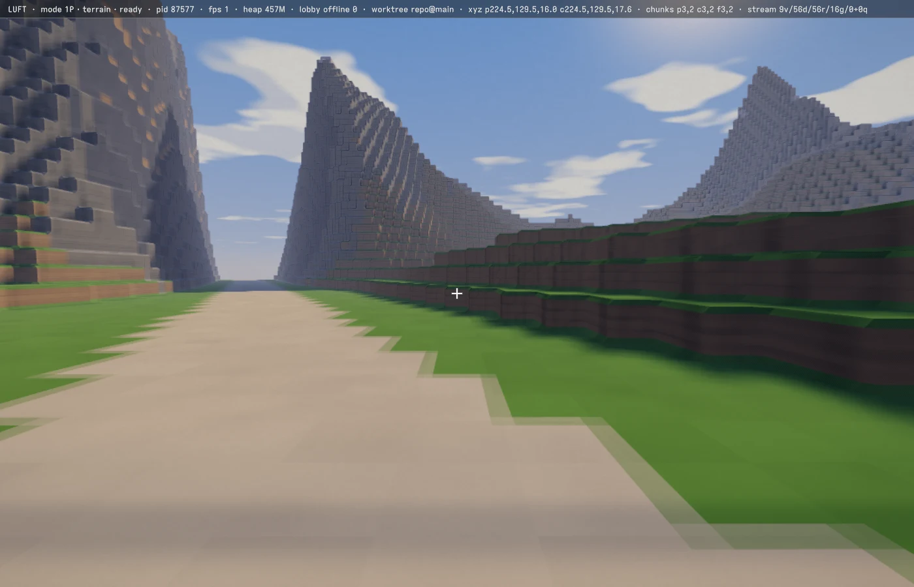
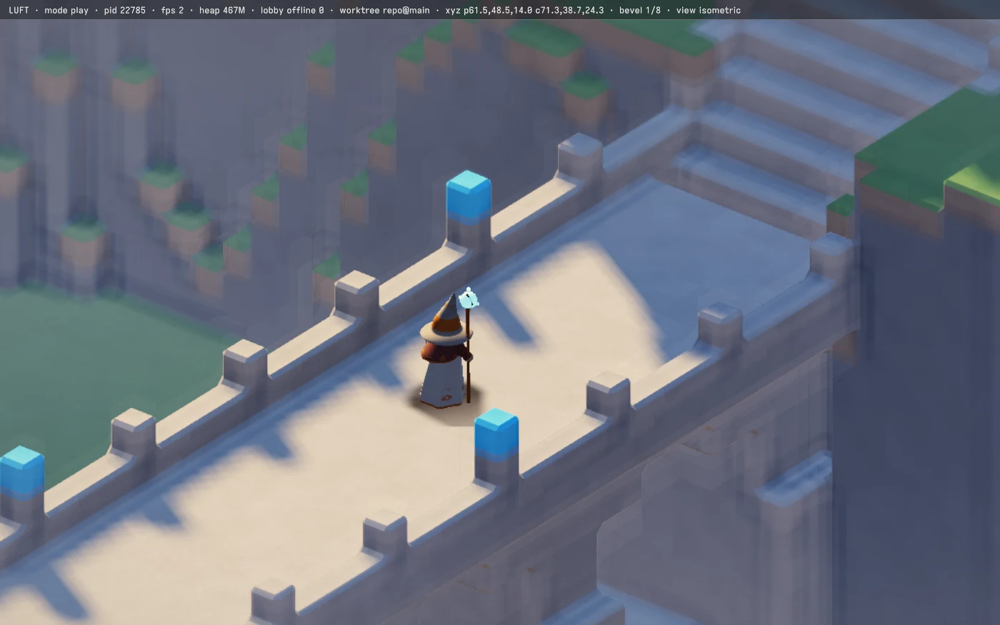
</p>

You can walk it in first person, or switch to an isometric view and click
where the little traveller should go. You can fly, place and remove material,
and point at any piece of the surface to see how it was built.

Under the hood, every corner, edge, face and cell of the grid has a number, and
the surface is computed from those numbers with exact integer arithmetic. The
mesh is packed small enough that the shaders read it straight from GPU memory.
The highlands stream in around you as you travel.

## Luvland

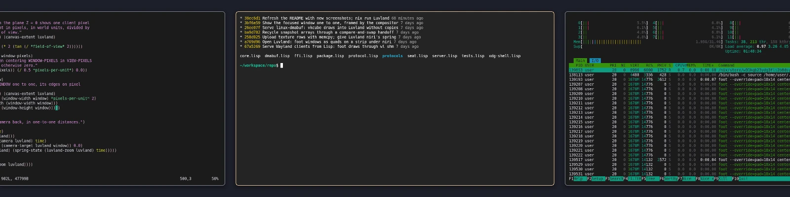

Luvland is a Wayland compositor, written in Lisp, where the world is nothing
but other programs' windows. Windows sit side by side on a long strip, like the
columns of [niri](https://github.com/YaLTeR/niri), and the camera glides from
one to the next on a spring. The window in focus is shown at exactly one of its
pixels per pixel of your screen, so text is as sharp as it would be anywhere
else.

It runs as a window in your current desktop and opens a
[foot](https://codeberg.org/dnkl/foot) terminal to start with. Programs you
launch from there open as new windows on the strip, as long as they make do with
the parts of Wayland implemented so far.

| Keys | |
|---|---|
| `Ctrl-Alt-←` / `Ctrl-Alt-→` | move focus along the strip |
| `Ctrl-Alt-O` | pull back to see the whole strip, or come back in |
| `Ctrl-Alt-Return` | open another terminal |
| `Ctrl-Alt-Backspace` | close the focused window |

The Wayland protocol itself is handled by the standard `libwayland-server`
library; every part of the protocol on top of it — surfaces, toplevel windows,
the keyboard and pointer, buffer sharing — is implemented in Lisp, read from
the protocol's XML description. GPU clients like `vkcube` hand over their
frames as dmabufs, which Luvland shows without copying.

## The shader language

Shaders in Luv are written in Lisp. Here is a complete program that fills the
screen with a sky and a soft sun:

```lisp
(define-shader sky-vertex
    (:stage :vertex
     :inputs ((corner :uint :built-in :vertex-index))
     :outputs ((clip-position :vec4 :built-in :position)
               (uv :vec2 :location 0)))
  (let* ((st (vec2 (float (* (uint 2) (logand corner (uint 1))))
                   (float (logand corner (uint 2))))))
    (set-output clip-position (vec4 (- (* st 2.0) (vec2 1.0 1.0)) 0.0 1.0))
    (set-output uv st)))

(define-shader sky-fragment
    (:stage :fragment
     :inputs ((uv :vec2 :location 0))
     :outputs ((color :vec4 :location 0))
     :resources ((sky :uniform-block :binding 0
                  :members ((horizon :vec4) (zenith :vec4) (sun :vec4)))))
  (let* ((height (clamp (- 1.0 (swizzle uv :y)) 0.0 1.0))
         (offset (- uv (swizzle sun :xy)))
         (base (mix (swizzle horizon :rgb) (swizzle zenith :rgb)
                    (smoothstep 0.0 0.8 height)))
         (glow (- 1.0 (smoothstep 0.0 (swizzle sun :z)
                                  (sqrt (dot offset offset))))))
    (set-output color (vec4 (+ base (* glow (vec3 1.0 0.85 0.6))) 1.0))))

(define-shader-program sky
  :vertex sky-vertex
  :fragment sky-fragment)
```

A shader is not a string handed to a driver: it's a typed expression that Lisp
checks and then translates for each GPU API — SPIR-V for Vulkan, MSL for Metal,
HLSL for Direct3D 12, and WGSL for WebGPU. Inside a running Luv program a
shader is a live object, and redefining it changes the next frame.

The same shaders also work outside Luv. `luv-shaderc` is a small command-line
compiler that turns these files into ready-to-load shaders for every target,
plus a description of each program's inputs:

```text
$ nix run github:mbrock/luv#luv-shaderc -- --out shaders hal/shaderc/examples/sky.lisp
luv-shaderc: 1 program, 10 files in shaders/
$ ls shaders
sky.fragment.hlsl   sky.fragment.spv    sky.hh              sky.vertex.hlsl     sky.vertex.spv
sky.fragment.metal  sky.fragment.wgsl   sky.json            sky.vertex.metal    sky.vertex.wgsl
```

`sky.json` and the C++ header `sky.hh` describe the resources each program
expects, with the uniform structures laid out and their sizes checked at
compile time. Here is the fragment stage as WGSL:

```wgsl
@fragment
fn sky_fragment(stage_in: SkyFragmentInput) -> SkyFragmentOutput {
  var result: SkyFragmentOutput;
  let height: f32 = clamp((1.0f - stage_in.uv.y), 0.0f, 1.0f);
  let offset: vec2<f32> = (stage_in.uv - sky.sun.xy);
  let base: vec3<f32> = mix(sky.horizon.rgb, sky.zenith.rgb, smoothstep(0.0f, 0.8f, height));
  let glow: f32 = (1.0f - smoothstep(0.0f, sky.sun.z, sqrt(dot(offset, offset))));
  result.color = vec4<f32>((base + (glow * vec3<f32>(1.0f, 0.85f, 0.6f))), 1.0f);
  return result;
}
```

That makes the language useful as a portable shader language on its own.
[Moppe](https://github.com/mbrock/moppe), a C++ game, writes its shaders this
way and builds them for Metal 4 on Apple devices, Direct3D 12 on an Xbox,
Vulkan, and WebGPU in a browser. Besides vertex and fragment stages the
language has compute shaders, structured buffers, every kind of texture,
shared workgroup memory, atomics, and wave operations; see the
[examples](hal/shaderc/examples) and
[HLSL, shader programs, and luv-shaderc](wiki/hlsl-and-shaderc.org).

## Built from the ground up

Most graphics code in high-level languages sits on large generated bindings
that expose every function and structure of an API at once. Luv goes the other
way. It binds exactly the parts of each platform it uses, by hand, and adds
more only when a feature needs them:

- **Vulkan** is roughly ninety hand-declared entry points over CFFI, each one
  added for a concrete operation the backend performs.
- **Metal 4** is reached through a small Objective-C bridge written in Lisp,
  where every message Luv sends is declared with its exact calling convention.
- **SPIR-V** is assembled in Lisp, instruction by instruction; there is no
  external shader compiler in the loop. MSL, HLSL and WGSL are generated
  the same way.
- **Text** is drawn from font outlines on the GPU with an implementation of
  the Slug algorithm, so glyphs stay crisp at any size and angle.
- **Tools** inside the games are built with [McCLIM](https://mcclim.common-lisp.dev),
  which Luv teaches to draw on GPU surfaces.

The result is a codebase where you can follow a pixel from the game's logic to
the exact GPU call that draws it, and change any step along the way while the
program keeps running. SDL3 opens the windows and reads input; Ghostty handles
terminal emulation, and FFmpeg decodes video.

## Develop in the live image

Day-to-day work happens in a long-running SBCL image managed by
[Swash](https://github.com/lessrest/swash). The `./sly` command talks to it:

```sh
./sly play luft                     # start the image and open Luft
./sly status                        # which image, what's playing, is it healthy
./sly screenshot build/frame.png    # capture the next frame
./sly stop-playing                  # close the window; keep the Lisp running
```

`./sly play` alone opens Luvcraft, and `./sly play luvland` the compositor.
The same command can `eval`, `inspect`, `describe`, `apropos`, `edit`, and
`xref` against the running program. [AGENTS.md](AGENTS.md) walks through the
workflow with real output.

`./sly` and `make` enter the repository's Nix environment by themselves. To
run anything else inside it, use `./env COMMAND`; `./env --slim COMMAND` is a
smaller environment that is enough for the non-graphical parts of Luft.

To build standalone programs instead:

```sh
make
./build/luvcraft
./build/luft-atelier
make luvland && ./build/luvland     # Linux
```

`make help` lists the other build targets. Most pictures in this README come
from camera recipes in the source; `scripts/captures list` shows them.

Luv uses Metal 4 natively on macOS and Vulkan everywhere else (Vulkan also
works on macOS, for comparison).

## Explore

- [The workshop wiki](https://mbrock.github.io/luv/) is the design notebook,
  with a browsable, cross-linked view of the source.
- [Luvcraft](wiki/block-world.org), [terminals in the world](wiki/world-terminal.org),
  [Luft](wiki/luft.org), and [Luvland](wiki/compositor.org) describe the
  programs.
- [GPU architecture](wiki/gpu-architecture.org),
  [mathematical shaders](wiki/mathematical-shaders.org), and
  [quantities and measurement](wiki/quantities-and-measurement.org) describe
  the machinery underneath.

Everything here is an experiment and still being built.
