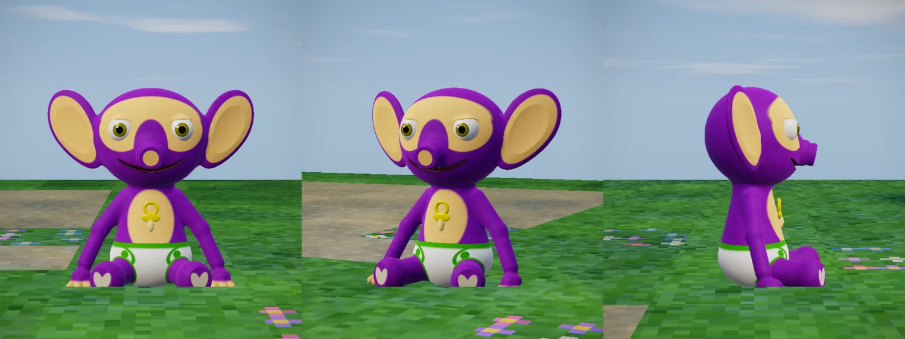

#+title: An agent in the little world
#+startup: overview

An agent should be able to stand inside luvcraft the way a player does: see
what is there, act on it with the same verbs, and leave a record others can
read.  The harness notes ([[file:agent-harnesses.org][#YY6EYZ]]) settled what
any such surface must do.  This page says how luv does it: with the CLIM
vocabulary the game already speaks -- command tables, presentation types,
views, output records -- and with the world itself as the place the agent's
work shows up.  The OpenAI websocket client
([[file:../openai/agent.lisp][openai/agent.lisp]]) is the first provider
behind it; nothing here depends on which provider it is.

* The agent surface is a command table, a view, and a handle space
:PROPERTIES:
:ID: 4Y8Q8B
:END:

The four harnesses converged on seams (#YY6EYZ), and CLIM already has a name
for each of them.  That is the whole design bet of this page:

| harness seam                           | CLIM concept                                              |
|----------------------------------------+-----------------------------------------------------------|
| tool definition and JSON schema        | =define-command= with presentation-typed arguments        |
| argument validation, "did you mean"    | =accept-from-string=, =complete-input=, presentation errors |
| typed result with several renderings   | a presentation, presented under different /views/         |
| short stable handles                   | presentation history, a =handle= presentation type        |
| "what can I do with this?"             | =find-applicable-translators= on a presentation           |
| history as data, re-rendered later     | the output-record history of the agent's stream           |

Nothing in the table is a new mechanism.  The work is to choose the
presentation types, write the views, and route a provider's tool calls
through =accept= and =execute-frame-command= instead of around them.
#0IF4TY through #1W8K03 take the rows in turn; #9K823O and #14ZP6S take the
rendering from nxt; #UTQQV9 and #5JDNKF put the agent in the world.

* A tool is a CLIM command whose arguments are presentation types
:PROPERTIES:
:ID: 0IF4TY
:END:

[[file:../luvcraft/clim/command-menu.lisp][command-menu.lisp]] already answers
"what can I do?" for the player by walking the command tables, and it skips
parameterized commands because M-x cannot yet prompt for their arguments.
The agent's tool list is the same walk with the same gap.  One

#+begin_src lisp
(define-command (com-place-block :command-table luvcraft-world)
    ((kind 'block-kind) (where 'block-position))
  ...)
#+end_src

should yield a keystroke, an M-x entry that prompts through =accept=, and a
JSON-schema tool whose arguments are parsed with =accept-from-string= per
presentation type.  Finishing parameterized M-x and building the agent
surface are one piece of work.

Concretely: a =command-tool= is an =openai:tool= wrapping a command name; a
generic =presentation-type-json-schema= with EQL methods on type names
(=integer=, =string=, =(member ...)= as an enum, =block-position= as an
object of three integers, =handle= as a pattern) derives the schema once
from the command's parser table; and =call-tool= accepts each argument by
its declared type and hands the finished command to the canvas thread
(#T6PEVY).  An argument the model gets wrong is a presentation-parse error
rendered back to it, not a crash, which is nxt's "failures as values"
(#KZ019W) without writing a second validator.

* A tool result is a presentation, and the model reads it under a view
:PROPERTIES:
:ID: WS5OEX
:END:

Froth's lesson is that /what the tool found/, /how much the model sees/,
and /how it is spelled for a provider/ are three policies (#5GU1VI).  In
CLIM a tool body does not return a string; it =present=s objects to a
recording stream.  The three policies become three views over the same
records:

- =+model-view+= renders compact text for the provider: the output of
  =present-to-string= on the record, folded by an =:around= method that
  keeps a head and a tail and a handle (#1W8K03) when the body is long.
  Folding lives here and nowhere else, so tool bodies never truncate.
- =+trace-view+= is the three-line preview used when an old turn is replayed
  inside a later prompt: for remembering, not for working, exactly as froth
  distinguishes live from trace.
- The ordinary view, and the cassette view (#9K823O), are what people see
  on the HUD and on a terminal wall.

Because rendering is =present= to a string stream, escaping and layout are
in one place; there is no string concatenation anywhere between a tool and
the model.  And because the records are kept, the whole transcript can be
redrawn under any view later without rerunning a thing, which is the
"history is data first" point of #YY6EYZ with the output-record history as
the data.

* Handles are presentation history
:PROPERTIES:
:ID: 1W8K03
:END:

Sheaf's six characters (#9P5YLW) and this wiki's figure IDs are the same
idea: a short handle the model can cite by typing.  In the agent stream,
every presented object of interest -- a chunk, a block position, a session,
a folded body -- is entered in a presentation history under a short id, and
=handle= is a presentation type whose =accept= method resolves the id back
to the live object.  The model says =#AB12= in a tool argument; =accept=
gives the tool the object; an unknown or stale handle is a parse error the
model can read.  The pager (#FDMSXG) is then nothing special: =accept= a
handle, =present= a slice of it under the model view.

* The cassette is one presentation file
:PROPERTIES:
:ID: 9K823O
:END:

Before nxt deleted its UI runtime (nxtui commit =3d692d0=), a tool call was
drawn as a /cassette/ (#7FFNVT): a trace as XML (=turn > thought | call[name,
status, elapsed] > args, result[kind], affordances[key]=), and one XSLT
stylesheet, =cassette/baltic-birch-v1.xsl=, holding the whole visual
language in about three hundred lines organized as

- a /spine/ keyed on call status (=✓= in the tool's colour, =!= rose, =?=
  amber for pending approval, a spinner while running, =N= denied),
- a /tool identity/ as one template pair per tool name (search amber, read
  emerald, shell orange, fallback teal),
- a /meta chip/ per result kind (=⨉309 22K=, =109L 3K=, =exit 0=),
- a /window/ per result kind (hit list and "...N more", head of a file,
  stdout and stderr tinted apart, a fact's fields, an error's message),
- an /affordances/ strip -- =[A] see all 309  [P] by path  [C] context for
  #1= -- "the same surface the model parses as its action menu."

=<xsl:template match="result[@kind='matches']">= is a declarative visitor
case, and =define-presentation-method present (object (type matches) stream
(view cassette-view))= is the same case with a live object behind it.  So
the luv cassette is one file: a =cassette-view=, presentation methods keyed
on result kind for the window and the chip, a spine keyed on call status,
the per-tool colour as a generic on the command name, and the affordances
strip as =find-applicable-translators= printed as a menu.  That last point
is the nicest: the affordances are not a list a tool author writes, they
are whatever translators apply to the result's type.

* Draw and print: live cards and committed records
:PROPERTIES:
:ID: 14ZP6S
:END:

The same nxtui tree (=src/nxtrt/ui_runtime.hpp=, =src/nxtai/tool_ui.cpp=)
drew a batch of parallel tool calls with two verbs: =draw(layout)= replaces
a /live surface/ shown as a bottom HUD, and =print(layout)= commits a
rendered block to /durable scrollback/ above it.  Each tool call was a child
with its own slot; the batch drew a column of the children's slots; each
child redrew its card every frame with elapsed milliseconds while running,
flipped it to ok or error with a few sanitized lines of output and a memory
chip when done, held it for 900 ms so a person could see the flip, and
returned.  When the batch finished the live column was cleared and the
assistant's text was printed as a block.

Luv has both surfaces already.  The HUD overlay (the legend and the tape
prompt are McCLIM frames composited over the view) is the live surface:
running calls are =call-view= objects, each presented every frame under
#9K823O with its status.  The terminal wall and the agent's output-record
history are the committed surface.  Keep the settle delay: a card that
flips and vanishes in the same frame cannot be read.  And keep the
no-terminal fallback -- when nothing is drawing, one line per call on a
plain stream -- so the agent is usable from =./sly= alone.

* A shell scope is a session object with a screen and an observation
:PROPERTIES:
:ID: UTQQV9
:END:

nxtui's =demo/shell_scope_demo.cpp= ran a shell as =systemd-run --user
--scope= so it had a cgroup by construction, then forked four siblings into
one scope: a PTY reader, a stdin pump, a 33 ms cgroup sampler keeping a
sparkline series, and a 16 ms renderer drawing memory and CPU sparklines
above the live PTY screen.  The =observation= (unit, cgroup path, samples)
rode along inside the tool result, which is how a finished cassette could
show a memory chip (#KZ019W).

In luv the scope is a CLOS object rather than a coroutine zone: a
=shell-session= owning a PTY (the world terminal already has one serialized
PTY owner, #NMAD2U), a sampler thread, and its observation, all presentable.
A shell a tool starts should /become/ a terminal-material wall the agent
stands beside and the player can walk up to.  The concurrency story is the
one [[file:../luvcraft/agent/wall.lisp][the agent's wall]] already states: a
mailbox one way, a published immutable snapshot the other, and no lock
anywhere.  Swash's default applies too (#I0U0LI): a
shell tool returns within a few seconds with either the exit and a
screenful, or a handle to the still-running session and the command to
follow it.

* The agent has a body
:PROPERTIES:
:ID: 5JDNKF
:END:

An agent that is only a websocket is a chat window with extra steps.  The
point of doing this inside luvcraft is that the agent can be /somewhere/:
a presence object with a position and a facing, so =look=, =walk= and
=place= are presentation-typed commands relative to it, and its transcript
is the terminal wall it is standing at.  The playful surface follows from
that without new machinery:

- a thought (the =thought= element of a trace, a reasoning summary from the
  provider) is a thought bubble drawn above the avatar, a McCLIM frame in
  world space like the instruments in #AX9ZTA;
- a tool call in flight is the avatar typing at its wall while the live
  card (#14ZP6S) sits on the HUD;
- a parked call -- a question for the player, froth's park-versus-finish
  (#IOGTGD) -- is an =accept= against the /player/, offered as a HUD gadget
  like the tape prompt, and the turn resumes when it returns;
- the evaluator is the durable image itself, the =./sly eval= shape with a
  three-second detach (#ENM1B2); a form that returns objects gets them
  presented, so the agent receives handles and applicable commands for what
  it just computed -- froth's discover, inspect, act loop by way of
  translators and =describe=.

* The turn runs beside the canvas, and commands cross by mailbox
:PROPERTIES:
:ID: T6PEVY
:END:

Commands run on the canvas thread; a provider turn runs on its own.
=call-tool= must therefore never call =execute-frame-command= from the
websocket thread.  It accepts its arguments and posts the finished command
through =request-canvas-frame= -- froth's prepare/commit split (#IOGTGD),
with =accept= as the prepare.  Most commands return their values in that
one frame.  A command may instead return a running semantic object and let
=settle-command-result= wait for it on the provider's turn thread.  =Move
To= does exactly that: the canvas returns a =body-move-action= immediately,
keeps advancing it at frame boundaries, and publishes its terminal state to
a private mailbox.  The tool call is deliberately blocking in this first
version while the canvas never is.  A later duration bound can return a
handle to the same action without changing either the command or movement
protocol.

* A conversation outlives its connection
:PROPERTIES:
:ID: PNGT18
:END:

Each gnome or cat keeps one provider agent for as long as it is in the
world, so talking to the same figure again continues the same conversation:
every turn is a =response.create= under =previous_response_id=, and the
server holds the history.  The connection is not that durable.  The server
ends a Responses WebSocket after sixty minutes, and the first gnome to stand
in the world that long went mute: the limit error and the close sat queued,
and every later question failed on them.

So =response-id= names the last turn that /finished/ -- one that dies with a
function call still unanswered would otherwise poison every continuation --
and a turn begins by discarding anything queued since the last one and
opening a fresh socket when the old one is gone or near its hour.  Events
from a replaced socket are dropped.  The harness holds its turn and close
functions by name, so a redefinition reaches agents already standing in the
world; the stranded gnome was revived in place and recalled its plank square
and the flowers it meant to grow there.

* Gnomes and cats are inhabitants of the saved world
:PROPERTIES:
:ID: 9AONMH
:END:

A save (#TR2JNQ) now carries an optional =:inhabitants= list beside its
world and resume state.  The core knows no inhabitant kinds: a system
registers a describer on =*inhabitant-describers*= and specializes
=restore-luvcraft-inhabitant= on its own keywords.  A gnome or cat is
written as its cell, its heading, the response its conversation continues
from (#PNGT18), and the last thing asked and said, which the card shows
again on return.  The provider keeps the history; the save keeps only the
name of where it stopped, so a gnome brought back in a later game is the
same gnome mid-conversation.

A description no loaded system restores -- because the agent system is not
loaded, or restoring it failed -- is kept as written and saved again, never
dropped; a failure is also reported.  Spawning and every finished turn
request a checkpoint, so the conversation's place is durable as soon as it
moves.  Old saves have no inhabitants and read as before.

/Evidence./ 2026-10-20.  The gnome that built the plank square was written
into the default world, the game was closed and played again, and asked
whether it remembered, said what it had last been asked and what they built.

* A proposal is a temporary possible world
:PROPERTIES:
:ID: Y7X7WK
:END:

A tool approval should show its consequence, not merely ask whether a verb may
run.  Construction makes that unusually literal.  =tool-approval= retains an
inert semantic payload, its =:proposed= state, and a private decision mailbox;
the provider's turn may wait in =settle-command-result= while the canvas keeps
rendering.  =validate-tool-approval=, =commit-tool-approval= and
=detach-tool-approval= are the open CLOS protocol.  Approval validates the
frozen expectations again and commits, denial drops the temporary presence,
and typed feedback finishes as =:changes-requested= so the model can propose a
different world.  There is no retained arbitrary thunk to become dangerous or
opaque.

The construction specialization carries a =block-change-set=: dense integer
coordinate and value columns at the semantic boundary, plus a small lookup for
counterfactual neighbour queries.  Its scene overlay uses the ordinary block
mesh vertex product, atlas, material shader, depth and lighting vocabulary.
Only the emission lane is raised, enough for the post stack to give the
candidate a soft possible-world glow.  In focused conversation the same
approval supplies a slowly orbiting camera pose, and the dialogue line offers
=Ctrl-Y= approve, =Ctrl-N= deny, or prose plus Enter to steer.  What the player
judges is therefore recognizably the finished result, not a wireframe bill of
materials.

[[capture:Y7X7WK-construction-proposal-still.png]]

[[capture:Y7X7WK-construction-proposal-orbit.mp4]]

The first =Propose Block Box= primitive is intentionally additive and capped
at 512 resident cells.  It refuses to replace an occupied cell, freezes air as
the expected value, and rechecks every site immediately before one
=with-world-change-transaction= commit.  Additions can be drawn exactly over
the current scene.  Removal and replacement previews need the next rendering
step: candidate chunk products substituted for the live products in the
affected window, so the possible world can hide geometry as truthfully as it
adds it.  That extension changes the preview realization, not the approval
protocol or change-set object.

* A glance is an image and the small truth that frames it
:PROPERTIES:
:ID: IFEAQ6
:END:

An embodied agent's =View Surroundings= is one observation at one canvas
boundary, not a screenshot followed by unrelated queries.  Its image comes
from a camera above and behind the body, aimed forward over its shoulder; its
text names the body and camera poses, the player relative to the body, the
world revision, and one exact integer box whose block population was counted.
The box is deliberately called the /sampled neighbourhood/, not the viewport:
a perspective frustum sees sky and distant geometry and has no honest voxel
bounding box without reading depth back too.

The observation keeps unavailable cells distinct from air (#YUBB7X).  It
selects each intersecting resident chunk once, borrows that chunk's palette
and dense index column, and counts raw lanes inside the box.  The retained
result is a semantic object with an encoded PNG and a small material
histogram; the model reads its compact textual presentation and the provider
receives the same result's PNG as image content (#WS5OEX).  A glance therefore
remains cheap enough to be an ordinary verb and rich enough to orient action.

Facing belongs to the body rather than the observer.  Movement updates a
retained yaw and stopping preserves it, so both the over-the-shoulder camera
and the analytic gnome or cat field read the same direction.  The proxy quad
may face the camera for conservative rasterization while the figure inside it
looks where the agent is going; an avatar need not stare at every eye that can
see it.

/Evidence (2026-08-21)./ The first live gnome glance was an 819 by 614 clean
PNG looking east over the gnome's back.  Its paired reading counted 10,625
sites in =(-570 -2 -532)..(-546 14 -508)=: 9,375 resident, including 6,868
air, and 1,250 unavailable.  The two SDF pipelines validated after their
instance records gained facing, and the provider boundary received the
observation as text plus image content.

* IDEA Authored edits form sparse swaths, not another terrain field
:PROPERTIES:
:ID: 758F9X
:END:

/Intent./ Add a =Survey Edits= observation over the little world's sparse
authored overlay.  Nearby edited sites should be clustered into
semi-contiguous swaths and each swath presented by its integer bounding box,
edited-site count, box fill ratio, and final block-kind distribution (with
explicit air retained as a value).  This is archaeology of authored intent,
not a census of the current materialized terrain.

/Evidence./ =little-world-source-edits= already owns one hash entry per final
authored site and survives chunk departure.  A neighbourhood query can filter
those sparse keys before a bounded 26-neighbour or small-gap component walk;
it need not scan chunks or retain an object per ordinary cell.

/Done when./ A wall, a diagonally joined ornament, and two genuinely separate
works produce stable, inspectable swaths without treating generated blocks as
edits or merging distant work merely because their bounding boxes overlap.

* IDEA Terrain summits are born at peaks and merge at saddles
:PROPERTIES:
:ID: ANOLKV
:END:

/Intent./ Add a =Survey Terrain= observation derived from a resident
height-field window.  Besides elevation range, relief, and slope summaries,
report the strongest summits by a discrete merge tree: descend through height
levels, birth a component at each local maximum, and record the saddle where
it joins a component with a higher peak.  Peak height minus that saddle is a
useful topological persistence -- the playful "geotopological peak" with a
real definition.

/Evidence./ The block world is volumetric, while a landscape survey is a
derived two-dimensional product: the highest occupied site per horizontal
column plus an availability mask.  Naming that product prevents caves,
unloaded columns, and absent terrain from being silently flattened into a
height.  The descending component pass is then dense work over the finite
window, not repeated sparse world lookup.

/Done when./ Synthetic plateaus, twin peaks joined by a known saddle, a peak
touching the window boundary, and unavailable columns have exact results; a
live survey names a few durable landforms rather than dumping every local
maximum.

* DONE Give embodied agents a truthful third-person glance
:PROPERTIES:
:ID: AHAI6I
:END:

The basic =view-surroundings= verb now realizes #IFEAQ6: it captures on the
canvas boundary under a temporary over-the-shoulder pose, restores the
player's camera, retains one semantic observation, and sends its clean PNG
beside the compact textual census.  Stable body yaw is shared by movement,
=where-am-i=, capture, and the gnome and cat fields.  Dense census tests keep
air separate from unavailable space; the shader validator covers both
oriented figures.

* DONE Give construction tools a visible possible world
:PROPERTIES:
:ID: YXUKSU
:END:

/Intent./ Let an embodied agent propose a voxel change set which remains inert
while the player sees the actual candidate materials in the world, flies
around them in focus chat, and approves, denies, or steers in ordinary words.

/Evidence./ =Propose Block Box= installs a =construction-approval= and a
GPU-owned =construction-preview-overlay=.  The focused tests freeze and stale
check four cells, verify that one proposed block is the ordinary 36-vertex
block mesh with the proposal emission lane, prove a finished approval does not
wait, and find the command in the gnome toolbox.  On 2026-08-21 a live
six-block stone-brick possible world rendered beside the gnome while the
dialogue showed all three decisions and the focus camera orbited it; denial
removed the GPU buffer without editing any cell.

/Done when./ A proposal never edits terrain before approval; its candidate is
visually legible as the after-world; focus supplies decision affordances and a
cinematic view; approve revalidates and commits once; deny and steering release
the preview and wake the waiting tool call; and the behavior has focused tests
plus a live capture.

* DONE Wire three commands into an agent and draw their cassettes
:PROPERTIES:
:ID: YDAQNO
:END:

/Intent./ The first slice: a =luvcraft.agent= layer where a =command-tool=
wraps a CLIM command (#0IF4TY), =presentation-type-json-schema= derives its
schema, tool bodies' values are presented under =+model-view+= (#WS5OEX),
and a =cassette-view= draws each call while it runs and after (#9K823O,
#14ZP6S).

/Evidence./ =luvcraft/agent/= (2026-08-19).  =make-command-tool= reads
=climi::*command-parser-table*=; =accept-from-string= parses every argument
and a bad one comes back as a parse error the model reads ("cheese is not a
block kind; try one of grass, dirt, ...").  Results are presented under the
model view and objects worth returning to carry =#ABCD= handles
(=describe-handle= reads them; folded long text names its remainder by
handle).  Commands run on the canvas thread through =request-canvas-frame=;
=eval= runs on the turn's thread.  The cassette is one file of presentation
methods keyed on status and command (=hud.lisp=), drawn both on a HUD pane
and -- the thing that turned out to matter -- as bubbles in the world
(#V9DHV5).  A real turn against GPT-5.6 over the websocket placed blocks,
surveyed its neighbours in one parallel batch of =block-at= calls, and, asked
to remove a block without a removal tool, used =eval= with =apropos= to find
=edit-block-at= on its own.  The provider client had to move from
=response.append= to =response.create= with =previous_response_id= along the
way.  Parameterized M-x is still open (#OL2JZ1).

* The gnome is an agent occupying a cell, not a block
:PROPERTIES:
:ID: V9DHV5
:END:

The body (#5JDNKF) is deliberately skew to the block field.  A =gnome= or
=cat= belongs to =*agents*=, not =*critters*=, and =Spawn Gnome= or =Spawn
Cat= chooses an empty supported cell ahead of the player without editing
terrain.  Its integer =(x y z)= is the public, intentional place; continuous
position and velocity are the physical authority while it travels between
places (#YPGXKI).  The old =gnome-block-kind= and its atlas tiles no longer
exist.

The visible bodies are analytic SDFs launched from conservative scene
proxies: a red-hatted gnome and an orange tabby cat, each with its own live
metabar vocabulary.  Their world-space fields follow continuous body
positions, so focus rays, lighting, and silhouettes move with the same body
that collides with terrain.  Focusing one with TAB frames it for a
conversation: a level camera, at the figure's own eye line, whose distance and
height are solved so that the band from its feet to the top of a typical
thought cloud lands exactly between the status bar and the conversation card
(=solve-level-framing=; two linear equations in a pinhole projection).  It
approaches from the player's side, and swings round in thirty-degree steps
until six sight lines through the world's own voxel ray cast -- face and
feet, middle and either side -- all reach the agent, so a wall it has just
built never fills the view.  The keys become the card's input line; RET
asks.

What the gnome shows is the transcript in three registers, each for a
different reader:

- /The cloud./ While it works, one cut-paper thought cloud stands above the
  hat: cream, scalloped from an uneven sequence of circles so it reads as a
  cloud rather than a crown, with a darker rim for the paper's thickness and
  a trail of puffs down to the hat.  It says what the agent is thinking about
  -- the title of its latest reasoning summary, which the provider writes as
  a short heading -- and the last three things it did, as sentences
  (=call-phrase=, one method per command: "checking the block at -677, 8,
  -581 · grass").  A run of calls to one command is one line with a count.
  Handles, timings, and raw output are for the model and the agent HUD, not
  for someone standing in the garden.  The cloud is fitted to its text, rises
  out of the hat as it appears, and lingers a few seconds after the turn.  It
  is a McCLIM world widget of the paper sheet's family, placed at birth and
  on every refresh because painter order reads its depth before encoding.
- /The card./ =say= is a tool like any other, and the only way the gnome is
  heard.  The conversation card at the bottom of the view is a dark warm
  panel with the agent's name on a tab in its hat colour; it shows the
  player's last question quietly, the answer in a book face (DejaVu Serif),
  breathing dots while the agent thinks, and an input field with a caret and
  key hints.  Unfocused, a fresh line still shows as a subtitle.  Inks are
  chosen as display colours and decoded with =display-color=, because the
  canvas is an sRGB target and McCLIM inks there are linear light.
  =say= reaches its gnome through =*current-agent*=, bound around the command
  by =call-tool=.
- /The record./ The same turn is on =transcript-lines= for a windowless
  session, and on an agent terminal wall if one is open.

The threads meet the same way as everywhere else on this page: the turn's
observer posts notes to the gnome's mailbox; the gnome's own
=refresh-luvcraft-overlay=, on the canvas thread, turns them into bubbles
and lines.  Repainting a mirror from any other thread races the frame and
faults; every repaint here happens at the frame boundary.

* Fantus is a third body, sewn from felt
:PROPERTIES:
:ID: JGEQ4U
:END:

=fantus= is NRK's purple felt toddler, Fantorangen's little sibling, as a
third embodied kind beside the gnome and the cat (#V9DHV5).  It shares their
conversation, travel, and save surface (#9AONMH, as =:fantus=) and brings its
own fragment program, =:fantus-sdf=.  Every part is an ellipsoid, capsule,
round cone, or ring, so an SDF suits it better than a loaded mesh would.

/References./  The character exists as a felt TV puppet, a licensed plush,
and NRK's 3D animated figure.  The first model followed the puppet photos on
Sceneweb and came out as a small round head on a long neck; the puppet's
neck is a puppeteer's convenience.  The plush and the 3D figure agree with
each other and became the reference.  Measured on the seated plush, with the
ground at 0 and the top of the head at 1.32: the head is nearly half the
figure and a fifth wider than it is tall, the ears together span twice its
width and reach from its crown to its chin, the arms are long enough to rest
the hands on the ground, and the nappy comes up to 0.41.  The puppet keeps
one thing: the yellow dummy.

/What the comparison taught, part by part./  Each item was found by
rendering beside the photos at matching views and changing one thing.

- The mask is a broad band across the upper face with a lobe round each eye;
  the purple of the trunk rises into it as an arch.  Projected along Z it
  wrapped over the crown, so it is cut sharply where the face turns away.
- The trunk is a ringed round cone along a tilted axis, cut flat, with a
  peach oval inset in a purple hem at its end -- the plush's peach tip and
  the puppet's peach dot are the same mark at different sizes.
- The smile is a cavity, not paint: a slot along a parabola under the trunk,
  parted in the middle by =fantus-smile=.  Opened as wide as the puppet's
  mouth it read as a shout; the plush and 3D figure only part their lips.
- The eyes are white with olive-hazel irises and a painted catchlight that
  sits on the same side in both eyes.  The upper lids are a felt shell cut
  along a nearly level line and joined to the face; a hard-edged shell read
  as a visor, a line tipped down at the outer corner read as sorrow, and a
  low line read as boredom.
- The ears are paddles, not discs, tilted 34 degrees with the broad top
  outward and the narrow bottom tucked against the cheek.  The cup pressed
  into each must not be cut with the usual ellipsoid approximation, whose
  value goes to zero at the centre: subtracted, that made phantom specks in
  the cup.  =fantus-scaled-ellipsoid-distance= is a lower bound inside too.
- The cheeks under the mask are narrower than the skull; full width made a bun.
- The nappy's waistband is green where the nappy's distance is close to the
  body's, not at a fixed height, because its top is buried in the torso.  A
  green-edged tab with a button sits on each front hip.
- The soles carry the plush's cream cloven print: two toe ellipses leaning
  together so they close to a point below and part in a notch above.  Side by
  side and upright they looked like a pair of eyes.

Everything above the neck is drawn in =fantus-head-point='s frame, so the
=fantus-head-size= knob grows face, mask, and ears together.  The =:fantus=
metabar group also has ear size and spread, the lid line, and how far the
smile is parted.  Because the shader language inlines every call, the
fragment program is about 2.4 times the cat's in WGSL; Dawn accepts it.

* DONE Discrete destinations, continuously embodied
:PROPERTIES:
:ID: YPGXKI
:END:

/Intent./ An embodied agent acts in places rather than holding a WASD key:
=Move To (x y z)= is one discrete, nearby destination and one terminal
result.  Intent does not flatten physics.  The body has a continuous position
and velocity, accelerates through the same collision motor as the player,
falls under gravity, steps one-cell ledges, and only changes its reported cell
as its base crosses the lattice boundary.  Those are two explicit authorities
rather than an interpolation pretending not to be state.

A bounded four-connected search names standable cells, routes around terrain,
and permits one-cell steps up or down.  The path is an inspectable part of the
=body-move-action=.  Stalling replans twice before failing; impossible,
nonresident, or distant destinations fail as values.  The player implements
the same body protocol and can use the primitive internally, while held
movement or jump input cancels it immediately rather than fighting an
autopilot.

/Evidence./ =simulation.lisp= factors =step-walking-body= out of the player;
=locomotion.lisp= owns path search, action state, completion mailbox, and the
fixed-step motor; =embodied-agent= supplies the same body methods and advances
from the overlay frame clock.  =com-move-to= chooses the current command
subject (agent presence or player), returns on the canvas, and settles beside
it (#T6PEVY).  On 2026-08-20 the live SDF cat travelled four terrain cells
while all 60 film frames rendered; the waiting worker began in =:running= and
returned =:arrived= after 2.458 simulated seconds at the requested cell.

/Done when./ A cat asked to move reaches a nearby supported place by a visible
continuous route; its tool call waits without parking rendering; the same
primitive moves a player body; manual player input takes authority back; and
terrain routing and invalid destinations have tests.

/Correction, 2026-10-19./ Gnomes looked glitchy.  They braked into every
cell centre (speed was =min(walk, 5·distance)= toward each waypoint), walked
the search's L-shaped staircases with 90° snaps, and ended a diagonal walk
facing sideways, because acceleration was bounded per axis and the smaller
component stopped first.  Now only the destination is braked for; each step
walks straight to the farthest same-level waypoint whose swept footprint is
standable (a cell is met exactly when the segment meets that cell grown by the
half-width); and the acceleration bound is on the velocity vector.  An idle
gnome also turns toward a near or focused player, and a spawned gnome faces
whoever spawned it rather than away.  Worst of all, a gnome's first thought froze the
game: the native-resolution painter sort read each world panel's depth before
encoding, but a bubble was placed only when encoded, so its centre was NIL and
the frame parked -- with it the Move To motor, which is why tool calls hung.
A bubble is now placed at birth and on every refresh.

* NEXT Parameterized M-x prompts through presentation types
:PROPERTIES:
:ID: OL2JZ1
:END:

/Intent./ Finish what #0IF4TY promised: the command menu should offer commands
with arguments, prompting through =accept= with the presentation types the
agent already uses, so =place-block-at= is one definition reachable by key,
M-x, and tool.

/Evidence./ The tool side already reads the command parser table.  The M-x gap
is =command-menu-command-without-arguments-p= in
=luvcraft/clim/command-menu.lisp=.

/Done when./ M-x "Place Block At" prompts for a kind and three integers and
places the block.
