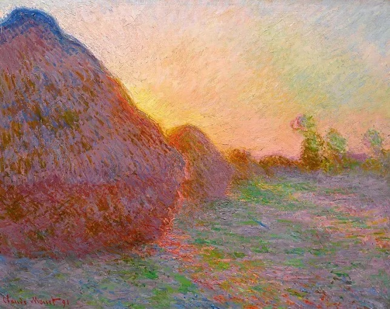
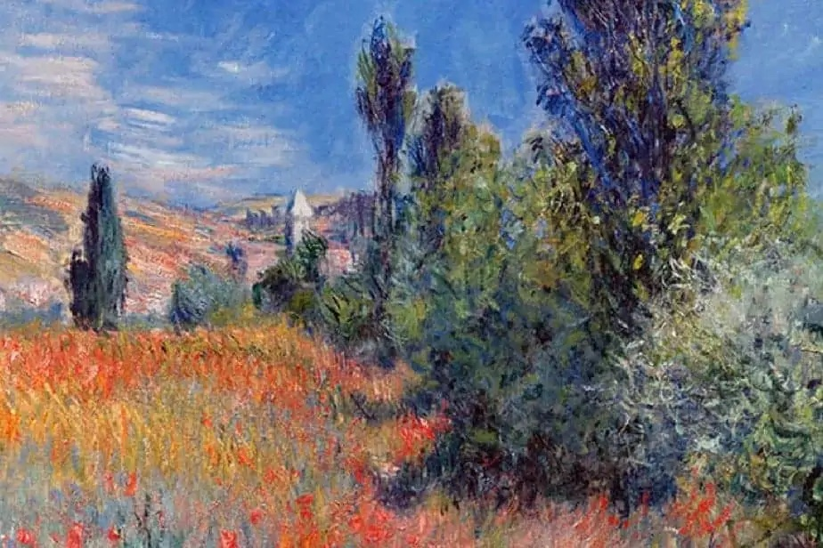
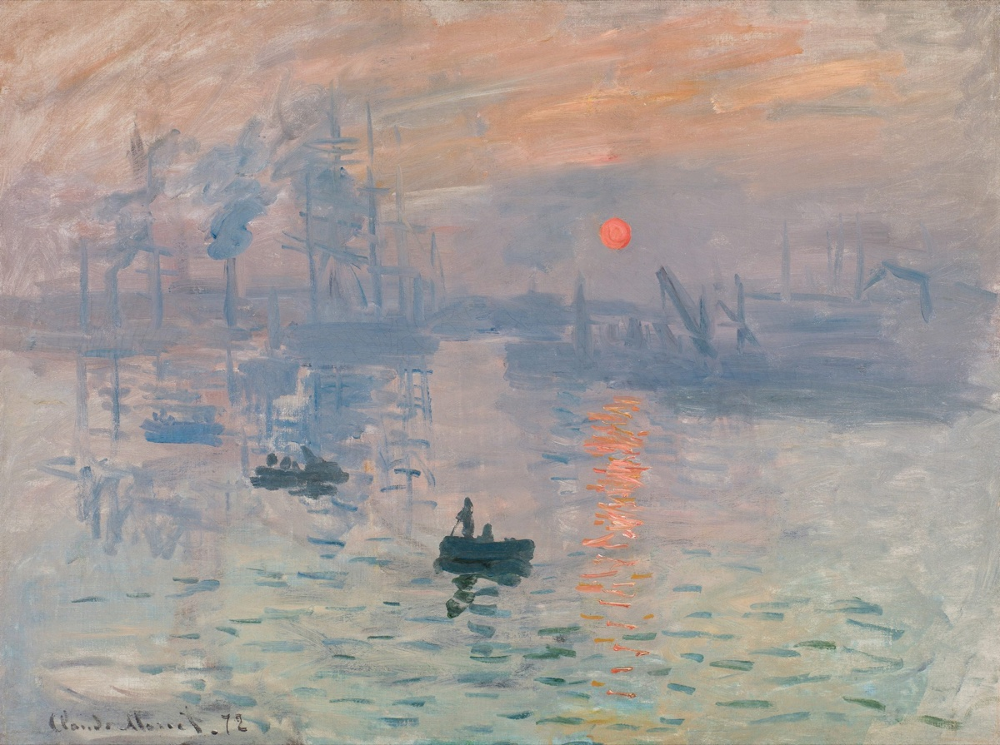

#+title: Beauty in the breakdown: Luft's far field
#+startup: overview

A direction to remember and steer by, not a renderer specification. We will
not find the right representation in one shot. Expect attempts, struggle,
unlovely intermediate images, and changes of mind. Keep the useful discoveries
without letting an expedient experiment become the artistic destination.

Origin: [[https://ampcode.com/threads/T-01a16a97-09d4-76c6-9fcf-75e9b42a2d08][the rendering, integration, and painting conversation]], 2026-10-24.
The [[file:luft-rendering-campaign.org][rendering campaign]] holds the measurements; this page holds the direction.

* The ambition is a vast landscape that feels good to inhabit
:PROPERTIES:
:ID: KK9136
:END:

The hilltop panorama is not an exceptional workload to hide. We want headroom
for a game that feels big, fast, and reliable when the player climbs a hill
to enjoy the view. Shorter render distances and occlusion can reduce work,
but they cannot be the foundation of that promise.

Nor must every distant surface remain an exact assembly of sharply visible
voxel triangles. The ambition is closer to a yearning for the vast and endless
sea than to squeezing a few more operations out of a tedious complex of
confetti. A different representation may open more room than a better rule
for deciding which of the existing triangles can survive.

* Detail can become marks, rather than merely disappear
:PROPERTIES:
:ID: 238VRI
:END:

The user-supplied painting references below are not simply blurry. They are
full of crisp marks that decline to describe crisp objects. The haystacks
hold together through violet shadow and an orange rim while their boundaries
dissolve into the surrounding strokes. The trees have texture without an
inventory of leaves. In the harbour, a few dark strokes establish the boats
while the industrial background becomes atmosphere; the orange reflection
is more definite than many of the solid things.

These are visual references from the conversation, not render outputs or
performance evidence. The repository copies are resized for the page.

Detail has been redistributed toward what makes the scene felt. Some edges
remain emphatic; others disappear. Small colour variations survive inside
simplified masses. A distant light may deserve more precision than a nearby
wall. This is richer than a rule that everything near is crisp and everything
far is blurred.

Pleasant softness, even perceptually unusual softness, is allowed. The enemy
is not blurry soup; it is an unpleasant or unstable breakdown: changing
density, sparkling highlights, flickering gaps, or a camera-centred frontier
that follows the player. In motion, the marks need enough persistence and
spatial belonging that walking feels like entering the painting rather than
watching noise boil over it.

* The surface is not its triangles
:PROPERTIES:
:ID: 0S5G7A
:END:

Luft has unusually structured raw material. Its current local surface atlas
has 256 occupancy cases, 22 symmetry families, and 26 oriented face-normal
directions. Faces, bevel bands, and junctions have explicit ownership and
exact integer geometry (#IQC0Y4, #W5L4L3). These are properties of the current
canonical atlas, not a claim that materials or whole-scene visibility have
only 22 possible states.

We do not have to begin by recovering structure from arbitrary production
meshes or irregular, moving vegetation. We can derive different drawing
representations from the same authoritative cubical surface. Exact triangles
nearby and spatial aggregates farther away are one possibility, not the
selected architecture.

The SDF creatures already suggest that representational purity is unnecessary.
Solid cubical terrain, mathematically described inhabitants, and a softer
distant landscape can share a world. They must agree where it matters for
depth, light, occlusion, and motion; they need not share a primitive type.

* A coarse representation owes the fine one an appearance
:PROPERTIES:
:ID: 7Q17FX
:END:

Moppe's [[https://github.com/mbrock/moppe/blob/a9285cb/docs/ensemble-continuity.md][ensemble-continuity note]] states the useful principle: continuity is not
a blending problem but a matching-conditions problem. When individuals or
surface pieces retire, their visible contribution must go somewhere. Mean
lighting and colour, projected coverage, surviving texture, and motion are
separate things to judge. A slow fade does not repair a mismatch between
independently authored representations.

For a bevel, a pixel may receive light from both an axis face and its diagonal
band. Removing the band, or shading one averaged normal, does not generally
reproduce that mixture. Highlights make the distinction particularly clear.
A distribution of surface orientations is already a kind of principled soup:
several surfaces are present, and together they catch light this way.

But a census of surface areas is not visibility. Silhouettes, passages,
cavities, foreground/background separation, and neighbouring occluders remain
real problems. Opaque terrain is not a translucent leaf population; importing
a forest's extinction model would not solve them. The full three-rung grass
and forest constructions in Moppe's notes are also not all present in its
current NHAL renderer. They supply ideas and historical evidence, not a
complete implementation to transplant.

The exact renderer is a reference for understanding what an approximation
changes, not an aesthetic obligation to preserve every pixel. An intentional
departure can be beautiful. Name it, look at it in motion, and distinguish it
from an accidental loss of material, light, or world agreement.

* Nanite voxels are a precedent, not a project specification
:PROPERTIES:
:ID: 3BR6ZQ
:END:

[[https://dev.epicgames.com/documentation/unreal-engine/nanite-foliage?application_version=5.7][Epic's Nanite Foliage documentation for Unreal Engine 5.7]] describes an
experimental representation switch: clusters can simplify into 4 by 4 by 4
voxel bricks rather than fewer triangles, selected by simplification error.
The near-pixel-sized voxel clusters use a separate rasterization path. A
voxel can contain multiple surface normals, so it retains a distribution
instead of one normal. The documented implementation samples that distribution
stochastically into the GBuffer; accounting for it directly during shading
is described as future work already used in the Witcher 4 demonstration.

That is a useful precedent for retiring tiny primitives while retaining their
lighting population. It is not a flat distant billboard, nor evidence that
every Unreal landscape uses this path. Lumen's Surface Cache and Far Field
serve a different job: indirect lighting and reflections.

Our world voxels are not already these render aggregates. Occupancy alone
does not encode the beveled surface's visible coverage, depth, or directional
material response. Deriving multiscale rendering bricks from that surface is
an interesting candidate. So are other compact evaluations of the canonical
patches. Do not turn this direction into a commitment to build our own Nanite.

* The bevel-shrinking experiment is evidence, not the destination
:PROPERTIES:
:ID: VK1FJV
:END:

#S5CFOO established that bevel geometry is expensive at unchanged landscape
coverage. #YHVCJU then established repeatable gains from shared-corner
retirement, including its selection and upload cost. Keep those results.

Do not promote its 2px or 4px corner-displacement policy as the next product
step. It repeatedly computes a conservative positional bound, not the actual
perceptual opportunity. More importantly, moving vertices toward sharp
corners shrinks the area carrying diagonal normals to zero. A thick bevel
makes the failure of intent obvious: distance changes the object's shape
and drains away its lighting band rather than changing how we draw it.

Making that selector cheaper would improve a compromise we have not chosen.
The next question is what information the unresolved surface should deliver
to the image, and what machinery can deliver it cheaply. The bevel might
survive as a broad warm mark after it ceases to be an identifiable band.

* NEXT Learn through small attempts with a large horizon
:PROPERTIES:
:ID: BBFT2Q
:END:

Start with a deliberately thick straight bevel, then a junction and a small
piece of terrain. Use the exact surface and supersampled views as references.
Try a compact alternative that carries actual depth/coverage and directional
appearance, not just a coloured occupancy cloud. The choice between analytic
evaluation, filtered lookups, spatial bricks, or another representation is
still open. Keep the world-space shape fixed while studying the rendering.

Look under moving light and a moving camera, head-on, at grazing angles, and
across silhouettes. Judge both a stationary image and the experience of
approaching it. Include pleasing intentional departures as well as errors.
Choose enough cases to expose the idea's weakness; do not build a complete
renderer before finding out whether its smallest version has a future.

If a representation earns a larger trial, the full hilltop panorama is the
performance test. Charge preparation, selection, uploads, shading, memory,
and transitions honestly. Exact coplanar compression and cheaper material
evaluation can complement the work, but neither triangle counts nor static
instruction counts establish a faster frame. Improve the HAL when the
representation has a real need; it is ours to change, not a fixed obstacle
that demands permanent workarounds.

This is an iterative research direction, not a single-shot acceptance plan.
Keep failed attempts and what they taught beside the successful ones. Let
measurements discipline the machinery and images discipline the measurements.
The ambition is a world that can change drawing medium with scale without
losing its character: a world that becomes paint, not a world that becomes
less.
