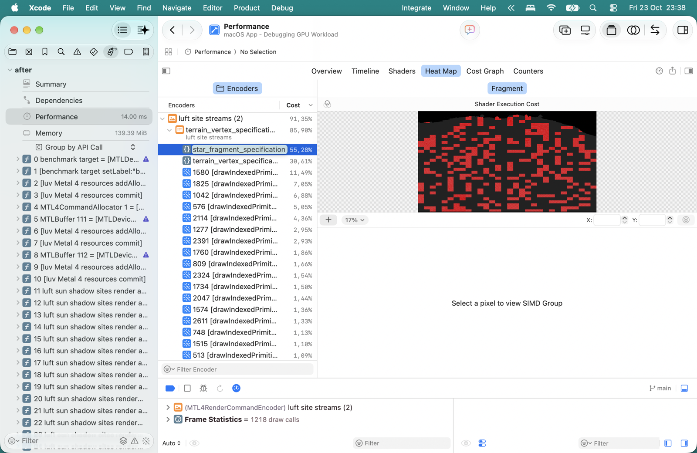
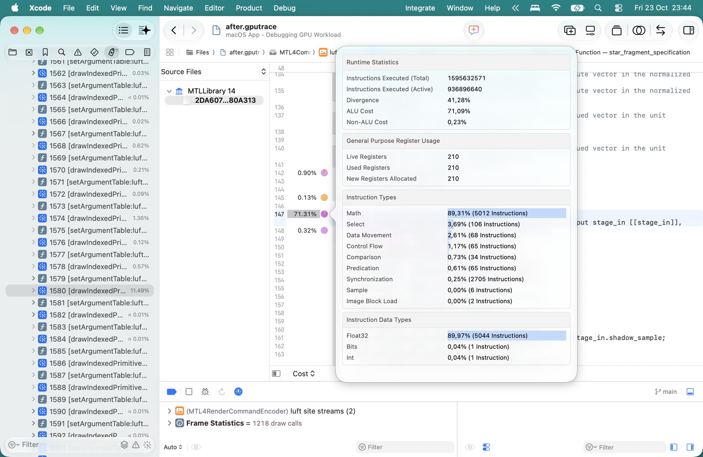

#+title: Luft rendering campaign: measure the work, then remove it
#+startup: overview

* A basecamp for rendering and compiler experiments
:PROPERTIES:
:ID: O523R1
:END:

Make Luft materially faster without losing its near-field appearance,
manifold boundaries, lighting, or live-editing behavior. This page is the
campaign ledger, not another renderer architecture. Keep the next experiment
small, its counterfactual explicit, and its failed results easy to find.

The hilltop view is a required workload, not an exceptional failure to hide
with a shorter horizon. Build headroom by reducing work per visible surface
and shaded pixel at fixed scene coverage. Visibility rejection can complement
that work, but a lower render distance or a view-dependent culling win does
not establish that the renderer can afford a big, open landscape.

Start with the [[file:../.agents/metal-profiling.md][agent Metal profiling runbook]] for the shortest known path to
real counters, heatmaps, and source costs. #4C7L3C defines the fixed-target
runtime measurement contract; #E6JYVE records the earlier Metal System Trace
investigation. The geometry/compiler experiments remain beside their design
history on [[file:luft.org][the Luft page]]. This page connects their conclusions.

Origin: [[https://ampcode.com/threads/T-01a16974-f1f6-7698-9082-658f7825c505][the terrain, compiler, and Xcode investigation]], 2026-10-23.

The artistic and representation direction is now [[file:luft-far-field.org][Beauty in the breakdown]].
#KK9136 keeps the large-horizon ambition; #238VRI makes pleasant softness and
selective detail legitimate; #BBFT2Q scopes the next small attempts. This
ledger preserves the measurements without turning the latest fast experiment
into an automatic product decision.

* DONE Recover real shader profiling before guessing again
:PROPERTIES:
:ID: 45005M
:END:

On yawl (Apple M5, macOS 27.2, Xcode 27.1 build 27A9275), =gpudebug= 1.0
could return replay timing and counters while leaving shader cost weights
zero, shader timelines empty, and the heatmap builder unavailable. Embedded
MSL and =full= profile mode were already present. A zero weight was missing
evidence, not free execution.

The same symptom survived a tiny handwritten shader compiled through both
runtime Metal APIs and an offline library with explicit line tables. It
also affected Moppe's C++ application and Apple's deferred-lighting sample.
An application bundle or another compiler flag was not the missing proof.

The working path was Xcode's =Profile after replay=, then =File → Export=
with =Embed performance data=. All three applications produced nonzero
costs and heatmaps in Xcode. Both Luft and Moppe exports then loaded with
real shader weights and heatmaps in the CLI. The exact difference in CLI
collection versus GUI collection remains unknown; we have a workaround,
not a diagnosed Apple bug. The runbook records the permission layers,
navigation traps, session cleanup, and precise commands.

* The current measured frame is arithmetic-heavy, with many helper fragments
:PROPERTIES:
:ID: EFKH0C
:END:

This is the #YH5LWK candidate capture: seed-7 settled live-alpine, native
1920×1080, no temporal reconstruction, nine scene residents, merged shadow
rectangles, original instanced scene geometry. Its capture metadata says
baseline revision =4909081= plus then-local branch-lowering changes later
committed as [[https://github.com/mbrock/luv/commit/bd55997][bd55997]]. Do not describe it as an untouched baseline checkout.
The [[file:../wiki/measurements/yawl-xcode-profile-20261023/capture.sexp][capture record]] is provenance, not a useful one-frame timing benchmark.

Xcode replay used medium performance state and overlapping execution. It
reported 14.00 ms effective GPU time and only 3/10 sampled cores (Apple's
sample had 9/10, Moppe 2/10). Sampling coverage, repeatability, and clocks
must be resolved before treating the following as precise comparative
budgets. Encoder counters are isolated measurements, not an additive
breakdown of the sampled replay.

| Measurement | Observed value | Meaning |
|-
| Terrain fragment shader cost | 55.28% | Share of sampled shader cost |
| Terrain vertex shader cost | 30.62% | Share of sampled shader cost |
| Scene FP32 limiter | 64.92% | Relative to that unit's peak, not frame time |
| Scene instruction-throughput limiter | 61.42% | Relative to instruction pipeline peak |
| Scene texture-read limiter | 6.11% | Much lower than arithmetic in this replay |
| Scene valid fragment invocations | 2,235,904 | Scene encoder includes sky |
| Scene helper fragment invocations | 1,298,176 | Extra lanes for partially covered quads |
| Helper fraction | 36.73% | Helpers / (valid + helpers) |
| Terrain fragment compiled instructions | 8,887 | Static program count, not per-pixel execution |
| Temporary / uniform registers | 106 / 100 | Compiler statistics; zero spilled bytes |

The source editor displayed real costs, but attributed 71.31% to the
fragment function declaration and other costs to surprising source lines.
That is not enough to identify which material expression dominates. Its
hover reported 41.28% divergence; the expensive draw's hardware ALU
inefficiency was 53.17%. Neither number isolates branch divergence from
partial SIMD groups or uncovered quad lanes.

** Evidence that survives the scratch directory
:PROPERTIES:
:ID: 9HP35K
:END:

The [[file:../wiki/measurements/yawl-xcode-profile-20261023/luft-shaders.txt][shader ranking]], [[file:../wiki/measurements/yawl-xcode-profile-20261023/luft-fragment.txt][fragment compiler statistics]],
[[file:../wiki/measurements/yawl-xcode-profile-20261023/luft-scene.txt][encoder overview]], [[file:../wiki/measurements/yawl-xcode-profile-20261023/luft-counters.txt][full selected counter groups]], and
[[file:../wiki/measurements/yawl-xcode-profile-20261023/counter-definitions.txt][counter definitions]] are verbatim CLI responses from the GUI-exported trace.
The [[file:../wiki/measurements/yawl-xcode-profile-20261023/luft-draw.txt][expensive draw record]] relates cost to an actual draw and explains ALU
inefficiency. [[file:../wiki/measurements/yawl-xcode-profile-20261023/moppe-terrain.txt][Moppe's terrain record]] reports 1,298 static fragment instructions,
but different shading, geometry, and sampling make this no speed ratio.

Large captures remain local to the source checkout, deliberately not in Git:
=.amp/in/artifacts/branch-lowering/gui-profiled.gputrace= (153 MiB) and
=.amp/in/artifacts/moppe-profile/gui-profiled.gputrace= (237 MiB). Their
[[file:../wiki/measurements/yawl-xcode-profile-20261023/capture-files.sha256][file hashes]] identify the exact exported inputs if recovered later.
These paths are provenance, not a promise that a fresh clone contains them.
Recreate a capture and use the runbook if they are unavailable.

* Keep the negative results in the plan
:PROPERTIES:
:ID: 47JDVB
:END:

| Experiment | Established result | What it did not establish |
|-
| Shadow coplanar rectangles, #5UH08L | 1,679 → 16 shadow draws; lower CPU encoding | A whole-frame GPU improvement |
| Scene batching, #7B19HJ | 1,163 → 9 scene draws; lower CPU encoding | Faster scene GPU execution; reference streams increased vertex reads |
| Coplanar scene merging, #FIW26N | 41.7% fewer triangles; lower vertex replay time | Comparable fragment savings: total fragment invocations fell only 1.7% |
| 16-cell visibility probe, #FIW26N | About 1.03M fewer vertex invocations; identical terrain pixels | Moving-camera selection/upload cost; selection was frozen |
| Screen-gradient relief, #57KXBH | Fewer repeated fields and faster fragment replay | Ordinary runtime improvement or close/grazing/moving-view quality |
| Branch-local value conditionals, #YH5LWK | Correct control-flow ownership across four lowerings | Runtime speedup: 13.284 ms before, 13.341 ms after |

The new helper count does not overturn the measured merging result. Removing
coplanar interior triangles left most expensive fragments and helper lanes
in place. Geometry simplification must target the geometry responsible for
work, not merely maximize the percentage reduction in triangle count.
The original atlas already reuses indexed vertices and instances stars;
replacing that representation can spend the saved work on memory traffic.

* DONE Recover a runtime shading comparison that survives clock variation
:PROPERTIES:
:ID: ZRQM38
:END:

The [[file:measurements/yawl-runtime-f87a44f/README.org][runtime experiment bundle]] continues #57KXBH on current production
source, with the camera, nine residents, geometry, shadows, and native
1920×1080 shading extent fixed. No render-distance or visibility change.

Multi-second blocks still hid the shading reduction. Read-only power
sampling showed an unchanged control going from about 8.33 ms at 1.56 GHz
to 16.9 ms at 0.78 GHz, with nominal thermal pressure. Event pumping,
a scoped user-initiated activity, and user-initiated thread QoS did not
stabilize it. These are failed controls, not proposed production fixes.
The reason for the governor's behavior remains unresolved.

Adjacent-frame ABCCBA/ABBA comparisons keep variants in the same sustained
run instead. Both large relief ablations improved GPU and completion time
in all 15 windows. An identical-shader A/A control differed by just 0.019 ms
GPU and effectively zero mean completion time. The screen-gradient candidate
then improved both measurements in all 30 windows across two fresh runs,
including reversed variant order:

| Run | Control GPU ms | Candidate GPU ms | Control completion ms | Candidate completion ms |
|-
| 1 | 14.992 | 12.963 | 17.768 | 15.723 |
| 2, reversed order | 15.098 | 13.024 | 17.822 | 15.735 |

That is 13.5–13.7% lower GPU time and 11.5–11.7% lower serialized completion
time under the mixed-workload comparison, not a demonstrated increase in
displayed FPS or a promise that candidate-only runs retain the same clocks.
It establishes a runtime benefit from sharing relief evaluation without
removing any visible terrain. It does not make this approximation production
ready. Current stationary overview/detail captures were inspected; near,
grazing, motion, temporal, and material coverage remain open.

Two archived runs previously called uninstrumented also contain watchdog
logs launching native process sampling during their long canvas request.
The isolated benchmark now disables that sampling, not the game's watchdog.
This is an established extra confound, not a quantified explanation of all
the old replay/runtime discrepancy. Preserve those old results and logs.

* TODO Establish repeatable sampling and useful source attribution
:PROPERTIES:
:ID: QVJVRZ
:END:

Repeat the same capture with recorded GPU state and sampled-core coverage.
Explain the low coverage before drawing close comparisons. Use a small
known shader to check whether instruction-to-source attribution is correct;
then inspect optimized MSL/AIR and native statistics for the real shader.
Do not disable optimization and call the resulting profile production cost.

A DSL source map or =#line= emission is useful only after generated-MSL
mapping is trustworthy. Source embedding, line mapping, sample collection,
and cost interpretation are separate contracts. Keep compiler correctness
work separate from application-level approximations, and retain native
validation of nested branches, folds, and values crossing their boundaries.

Done when: repeated profiles explain their coverage and the cost of a known
shader operation lands on a meaningful source region; an agent can repeat
the extraction without rediscovering GUI navigation or permissions.

* TODO Retire distant material work, not just its visible amplitude
:PROPERTIES:
:ID: 35AVAY
:END:

Continue #IE3WMY with a narrowly scoped shading experiment. The strongest
current candidates are sharing the repeated relief evaluation (#57KXBH),
or selecting a cheap distant material tier before procedural fields run.
Do not do both in the first comparison. Measure executed work, shader size,
register pressure, fragment invocations, and unprofiled frame time together.

Moppe offers useful precedents: small terrain LOD decision units, filtering
unresolved material detail, and removing inactive geometry before vertex
work. Its heightfield parent-grid morph is not a cave-safe Luft simplifier;
its old forest hierarchy is not its current renderer. Preserve mean material
appearance as detail retires. Fading a computed field toward zero need not
skip its evaluation. A blanket conversion to half precision risks world coordinates,
derivatives, and noise hashes; any precision experiment needs a bounded
numeric domain and independent image checks.

For geometry, investigate feature-sized bevel retirement or finer visibility
only with shared-boundary rules. Independent chunk bevel widths previously
opened seams. Keep the original indexed path as the control, and charge
selection, preparation, uploads, and retirement memory to the candidate.

Done when: interleaved unprofiled control/candidate runs show a repeatable
gain, and near/far, grazing, camera-motion, temporal, material-boundary,
chunk-boundary, cave, and shadow checks preserve the intended appearance.
Record a failed result here too. No approximate shading tier or new scene
compression path is approved for the default renderer by this page alone.

* DONE Try a bounded grass/stone material cache
:PROPERTIES:
:ID: FSOEGQ
:END:

The [[file:measurements/yawl-material-cache-5ee6831/README.org][material-cache experiment]] bakes Lisp-authored grass/stone relief into
filtered normal+height tiles. At the same hilltop camera, nine residents,
geometry, shadows and native 1920×1080 extent, adjacent ABBA and reversed
BAAB runs save 3.55–3.64% whole-frame GPU time (about 0.53 ms), and
2.82–2.92% serialized completion time. Both improve in every balanced
120-frame window, without a concurrent profiler or clock-policy change.

That is real but smaller than #ZRQM38, not the profound budget reduction we
want. Near stone and grazing grass become visibly smoother. Short native
and temporal moving views show no obvious hard seams or persistent trails,
but do not accept disocclusions, fast turns, long repetition or all boundaries.
Independent GPU readback checks validated every wrapped border and 2×2 mip
average to 8-bit readback precision. The retained atlas is 8.18 MiB; bake and
compilation are outside timing. Keep this as an experiment, not the default.

Only two relief codes changed, not the full material response or palette.
This is not evidence against baking surface response more generally. Packed
manual mips were expedient for a bounded probe; native mip chains and proper
filtering belong in our HAL when they make the implementation better. The
HAL is ours to improve, not a fixed limitation to work around indefinitely.

Thin projected bevel triangles, especially distant or grazing faces, remain
a plausible source of helper-fragment waste (#EFKH0C). Isolate scene bevels
without changing shadow geometry or material shaders before attributing the
helper count to them. Use actual profiling alongside runtime comparisons.

* TODO Validate shared relief before enabling it
:PROPERTIES:
:ID: XDZ78R
:END:

#ZRQM38 selects removal of repeated relief evaluation as the next shading
bet, before adding a distant material tier. It saves work at existing scene
coverage and is consistent with the hilltop-view goal. Screen derivatives
are the measured prototype, not yet the selected production implementation.

Check near materials, projected/grazing footprints, camera motion, temporal
reconstruction, and material/chunk boundaries. Screen derivatives replace a
fixed world-space finite difference with a pixel-quad difference; the
appearance is not mathematically identical. If that fails the quality bar,
try shared value-and-gradient evaluation rather than recomputing whole
procedural fields three times or hiding more terrain. Keep geometry efficiency
as a separate experiment retaining the indexed atlas and its memory reuse.

Done when: a bounded shared-relief implementation passes those quality checks
and a repeated runtime comparison, with unchanged coverage and no profiler
or native watchdog sampler competing for the GPU.

* DONE Isolate scene bevel cost without changing shadows
:PROPERTIES:
:ID: S5CFOO
:END:

The [[file:measurements/yawl-bevel-slivers-5ee6831/README.org][scene-only bevel ablation]] holds the merged shadow path, shadow tables,
material shader, nine residents and full native hilltop view fixed. Removing
all scene bevels cuts adjacent-frame GPU time 15.325 → 7.694 ms and, in
reversed order, 15.270 → 7.673 ms: about 49.8% in both runs. Serialized
completion improves about 42.5%; every balanced comparison window improves.

Fresh Metal hardware counter profiles show helpers 1,298,096 → 513,520
(60.4% fewer), valid fragments 2,235,968 → 2,091,936 (6.4% fewer), and
vertex invocations 2,890,813 → 491,695 (83.0% fewer). Helper fraction falls
36.73% → 19.71%. The terrain shader still has the same 8,887 static
instructions and 106 temporary registers. Shadows retain 16 draw uses.
These are real counter profiles, not new GUI source-cost samples: CLI
shader weights remain zero and are not used. Isolated stage intervals
and replay timings are distinct from the unprofiled runtime comparison.

Bevels are a major source of geometry and partial-quad fragment work in
this view. The entire runtime gain is not attributable to helpers alone.
This ablation also removes useful near bevels; it does not identify the
subset due to distant or grazing slivers or establish a production LOD gain.
Inspected images retain terrain coverage but intentionally have square edges.

* WAIT Retire bevel work by projected feature size
:PROPERTIES:
:ID: D8CYLU
:END:

#S5CFOO made bevel retirement a stronger immediate geometry bet than
coplanar merging or the first two-material cache (#FSOEGQ). The experiment
below established useful headroom, but not the right replacement appearance.
Retire work, not the landscape behind it or the lighting character of its
unresolved surfaces. Material shading efficiency remains necessary.

Keep the indexed atlas as the reference and require consistent boundaries
from any replacement. Independent per-chunk bevel widths previously opened
seams. Charge per-frame selection, uploads, transition buffers and memory to
the candidate. Validate near/far boundaries, silhouettes, moving cameras,
temporal reconstruction, caves and editing before any default change. The
all-flat result is a counterfactual, not the target appearance and not a
promise to recover the full 49.8%.

#YHVCJU now establishes a boundary-consistent shared-corner morph and a
repeatable native runtime gain. The 2026-10-24 discussion rejects promoting
its 2px/4px corner-displacement policy as the next product step: the bound
does not measure the actual perceptual opportunity, and shrinking bevels
drains their diagonal lighting bands away. #VK1FJV records that correction.
Do not merely optimize its selector and call the representation settled.
The next investigation is #BBFT2Q: a cheaper drawing medium for the fixed
surface, with intentional softness allowed and implementation choices open.

** DONE Measure shared-corner retirement with its selection cost
:PROPERTIES:
:ID: YHVCJU
:END:

The [[file:measurements/yawl-bevel-retirement-2a231b9/README.org][shared-corner experiment]] leaves landscape coverage, material fragment
shading and the original merged shadow path intact. At native 1080p, a
2-pixel projected-displacement policy saves 19.77–19.90% GPU time and
8.34–8.66% serialized completion in reversed adjacent-frame runs. A more
aggressive 4-pixel policy saves 37.13–37.28% GPU and 22.99–23.52% completion.
Both improve every balanced window. The 1-pixel policy retires no complete
patches in this view and worsens completion; not all costly detail is subpixel.

Fresh Metal counters show helpers 1,298,128 → 996,752 → 635,376 and vertex
invocations 2,890,813 → 2,326,870 → 1,477,559 for control/2px/4px. Valid
fragments change only about 6.2%; the fragment binary remains identical at
8,954 instructions and 108 temporaries. These counter profiles are distinct
from unprofiled runtime and from GUI sampled shader-source attribution.

Each canonical lattice corner chooses one morph weight shared by all owners.
Original bands taper through the transition; the smaller flat atlas is submitted
only once all corners of an owned patch have collapsed. Exact rational closure
checks pass 2,112 mixed-weight cases; the checkerboard zero endpoint explicitly
demonstrates that closed boundaries are not preservation of manifold sheets.
Eight sampled native camera poses retain terrain without observed new continuous
cracks. The 4-pixel view visibly squares edges; neither threshold is accepted
for production appearance or temporal reconstruction.

The measured candidate pays its 1.96 MB upload and about 1.4–1.5 ms additional
CPU encoding per frame. Its mutable staging buffer is only safe in the serialized
harness. Default rendering and semantic topology remain unchanged. This is useful
headroom evidence and a transition oracle, not a completed production LOD system.
