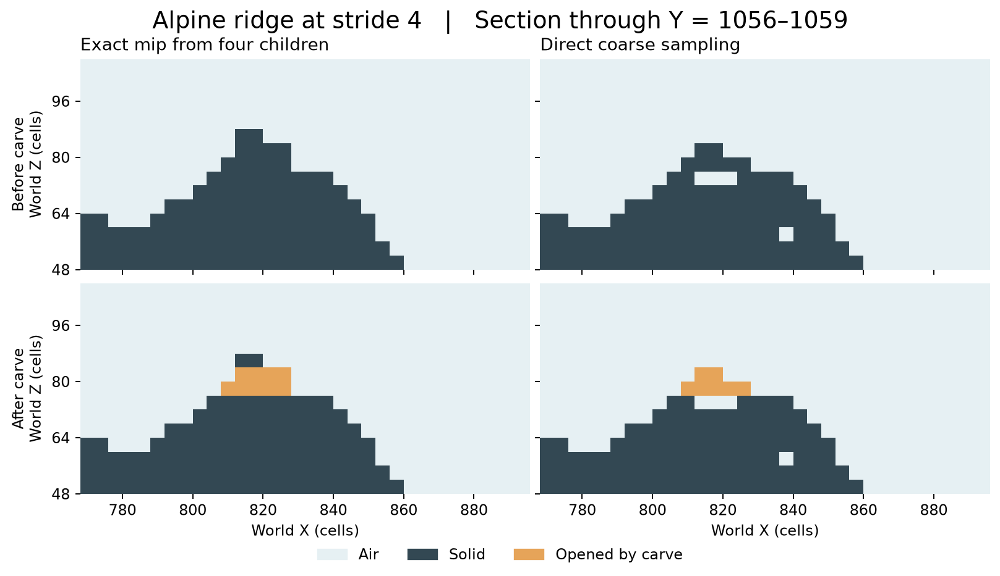
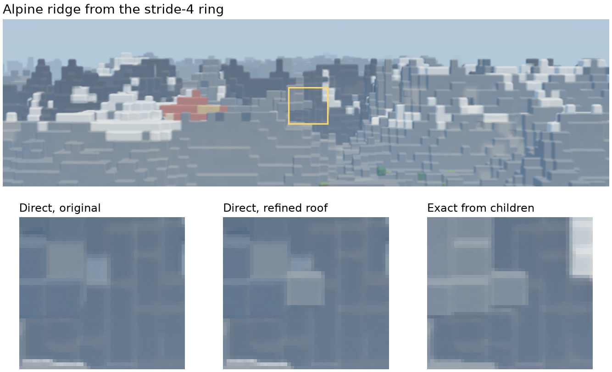
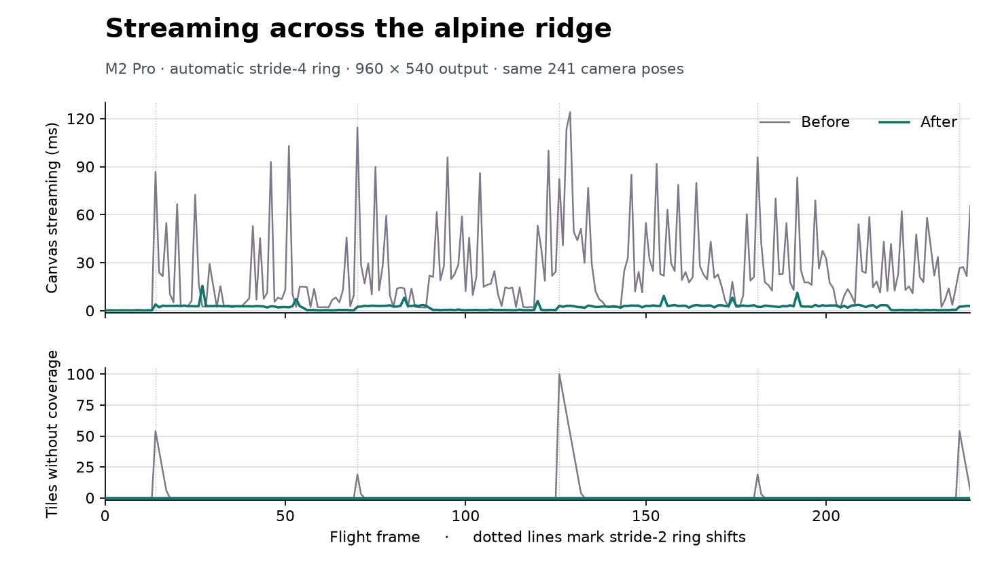

#+title: Luft voxel LOD campaign: honest 3D terrain across scales
#+startup: overview

* A basecamp for isotropic, voxel-accurate level of detail
:PROPERTIES:
:ID: INDOL7
:END:

Replace the 2.5D analytical heightfield horizon (=distant-terrain.lisp=) with a
generic, scale-covariant 3D voxel LOD built directly on Luft's =chunk-fibers=,
=chunk-materials=, 256-star beveled atlas, and pooled visibility buffer.

A heightfield horizon proved that a 2.5 km panorama is affordable and worth
having (#KK9136), but it cannot represent the heart of a block world: big
mountains with architecture integrated into them — tunnels punched straight
through a peak, arches spanning a valley, overhangs, caves, and lit windows
recessed into a cliff.  Once distant terrain bypasses the 3D voxel solid with a
heightmap, every 3D feature forces an ad-hoc fake projection (synthetic tree
columns, synthetic cacti, solid-skirted building tops that cannot carve air).

This campaign ledger sits beside [[file:luft-rendering-campaign.org][the rendering campaign]] (#O523R1) and
[[file:luft-far-field.org][Beauty in the breakdown]] (#7Q17FX, #VK1FJV, #BBFT2Q).  Keep experiments small,
preserve real measurements, test against real mountains and carved tunnels, and
keep the current heightfield as a live A/B control until the 3D pyramid beats
it cleanly on both appearance and GPU cost.

* What the x = 896 seam actually revealed
:PROPERTIES:
:ID: VX29JP
:END:

Inspecting the live =:biomes= alpine panorama from =(1088.99, 1081.32, 39.06)=
(0.99 cells east of chunk boundary =x = 1088=) and stepping 5 cells west
shifts the =8×8= near-chunk window from =cx ∈ [14..21]= to =[13..20]=.  That
instantly flips the 64-cell strip =x ∈ [832, 896)= (~193–257 cells ahead,
cutting straight across the left hillside, central rocky bowl, and upper-right
alpine summit) from Level-0 distant columns to near chunks.

Five separate discontinuities stack onto that single seam:

1. *Unrelated fake trees vs. real trees.*  Near chunks place real 3D trees in
   =luvcraft/terrain.lisp= (=little-world-landmarks-for-chunk=, deterministic
   16×16 chunk hash).  =sample-world-source-surface-grid= in
   =luvcraft/luft/world-source.lisp= invents an unrelated 4×4 hash and extrudes
   blocky =2×2×3= leaf pillars.  At the seam, whole clusters of green boxes
   vanish while origami trees spawn in different positions.
2. *45° beveled near slopes vs. 90° un-beveled distant box cliffs.*  With
   bevels active (=0.30= global, =0.42= on grass/stone via #K5MKUT), steep near
   hillsides are mostly angled 45° facets catching both sun and sky hemisphere
   light.  Distant columns emit strictly horizontal tops (=normal.z = 1=) and
   vertical cliff skirts (=normal.z = 0=) plus a flat =-12= AO penalty.  A
   grazing mountain wall jumps from dark charcoal blocks to bright layered
   stone in one frame (#7Q17FX, #VK1FJV).
3. *Point-sampling aliasing on steep ridges and snowlines.*  A single center
   height sample per =stride × stride= column shifts alpine ridgelines and
   disagrees on the =slope <= 2= snowline test, popping snow caps and strata
   onto crests when =cx = 13= arrives.
4. *Lighting, AO, and scatter mismatch.*  Near terrain carries shadow-map
   visibility, 3D voxel vertex AO, surface boulders, and carved caves; distant
   columns carry cloud visibility only and a synthetic per-quad =enclosure= AO
   that darkens around the fake =+3= leaf pillars.
5. *Hard grid-aligned snaps.*  The near boundary swaps an entire 64-cell swath
   in one frame with zero transition band.  Sixty-five cells further west,
   crossing =x = 1024= snaps all four nested rings in =distant-ring-bounds=
   simultaneously because =1024= is a common multiple of 128, 256, and 512.

Patching tree hashes or adding landmark special cases to the heightfield is the
wrong direction: even a bare, treeless peak pops sharply across items 2–5, and
no heightmap patch can represent holes carved through rock.

* Scale-covariant stars fit the existing visibility buffer
:PROPERTIES:
:ID: EML0YS
:END:

Production Metal terrain already renders through a compact two-RGBA8 visibility
buffer backed by one pooled =terrain-arenas= (=sites=, =appearances=, =lights=)
and one fullscreen material pass (#EAWKSG, #E5U8OV).  Every vertex call site —
forward, visibility raster, and visibility material reconstruction — passes
through =star-record-world= in =luft/render/shaders.lisp=.

Because =site.z= in =terrain-sites= (=uvec4=) only uses 8 of its 32 bits
(=0..255=), packing a 3-bit =lod-shift= (=0..4= → =scale = 2^k=) into bits
=16..18= of =site.z= makes the entire 256-star pipeline scale-covariant with
zero extra bytes per star:

#+begin_src lisp
(+ origin (* scale (+ anchor (* offset bevel))))
#+end_src

Consequences of unifying coarse LOD stars into the same visibility buffer:

- *Scale-covariant geometry and bevels (#YGP21F).*  Steep =stride = 2, 4, 8, 16=
  slopes retain their 45° beveled facets and #K5MKUT per-material bevel tiers,
  matching near-field sun and sky irradiance instead of collapsing into dark
  vertical walls.  Projected bevel triangles also stay =2^k×= wider in screen
  space at the distances where =stride = 1= slivers begin to shimmer.
- *True 3D topology and distant light.*  Tunnels, arches, bridges, overhangs,
  caves, trees, and buildings all render through one 3D occupancy path.  Because
  =terrain-lights= is already part of the star record, lantern- or crystal-lit
  openings carved into a distant cliff can glow naturally at dusk (#BQMYNU).
- *Zero overdraw shading and coherent distant retirement (#IE3WMY).*  Overlapping
  mountain ridges pay only tiny visibility-ID writes.  In the single fullscreen
  material pass, =lod-shift > 0= branches cleanly past the 3-tap =surface-height=
  derivatives (whose =fade= is already zero past 120 cells) and 9-tap shadow-map
  PCF while keeping identical =paper-surface-radiance=, material character,
  cloud shadows, blocklight, and aerial perspective.
- *Derivative-safe crossfading.*  =terrain-visibility-material-fragment-specification=
  reconstructs per-pixel analytic same-triangle plane gradients rather than
  using hardware =dFdx=/=dFdy= across screen neighbors.  Complementary fine/coarse
  screen-space dithering inside the visibility pass therefore incurs zero
  cross-pixel derivative corruption and zero Z-fighting, and perspective SSAO
  is already faded to zero past 95 cells.

* Measured baseline on alpine chunk (13, 16) and the cave-star catch
:PROPERTIES:
:ID: CLIAOO
:END:

Baseline measurements gathered live from the running M5 image on steep alpine
chunk =(13, 16)= (=x ∈ [832, 896), y ∈ [1024, 1088)=) right ahead of the camera:

| Measurement | Observed value | Notes |
|---+---:|---|
| Active near residency (=64= chunks, =stride = 1=) | 687,556 stars | Inside 2,097,152-star =sites= arena (33.5 MB) |
| Active distant heightfield (=636= tiles, =L0..L3=) | 1,518,512 quads | Separate 33.5 MB GPU quad arena |
| =generate-world-source-chunk= (=64×64×128=) | 19.05 ms | Single thread, 16 Luvcraft chunks + caves + landmarks |
| =mesh-star-chunk= on =(13, 16)= (=stride = 1=) | 10.59 ms | 32,612 stars |
| Unoptimized scalar =2×2×2= downsample of =(13, 16)= | 0.72 ms | Will drop under 0.1 ms with word-parallel bit ops |
| =mesh-star-chunk= on downsampled =(13, 16)= (=stride = 2=) | 2.37 ms | 7,740–7,865 stars across thresholds 1, 3, 4, 5 |
| =build-distant-tile-quads= (=L0=, =32×32= samples) | 1.36 ms | 2,695 quads |

*The underground cave-star catch.*  A =64×64= open surface only produces ~6–8K
stars; roughly 75% of chunk =(13, 16)='s 32,612 stars (and ~75% of its 7,786
coarse stars) are sealed deep-underground caverns that cannot be seen from
outside the mountain.

*Generic fix: exterior-air reachability culling on coarse tiles.*  Before
meshing any coarse tile (=stride >= 2=), run a 3D air flood-fill seeded from
open sky (=z = top=) and the four open tile borders; mark unreachable sealed
air pockets solid /for that coarse LOD only/.
- Tunnels punched through mountains, cave mouths opening on cliffs, arches, and
  windowed cliffside halls connect to exterior air and stay 100% hollow.
- Unreachable deep bedrock pockets vanish, cutting coarse star counts by ~3–4×.
- Because isotropic 3D downsampling halves Z alongside X and Y (=64×64×128= at
  =stride 2=, =64×64×64= at =stride 4=, =64×64×32= at =stride 8=, =64×64×16= at
  =stride 16=), a full 6 km × 6 km horizon (~48 tiles each at =L0..L2=, ~20 at
  =L3=) totals roughly ~850K coarse stars + ~687K near stars ≈ 1.54M stars —
  fitting inside the existing 2.1M-star GPU arena while retiring the separate
  33.5 MB heightfield arena.

* Generic 2×2×2 downsampling: symmetric occupancy and boundary-cell materials
:PROPERTIES:
:ID: NDXUW8
:END:

Downsampling eight fine cells (=2×2×2=) into one coarse cell requires clean,
material-agnostic rules for occupancy, material, and coarse lighting:

- *Occupancy filter.*  Union (=≥ 1/8= solid) preserves thin trees and walls but
  plugs tunnels/windows and bloats mountains by +1 coarse cell per level.
  Majority (=≥ 4/8= solid) is symmetric between solid and air: mountains hold
  exact unbiased volume, tunnels and arches stay open, and subpixel 1-cell
  detail retires cleanly.  Phase 1 should compare =thresh = 3= vs. =4= visually
  on live trees, cliffs, and carved tunnels (and keep fractional =0..8= density,
  #TI9NJP, in reserve if binary majority proves too harsh on thin canopies).
- *Boundary-cell material voting.*  Taking the mode of all 8 fine cells lets
  underground stone/dirt (6 interior cells) outvote a 1-cell grass, snow, or
  masonry facade (2 surface cells), turning distant hills brown or gray.
  Voting *only over exposed boundary cells* (solid cells adjacent to at least
  one air cell — the 3-chain boundary) preserves every surface skin generically
  without material-specific rules.
- *Coarse 3D sky-AO and blocklight.*  Populate =terrain-lights= on coarse tiles
  directly from coarse =chunk-fibers=: sky-AO (alpha nibble) from vertical
  clear-column bit-scans (=fibers-column-clear-p=) plus local 3D corner
  occupancy so tunnels darken inside and overhangs cast soft shade, and RGB
  blocklight downsampled from emissive voxels / authored light edits.  Bevel
  tiers in =lights.w= reuse the exact #K5MKUT corner =min= unchanged.

* Two-tier coarse voxel pyramid: exact mips over a 3D coarse fallback
:PROPERTIES:
:ID: 2LGM4W
:END:

Generating 15,000 unexplored =stride = 1= chunks on cold start (~19 ms each) is
not viable, yet we refuse to maintain two incompatible world models.  The
unified protocol is that *every LOD ring consumes 3D =chunk-fibers= +
=chunk-materials= at =stride = 2^k=*, backed by two provenance tiers inside one
coarse voxel pyramid:

1. *Exact bottom-up mip store (cached, then persisted).*  Whenever any
   =stride = 1= chunk is generated or edited, its =2×2×2= downsample updates its
   parent =stride = 2= quadrant in under 1 ms and cascades upward (=2 → 4 → 8 →
   16=).  Single-cell edits — both solid placements and carved air — update
   their ancestor column in =O(1)= per mip level.  A full 5 km × 5 km world's
   =stride = 4/8/16= mips is only a few megabytes and can persist alongside the
   save, keyed by seed and journal watermark.
2. *Coarse-native 3D generator fallback.*  For never-yet-visited far chunks,
   =world-source= populates a =stride = 2^k= =chunk-fibers= + =chunk-materials=
   directly (~1–2 ms/tile): filtered 4-corner surface height (eliminating
   point-sample ridge/snowline aliasing), true 3D strata, coarse 3D caves, and
   *3D replay of both solid and carved-air journal edits* so authored mountain
   tunnels, arches, and towers appear immediately at 2.5 km on load.
3. *Background exact refinement.*  A low-priority background pass lazily bakes
   the immediate =stride = 2= ring from exact =stride = 1= downsamples whenever
   idle, upgrading coarse fallback tiles seamlessly to exact ground truth
   (honest trees, boulders, micro-caves) with zero special-case code.

* Subtle shader, domain, and residency invariants to protect
:PROPERTIES:
:ID: Q5MNJR
:END:

Traps identified before implementation so we do not rediscover them later:

- *Signed / out-of-domain coordinates.*  Luvcraft currently declares an
  =11×11=-bit domain (=0..2047=, =offset = 1024=), while the 2.5 km horizon
  spans =[-1536, 4096)=.  Bias =site.x= and =site.y= by =+1048576= (=2^20=,
  exact in =float32= before subtracting in =star-record-world=) so coarse stars
  handle arbitrary signed coordinates without breaking existing saves.  Factor
  coarse star selection out of =mesh-star-chunk= so it accepts any signed
  world origin and 8-neighbor coarse apron rather than clamping to =[0, 2048)=.
- *Scale-aware fragment coordinates.*  Two places in =luft/render/shaders.lisp=
  assume =1 cell = 1.0=: =paper-surface-radiance= hashes
  =(floor (- world (* normal 0.25)))= and the grass overhang =fringe= (#HYBFRT)
  evaluates =(fract (- world.z 0.001))=.  Both must divide by =scale=, or
  coarse grass cliffs will show horizontal zebra stripes and coarse facets will
  carry sub-facet checker noise.
- *No TAA history resets on coarse arrivals.*  =renderer-update-meshes=
  invalidates MetalFX temporal history on near-chunk publication.  Coarse LOD
  tiles must allocate and free slices directly in the shared =terrain-arenas=
  on an independent cohort so streaming background tiles never flushes TAA.
- *Preserve bevel angles across scales (#VK1FJV).*  Scale bevel insets linearly
  with =scale= (=scale * bevel=) rather than clamping to 0.30 world cells;
  clamping drains away diagonal normals at =stride = 4, 8, 16= and reintroduces
  the brightness pop.
- *Visual and performance oracles.*  Judge every phase against four concrete
  cases: (1) the live alpine ridge seam at =x = 1088=, (2) a tunnel punched
  straight through that mountain, (3) a valley arch and glowing recessed
  cliffside window at dusk, and (4) native Metal GPU frame timings following
  [[file:../.agents/metal-profiling.md][the Metal profiling runbook]].

* DONE Phase 1: scale-covariant star shader and live stride-2 spike
:PROPERTIES:
:ID: 4R3Y36
:END:

Build the smallest live proof before committing to the full pyramid:

1. Pack =lod-shift= into =site.z= bits =16..18= and =+2^20= coordinate bias into
   =site.x=/=site.y=; update =star-record-world= across visibility, forward, and
   material passes; scale =paper-surface-radiance= cell hash and grass =fringe=;
   add the coherent =lod-shift > 0= fast shading branch in the visibility
   material shader.
2. Implement generic =downsample-chunk-2x2x2= (word-parallel occupancy with
   live-selectable threshold 3 vs. 4, boundary-cell material vote, exterior-air
   culling, coarse 3D sky-AO, and #K5MKUT corner bevel tiers).
3. Wire a live A/B switch rendering =stride = 2= downsampled star tiles right
   across =x ∈ [832, 896)= in front of the current alpine camera, plus a carved
   test tunnel through the ridge.

*Observed Phase 1 results (M5, =2200×1600=, camera at =(1088.99, 1081.32, 39.06)=):*
- *Star budget across 132 active L0 tiles (=t = 4=):* treating =z = -1= as solid
  bedrock eliminates ~133K buried =z = 0= stars (~1,008/tile: =647,945= →
  =514,939= unculled).  Exterior-air cave culling cuts =514,939= → =425,367=
  stars (-17.4%), all at =60 fps= vs. =58 fps= in the heightfield control.
- *=3/8= vs. =4/8= threshold:* =t = 4= (=425,367= stars) holds exact 50% majority
  volume and natural conifer crowns; =t = 3= (=402,672= stars) fills 1-cell
  noise pockmarks on sheer cliffs at the cost of slightly fuller trees.  Default
  remains =t = 4= with live threshold switching intact.
- *Seam & tunnel proof:* dropping coarse borders touching resident near chunks by
  2 coarse cells closes the =x = 896= sky slit completely; smoothing open-sky AO
  (=15= / =12= / =8= / =4=) eliminates harsh cliff banding; stepping across
  =x = 1088= streams =tx = 13= seamlessly without TAA resets; and punching a
  temporary =10,752=-cell through-tunnel opens a visible beveled arch straight
  through the central rock peak via standard journal invalidation.

* NEXT Phase 2: unified 3D coarse pyramid across L0..L3
:PROPERTIES:
:ID: AQCYEH
:END:

Extend the validated Phase 1 primitive into a full 2.5+ km 3D horizon:

1. Build the signed-origin coarse star mesher with 8-neighbor coarse aprons
   (eliminating artificial tile-border walls) and independent =terrain-arenas=
   residency without TAA resets.
2. Implement the two-tier coarse voxel pyramid: exact bottom-up mip store
   (=1 → 2 → 4 → 8 → 16=, with =O(1)= solid and carved-air edit propagation)
   over a coarse-native 3D =world-source= fallback (~1–2 ms/tile with filtered
   heights, 3D strata, coarse caves, and 3D solid + air edit replay).
3. Add low-priority background exact refinement for the inner =stride = 2= ring
   and design compact mip-cache persistence alongside format-2 saves.

The one-tile test (#QDEDGB) led to the live ring flight (#Q6UGN3).
The 552-cell crossing (#5XL96O) moved stride-2 production off the canvas.
The allocation pass (#WQFOT0) cuts heap traffic during that crossing.
Trace the remaining long collections and near-mesh allocations before stride 8.

** DONE One stride-4 tile through the alpine ridge
:PROPERTIES:
:ID: QDEDGB
:END:

Tile =(6,8)= covers =x ∈ [768,896)= and =y ∈ [1024,1152)= in the campaign's
seed-121 =:biomes= world.  A fresh source reproduces the viewpoint's height
and homeland.  A journal transaction carves a new 84×16×8 bore, starting at
=(780,1048,76)= and crossing the child boundary at =x = 832=.  The fixture
owns its journal.  Run it from the checkout:

#+begin_src sh
./env sbcl --script scripts/stride-four-ridge.lisp
#+end_src

Four unculled stride-2 children supply the exact parent's 2×2×2 votes.
The native builder samples four corner heights, the center column's strata
and 3D cave field, then applies authored solid and air votes to the coarse
cells they touch.  Its generated baseline currently omits landmarks.  Both
paths produce compact 32×32×64 tiles and feed the same packed-star mesher.

| M2 Pro, one tile | Exact parent | Coarse-native |
|---+---:|---:|
| Clear sightlines through the tile, before → after | 2/8 → 8/8 | 2/8 → 8/8 |
| Meshed stars after carving, with caves retained | 3,882 | 4,638 |
| Fresh tile CPU wall time, median of seven | 129.08 ms | 7.27 ms |

Timings use one generation thread in a warmed SBCL process, fresh tiles on
each call, and the edited journal.  The exact time includes all four child
builds.  Reduction alone takes 2.54 ms once the children exist.  Meshing and
GPU work are outside the timed interval.

After carving, 882 of 1,024 column tops agree and the mean absolute
difference is 0.58 world cells.  The worst difference matters to the eye.
At =(812,1056)= the native roof was one coarse cell lower even before the
carve.  The cut removes its last roof cell and exposes a natural cavity.
The exact tile keeps a cap at =z = 88= while the fallback drops to =z = 72=.
A clear sightline alone would have missed this loss.

** DONE The stride-4 ring in flight
:PROPERTIES:
:ID: Q6UGN3
:END:

Enable voxel LOD and use =Geometry → stride 4= to select =heightfield=,
=direct=, =exact=, or =auto=.  The initial setting is =heightfield=.
Automatic mode publishes direct tiles first, then a single worker refines
the ring once it has coverage.  It reuses available unculled stride-2
children at the current journal head and builds missing children.  Exact
generation covers the fine world's domain.  Signed tiles beyond it keep
their direct volumes.  The owner installs one finished mesh at a time and
retires the previous allocation after the GPU submission fence.  Pending
and empty tiles have distinct coverage, and neighboring tiles refresh their
aprons when the volume changes.

A repeatable journal carve in a separate Luvcraft host reproduces #QDEDGB.
At the same camera pose, the original direct tile visibly loses a piece of
the crest.  Sampling the 4×4×4 fine volume immediately above authored air
and applying the same two successive 4-of-8 votes restores the cap at
=(812,1056)= to =z = 88=.  Both builders pass 8/8 bore sightlines.  The
maximum column-top difference becomes four world cells, down from sixteen.
Other cave and material differences remain visible at the handoff.

=scripts/stride-four-flight.lisp= replays two camera paths on Metal.  First
the camera moves through a 32-cell-wide orbit with the bore in the stride-4
ring.  The ring contains 147 tiles.  Automatic mode publishes 119 exact
replacements and keeps 28 direct tiles beyond the fine domain.  The second
leg flies from =x = 1312= to =760= in 241 poses, crossing both inner rings
and passing over the crest.  The harness records arrivals, captures the
actual replacement, and saves matched frames from all four modes.

| M2 Pro / Metal 4 / MetalFX | Arrival frames | Arrival p95 ms | Settled p95 ms | Crossing p95 ms | Crossing streaming p95 ms | Crossing GPU p95 ms |
|---+---:|---:|---:|---:|---:|---:|
| Heightfield L1 | — | — | 10.99 | 92.74 | 82.34 | 9.27 |
| Direct | 290 | 13.87 | 13.59 | 57.90 | 46.13 | 9.24 |
| Exact in-domain | 290 | 13.81 | 13.49 | 46.22 | 33.15 | 9.41 |
| Automatic | 1,169 | 12.67 | 11.49 | 39.85 | 29.61 | 9.49 |

Nearest-rank percentiles.  Arrival frames include apron remeshes.  Settled
samples are the final 120 orbit frames.  CPU wall time covers streaming,
encoding, submission, and GPU completion at fixed 960×540 output and
720×405 internal resolution.  GPU times come from Metal queue feedback.
Readback is outside timing.  The four modes used that order in one process
with shared inner-ring caches, and the separate interactive game was running.
The crossed terrain and camera poses match, but the later passes revisit warm
chunks.  The crossing times establish a pacing issue across modes.  They
cannot rank their cold-flight costs.  In the automatic crossing 66/241
frames exceeded 16.67 ms.  The follow-up (#5XL96O) measures near publication,
stride-2 generation and meshing, and distant tile uploads.  Frame samples are in =wiki/measurements/stride-four-flight/frames.csv.gz=.

** DONE Streaming the ridge without blocking on stride-2 mesh generation
:PROPERTIES:
:ID: 5XL96O
:END:

During the flight in #Q6UGN3 the near scene already had a CPU worker for
chunk generation, regional lighting, and mesh preparation. The outer voxel
ring had a second worker for direct sampling and exact refinement. The
stride-2 ring could generate and reduce two complete fine chunks, or
rebuild neighboring meshes, within a single canvas callback. The heightfield
could build another sixteen tiles before the frame reached the GPU.

Stride 2 now has a single producer with room for one outstanding job.
The canvas captures the edit revision, neighboring volumes, and edge flags.
The worker builds the volume, meshes it, and sorts its stars. The canvas
checks the result against current demand, uploads it to the terrain arenas,
and retires the old allocation behind the submission fence. An edit, source
change, or abandoned camera location cannot publish an obsolete result.
Missing volumes take precedence over refreshing an already drawable seam.
Startup preroll retains synchronous filling before the first visible frame.

Heightfield work stays on the canvas in small batches. The 1.5 ms budget is
checked between tiles. Spare time fills the strips that one ring shift can
expose, including the inside edge of a ring and ground under near chunks.
A journal edit invalidates affected cached tiles and their sampling halos.
This trades additional resident quads for continuous coverage during motion.

| M2 Pro, Metal 4, automatic mode | Before | After |
|---------------------------------+--------+-------|
| Canvas streaming p95, ms        |  85.10 |  3.56 |
| Voxel rings on canvas p95, ms   |  79.63 |  0.38 |
| Heightfield on canvas p95, ms   |  18.67 |  3.03 |
| GPU completion feedback p95, ms |  21.68 | 15.48 |
| Whole frame p95, ms             | 108.31 | 25.54 |
| Frames over 16.67 ms, of 241    |    198 |    85 |
| Frames with any uncovered tile |     19 |     0 |
| Stride-2 catch-up at rest, s    |   6.97 |  3.21 |
| Heightfield arena capacity, MiB |     32 |    64 |

Each run started in a fresh process, warmed its own starting orbit, and
crossed the ridge once. The confirmation pair ran the change first, then
the =f0244f58= renderer. Output was 960×540, internal resolution 720×405,
with MetalFX and a queue completion wait per pose. PNG readbacks were off
and the interactive game stayed open. Stage timings are inclusive. GPU
timing varied between passes. In a separate pair that saved pictures,
streaming p95 was 83.90 ms before and 3.59 ms after. The initially reported
39.85 ms whole-frame result in #Q6UGN3 revisited terrain warmed by three
earlier crossings. Here every crossing first encounters that terrain.

The original canvas spent 62.75 ms at p95 generating stride-2 volumes and
27.61 ms meshing. Both timers read zero on the canvas after the move.
At the final pose, 73 stride-2 tiles were still using their heightfield
coverage. Both runs eventually settled to the same 365,087 stride-4 stars.
The lookahead increased the settled heightfield from 678 to 1,111 tiles.

The remaining tail has two distinct sources. Frame 132 took 78.85 ms,
including 62.69 ms of SBCL garbage collection across the shared heap. Its
streaming callback took 2.25 ms. On frame 192 the near scene spent 8.49 ms
installing mesh slots, including 6.21 ms sorting stars. Test worker-side
preparation of near star runs and reduce transient allocations before
widening the voxel horizon.

A separate SB-SPROF allocation run started at crossing frame zero with
=:mode :alloc :threads :all :max-samples 30000= and stopped after frame 240.
The sample cap was reached. The largest named self counts were Luvcraft
chunk content generation (15.4%), stride-2 downsampling (13.2%), and biome
surface height (9.5%). These are samples of allocation regions across the
process. They identify where to reduce allocation, without assigning any
one GC pause to a particular worker. The flat report is in
=wiki/measurements/stride-four-flight/streaming-allocation.txt=.

Reproduce the automatic-only crossing with =RING_FLIGHT_AUTO_ONLY=1= and
=RING_FLIGHT_NO_IMAGES=1= when running =scripts/stride-four-flight.lisp=.
The 482 paired per-frame samples are in
=wiki/measurements/stride-four-flight/streaming-crossing.csv.gz=.

** DONE Allocation per ridge tile and across a moving frame
:PROPERTIES:
:ID: WQFOT0
:END:

The workers in #5XL96O share SBCL's heap with the canvas. A small allocation
per coarse cell multiplied across a ridge tile: the material vote allocated
four eight-element vectors for every occupied cell. One 32-byte vote table
per tile now covers all cells. Its live prefixes retain the original tie
order and preference for exposed materials. In Luvcraft's biome generator,
inlining the double-float smoothstep also lets SBCL carry intermediate values
through interpolation without boxing at each call.

| Fixed work, mean fresh heap bytes per call |    Before |     After |
|--------------------------------------------+-----------+-----------|
| 4,096 biome surface heights                |   967,979 |    69,931 |
| Capture one 16×16 chunk request            |    13,304 |     2,292 |
| Generate its payload                       |   193,535 |   117,213 |
| Reduce one populated 64×64 chunk           | 4,034,928 |   242,715 |
| Generate and reduce one cave-culled tile   | 8,165,813 | 2,412,016 |

The fixed-work probe warms each operation, collects once, and then counts
bytes including the returned payload. The culled build reuses its fine
grids in both revisions. The new workspace also retains the flood queue
and reachable bits. The four ridge checksums matched for coarse occupancy,
coarse materials, fine materials and fine emission. A terrain test reuses
one workspace across four different children, their parent, and subsequent
culled builds, and compares the results with fresh builds.

Each streaming producer owns its workspace. The exact stride-4 producer can
reuse the same grid for all four children and their parent because published
child volumes own their arrays. The stride-2 worker has independent storage.
On the canvas, the visibility and material passes now share one list of
visible residents. Bounding-box culling intersects six-bit plane masks
across corners and stops when the common mask is empty. On 4,096 fixed boxes,
the old culler allocated 1.18 MB per pass. The new one registered zero heap
bytes per pass for both the camera and sun transforms. Both implementations
agreed on all 8,192 decisions.

| 552-cell Metal crossing, 241 poses      | Before 1 | After 1 | Before 2 | After 2 |
|-----------------------------------------+----------+---------+----------+---------|
| Process allocation, MiB                 |     2311 |    1499 |     2273 |    1556 |
| Total GC during timed frames, ms        |    89.91 |   19.45 |    89.88 |   86.64 |
| Most GC in one frame, ms                |    67.00 |    7.42 |    70.26 |   67.07 |
| Whole frame p95, ms                     |    27.75 |   26.68 |    27.20 |   24.76 |
| Longest frame, ms                       |    84.11 |   34.33 |    91.03 |   86.73 |
| Frames over 16.67 ms                    |      105 |      82 |      101 |      85 |
| Stride-2 tiles awaiting detail at end   |       62 |      71 |       63 |      62 |
| Time to full stride-2 detail at rest, s |     2.21 |    2.56 |     2.35 |    2.13 |

Each fresh process ran the automatic route with the same stage timers and
PNG readback disabled on the M2 Pro. Allocation is the difference between
the process counters at the ends of frames 0 and 240. The timings cover all
241 frames. Every frame had terrain coverage and each run settled to 365,087
stride-4 stars. The workers can publish different amounts of detail during
motion. Both pairs allocated about a third less, while a 67 ms collection
still occurred in the second optimized crossing.

#+begin_src sh
./env sbcl --script scripts/stride-two-allocation.lisp --check
RING_FLIGHT_AUTO_ONLY=1 RING_FLIGHT_NO_IMAGES=1 ./env sbcl --script scripts/stride-four-flight.lisp
#+end_src

The optional =--check= enforces byte budgets on the fixed workload. For a
separate all-thread SB-SPROF sample, set =RING_FLIGHT_ALLOC_PROFILE=1= on
the flight. The four timed crossings are in
=wiki/measurements/stride-four-flight/allocation-crossings.csv.gz=.

The subsequent allocation profile collected 19,635 samples. Vector growth
in =SB-VM::PREPARE-VECTOR-PUSH-EXTEND= accounted for 9.2% of self samples and
=MESH-STREAMING-SNAPSHOT= for 6.1%. Two unresolved functions account for
34.8% together. Measure bytes per near mesh and capture the callers that
grow vectors before choosing the next scratch buffer. The flat report is in
=wiki/measurements/stride-four-flight/allocation-after.txt=.

* TODO Phase 3 & 4: radial visibility-dither transitions, profiling, and heightfield retirement
:PROPERTIES:
:ID: 44LFVG
:END:

Close the seam in motion, prove the GPU budget, and delete the old heightfield:

1. Keep a 1-tile ring overlap behind each finer ring and add a radial
   complementary screen-space dither crossfade inside
   =terrain-visibility-fragment-specification=, decoupling transition distance
   from chunk-grid snaps (eliminating both the =x = 1088= near pop and the
   =x = 1024= synchronized 4-ring snap).
2. Compare static IGN vs. frame-phased dithering under MetalFX TAA while still,
   walking, and flying fast across mountain silhouettes and carved tunnels.
3. Run native Metal GPU comparisons against the heightfield control on the
   hilltop panorama and moving flights; record results here and in
   [[file:luft-rendering-campaign.org][the rendering campaign]], then retire =luft/render/distant-terrain.lisp=,
   =distant-terrain-shaders.lisp=, and the heightfield =world-source= methods.
