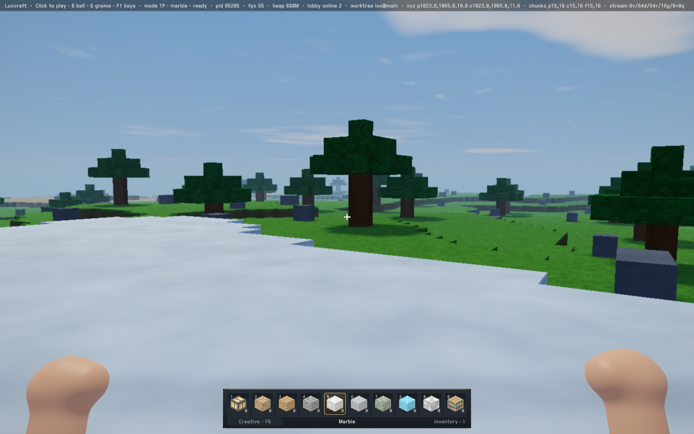
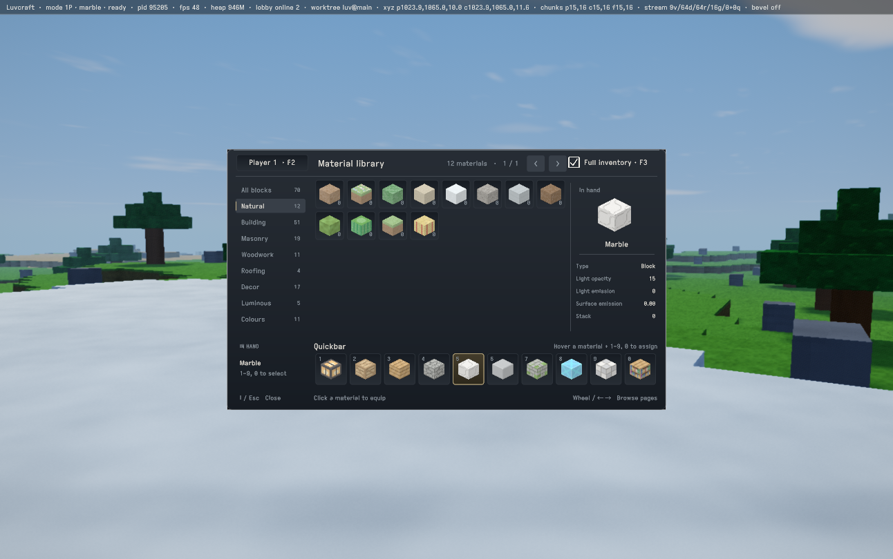
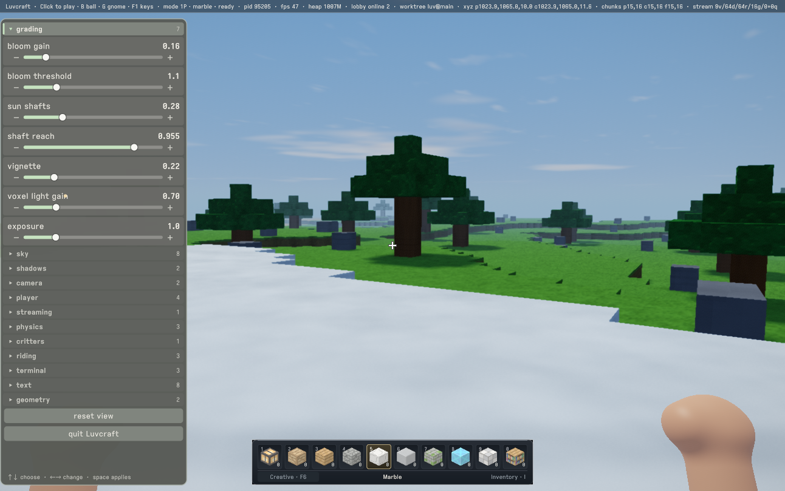
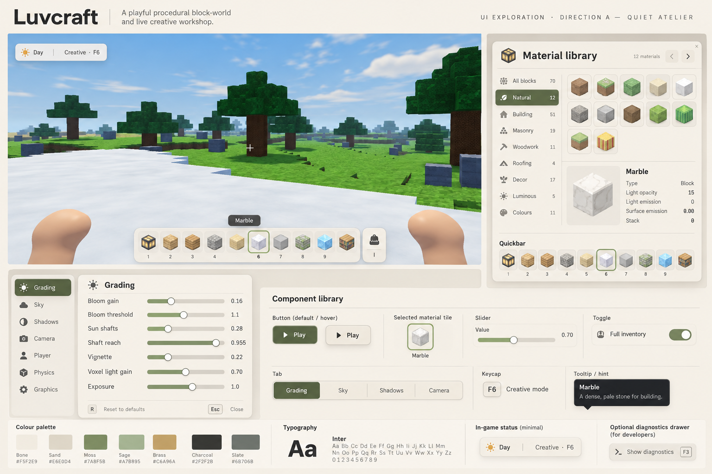
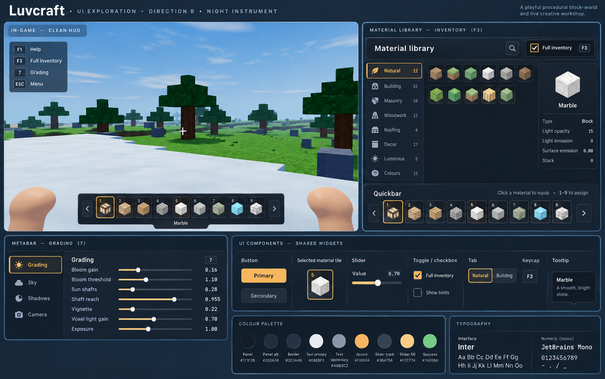
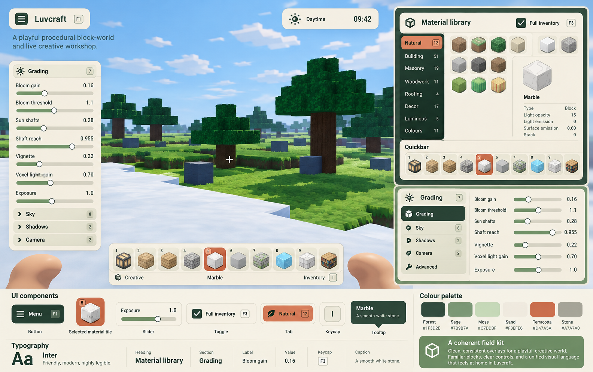

#+title: Luvcraft UI: one family of workshop instruments
#+startup: overview

* A shared visual language, not a new skin per tool
:PROPERTIES:
:ID: 23O6C3
:END:

The inventory, quickbar, metabar, status line, and in-world instruments
should feel like parts of one workshop. The first study uses actual daytime
screenshots from the laptop session, not an invented game. It keeps the
material cubes, existing controls, and current interactions while exploring
three visual directions. The chosen blend is Quiet Atelier's restrained
surfaces with Field Kit's forest and terracotta palette (#9Z486I).

The immediate engineering constraint is #LEEWJB: crisp screen overlays must
not force the world renderer to reconstruct every Retina pixel. The frame
budget from #KIGTDN still applies.

* DONE Separate world resolution from overlay resolution
:PROPERTIES:
:ID: LEEWJB
:END:

The native display stays 3420 by 2146 on the measured laptop. The world has
an independent 1,048,576-pixel reconstruction ceiling, with dynamic scene
resolution below it. Terrain, sky, exposure, bloom, shafts, depth-aware
presentation and grading stay inside that budget. The finished world image
is linearly sampled once into the native drawable; screen overlays are drawn
last into that same native pass. This avoids rerunning the expensive world
presentation shader at Retina resolution just to sharpen labels.

World-panel color and depth targets follow the dynamic scene extent. They
remain perspectival and depth-composited into the world, rather than jumping
into the flat HUD. Their source content may retain its own logical layout,
but its visible rasterization belongs to the world budget. Hotbar, inventory,
metabar, status, and workbench sheets are screen overlays and retain native
pixel coverage. Explicit fixed-scale captures bypass the world budget.

This is three grids: dynamic scene, capped reconstructed world, native UI.
Input and layout stay in logical window coordinates; GPU target dimensions
must not become another UI layout scale.

Live validation after loading: native display 3420 by 2146, reconstructed
world 1292 by 810, scene 968 by 608. Separate five-second measurements after
two-second settling periods gave 59.5 Hz in play, 59.7 with inventory open,
and 59.5 with the metabar open. All were unfocused; focused movement and
world-panel interaction remain follow-up checks. Renderer and Luvcraft-on-Luft
game suites passed 35,908 and 445 checks. A recorded-pass test verifies that
world presentation precedes the copy and HUD, with the overlay callback
receiving the native attachment.

* Three directions from the same screenshots
:PROPERTIES:
:ID: JK08FO
:END:

The ,
, and
 are actual pre-change
captures at the previous low drawable resolution. They show the inconsistency:
a dark inventory, grey-green slider drawer, separate keycap treatments, and
a telemetry-heavy status strip.

The following boards were generated with the built-in image_gen tool using
all three screenshots as references. [[file:measurements/laptop-ui-20261024/prompts.json][Exact prompts]] are retained. These are
proposals, not implemented screenshots or precise specifications. Generated
key labels, palette hex codes, counts, and shortcuts need verification; in
particular, do not inherit invented F3 diagnostics bindings or rearranged
quickbar selection numbers from the boards.

** Quiet atelier
:PROPERTIES:
:ID: 7LQLC4
:END:

Warm bone surfaces, charcoal text, moss selection, restrained brass. The
calmest option; a useful starting point for a creative workshop. Keep strong
text contrast against bright sky and snow. Avoid decorative texture and
making every surface look like a separate floating card.

** Night instrument
:PROPERTIES:
:ID: HLF9P9
:END:

Blue-charcoal panels, ivory text, amber selection. Closest to the current
inventory and easiest to migrate incrementally. The proposal overuses blue
panel outlines and has an oversized help block; simplify both. Monospace is
for numeric values and code, not every label.

** Playful field kit
:PROPERTIES:
:ID: JJSCKE
:END:

Chalk, forest green, terracotta selection. Friendlier, stronger ties to the
world's materials. Keep the palette and material tiles; drop the promotional
copy and oversized title/time badges from actual play. Those are design-board
presentation, not new HUD requirements.

* DONE One theme owner and a small component vocabulary
:PROPERTIES:
:ID: 9Z486I
:END:

The first implementation lives in =mcclim/ui-theme.lisp=. It blends Quiet
Atelier (#7LQLC4) with Field Kit (#JJSCKE): opaque bone panels, forest text,
moss controls, terracotta selection, and quiet hairline borders. Material
thumbnails keep their actual colors. UI paints are authored as sRGB hex and
decoded once into the renderer's linear-light colors.

| Role | sRGB |
|------+------|
| Surface / raised / inset | F3EFE4 / FAF7EF / E9E5D8 |
| Text / muted | 233E33 / 3E4B40 |
| Border / forest | C7CBBB / 1F3D2E |
| Accent / on-accent | 5B704D / FAF7EF |
| Selection / selection-soft | B95135 / E7A889 |
| Keyboard focus / hover | 314F3D / E0E6D5 |
| Error | A52F2A |

=mcluv:*ui-theme*= is the shared immutable paint owner. Widgets consume
=ui-ink= roles, rather than defining their own palettes. =draw-ui-surface=,
=draw-ui-tile=, =draw-ui-keycap=, =draw-ui-slider=, and =draw-ui-switch= supply
the recurring shapes. =ui-metric= owns the shared radii and rim widths;
widget layout and hit testing retain their existing common geometry.
This deliberately small library does not introduce a second widget system.

Quickbar, full and picture-first inventory, metabar, status, key help,
command search, prompts/messages, source-update panel, lobby, and the generic
material palette consume this theme. Ordinary pane labels share sans-serif
text styling through bundled DM Sans regular and bold. =ui-text-size= owns
the compact type scale: 14-point captions, 16-point body text, 20-point
headings, and 12-point keycap numbers. Symbol keys use the fixed-family
fallback because DM Sans does not contain all navigation glyphs; explicit
code text retains its specialized style. The font license and provenance
are in =fonts/LICENSE-DMSans.txt= and =fonts/README-DMSans.md=.

Field Kit now supplies forest inventory sidebars and expanded metabar groups,
with cream labels and warmer terracotta selection tiles. The play hotbar is
68 logical pixels tall instead of 98: no permanent footer, material caption,
or zero stock counts. Inventory and creative mode remain on I and F6, with
help inside the inventory. The generic material bar likewise drops its
permanent caption and shrinks from 104 to 80 logical pixels.
Selection has a thicker terracotta rim; focus uses a dark forest rim.

Replace the theme at a canvas frame boundary to restyle live. Retained owners
notice identity changes once, republish their drawings, and resume static
reuse. The shell invalidates its whole shared mirror so inactive panes also
receive the new theme. Inventory and quickbar include theme identity in their
visible-state snapshots. No theme work rebuilds UI textures each frame.

Tests cover one-time invalidation, cached inks, unknown roles, and at least
4.5:1 contrast for normal and muted text on the light surfaces. Existing
interaction and direct-GPU suites remain the checks for input geometry and
analytic rendering. Native overlays and the capped world remain separate
as described in #LEEWJB.

The implementation checks passed 456 McCLIM, 279 inventory/HUD, 76 workbench,
13 lobby, and 449 Luvcraft-on-Luft game assertions. Live captures confirmed the shared inventory and
metabar treatment. A repeated native-resolution capture batch exposed a
separate scaler-recreation stall: the watchdog sample on 2026-10-24 stopped
inside =MTLFXTemporalScalerDescriptor newTemporalScalerWithDevice:compiler:=,
then MPSGraph specialization/optimization, after switching between 3420x2146
capture input and 968x608 gameplay input. The watchdog ended the image after
30 seconds. Do not interpret capture-time FPS as interactive performance,
and avoid repeated full-resolution export cycles when reviewing UI.

Further work can bring world-paper content into this
vocabulary where it fits. Terminal and source contents should keep their
own semantic colors. Richer tooltips and button variants should be extracted
when a second consumer needs them, rather than invented in advance.

* DONE Ordinary status is not a diagnostics dump
:PROPERTIES:
:ID: 9MDH7R
:END:

Luvcraft's normal status is a small upper-right forest clock pill, driven by
the actual world clock, with a quiet FPS label in the upper-left corner. It replaces the full-width strip and does not shrink
type to squeeze in telemetry. The shared =status-bar-presentation= protocol
keeps conventional strips available to tools and diagnostics.

PID, heap, worktree, coordinates, chunk counts and streaming queues are
retained through =luvcraft.luft.game::*status-diagnostics-p*=, off by default.
A future diagnostics drawer can expose this vocabulary without consuming
the play HUD.

* DONE One picture-led inventory for both player profiles
:PROPERTIES:
:ID: 6OND7O
:END:

The inventory is now one alphabetically ordered material tray, without
categories, page buttons, player labels, or instruction copy. Its 840 by 364
logical panel shows a clipped, continuously scrolling grid and a material
portrait. Fractional wheel/trackpad deltas move the tray directly. A small
scroll thumb shows the position; keyboard movement scrolls its row into view.

The normal speedbar remains visible in its normal screen position, outside
the inventory. Click or Enter equips the chosen material and closes the tray
without modifying the speedbar. Number keys can still explicitly assign a
hovered material to a slot. Arrow keys navigate, Page Up/Down move a screen,
Home/End reach the catalog ends, and I or Escape closes the inventory.

Old player preferences and saved speedbars still load, but the inventory
has no profile-switch control or separate simple/full presentation. Retained
native HUD composition and the capped scene resolution are unchanged (#LEEWJB).

* DONE Material portraits explain what is in your hand
:PROPERTIES:
:ID: FP8GAR
:END:

The inventory portrait (#6OND7O) now has a two-line description and a small
trait list. Marble is pale, veined stone; a lantern is warm light in an iron
frame. =inventory-material-description= and =inventory-material-traits= are
extensible generics rather than separate layouts for each material.

Traits read the existing block properties: emitted light on the 0–15 scale,
surface glow when nonzero, and solidity. A lantern reports light 14/15 and
glow 1.10; marble reports light 0/15. These are distinct: surface glow does
not necessarily illuminate neighbours. No hardness or durability is invented.
The bulb, glow and solid markers use native vector shapes, independent of
font glyph coverage.

* DONE A clearer, warmer daytime atmosphere
:PROPERTIES:
:ID: CZQ8X2
:END:

Luvcraft-on-Luft adds a daylight treatment to its existing sky profile. Warm
sun and ambient channels lift the land; a bluer zenith, 28 percent less cloud
coverage, 15 percent less haze density, and 45 percent less vignette make
midday feel clearer. The treatment ramps smoothly from day-factor 0.35 to
0.85, preserving the original night and early twilight. The shared atelier
look is untouched.

This changes CPU-authored light/uniform values and uses the existing render
passes. The original filmic curve, saturation and contrast remain unchanged.
Set =luvcraft.luft.game::*daylight-look-strength*= to zero for the original
atmosphere. Native daytime comparisons at 11:00 showed clearer distance and
less blue-grey snow. Clouds still move between captures; this is a visual
comparison, not a controlled GPU performance benchmark. Tests cover night
preservation, the zero-strength baseline, and daylight warmth/cloud reduction.

* DONE Recover some of the old world’s painted texture
:PROPERTIES:
:ID: AVU8G2
:END:

The old Luvcraft reference has coarse atlas detail, olive foliage, warm
slanting sun and atmospheric distance. The Luft bridge preserved atlas
average colours but replaced painted detail with smoother procedural relief.
A game-specific material-character function now restores world-aligned
12-per-cell colour flecks, strongest on vegetation and restrained on snow.
The flecks fade between roughly 17 and 60 cells to avoid keeping fine detail
at distant scales. This is a new procedural treatment, not the original atlas.

Grass and leaves shift toward olive with a small saturation reduction. The
previous daylight experiment (#CZQ8X2) now keeps more haze and corner falloff,
and gives sunlight a slightly warmer balance. Midday and 16:00 live captures
checked both the ordinary day and the lower, warmer illumination in the
reference. The hour is a preview choice, not a new default start time.

The terrain hook is identity by default, preserving the atelier renderer.
Luvcraft binds it when building its terrain pipeline. There are no new texture
resources or render passes, but the added shader arithmetic is unprofiled;
these screenshots establish appearance, not a 60 FPS performance result.

* NEXT Try normal-only rounding on plain terrain
:PROPERTIES:
:ID: XSVMQA
:END:

The old renderer's friendly cube edges came partly from shading normals,
not beveled silhouettes. The Luft bridge now classifies each owned face's
four edges from the meshing occupancy halo: flush, convex, or concave.
Diagonal contacts keep separate convex rims. Metadata is a parallel CPU
product; canonical star occupancy stays unchanged. The renderer packs the
12 two-bit classes into the spare upper 24 bits of its existing site lane.

Luvcraft's plain-face shader bends normals within a tenth of a cell at
exposed rims, then combines this with the existing material relief. Flush
planes stay flat. The effect fades with pixel footprint and from 20 to 55
cells. Geometric bevel mode and the atelier retain their existing shading.
The experiment can be disabled with
=luvcraft.luft.game::*rounded-terrain-edges-p*= followed by a shader refresh.
There are no new triangles, buffers or passes; arithmetic cost is unprofiled.

Tests cover isolated cube rims, flush and concave edges across a chunk
boundary, canonical occupancy preservation, sorting and shadow merging.

The first live reload retained obsolete SURFACE-MESH layouts and stopped
terrain publication. A clean image restart restored the scene with no terrain
production errors; the player's position survived. Reloads that change this
structure must discard the old image's instances and compiled accessors.
The live afternoon frame confirms seamless flat snow and subtle exposed rims.
