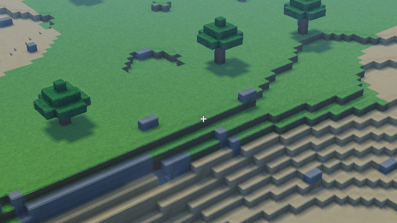

#+title: Shared-corner bevel retirement: measured headroom, not a default policy

Yawl, Apple M5, macOS 27.2, Xcode 27.1, 2026-10-23 UTC. Figure #YHVCJU.
Production source [[https://github.com/mbrock/luv/commit/2a231b97e3061c2c64d051736f1d855437385311][2a231b9]] plus the disposable scripts in this bundle.
Thread: https://ampcode.com/threads/T-01a16a97-09d4-76c6-9fcf-75e9b42a2d08

* Result

A renderer-only shared-corner morph can retire distant bevel patches without
reducing terrain coverage or changing the material fragment shader or shadows.
The 2-pixel candidate saves 19.77–19.90% GPU time and 8.34–8.66% serialized
completion time. The more aggressive 4-pixel candidate saves 37.13–37.28% GPU
and 22.99–23.52% completion. Every balanced comparison window improves for
both candidates in both orders. These remain experiments, not enabled defaults.

| Run | Variant | GPU ms | Completion ms | CPU encode ms |
|-
| AB | Control | 14.808 | 17.297 | 2.081 |
| AB | 1 px | 14.726 | 18.620 | 3.485 |
| AB | 2 px | 11.860 | 15.855 | 3.579 |
| AB | 4 px | 9.310 | 13.320 | 3.602 |
| BA | Control | 15.259 | 17.857 | 2.190 |
| BA | 1 px | 15.231 | 19.196 | 3.548 |
| BA | 2 px | 12.242 | 16.310 | 3.657 |
| BA | 4 px | 9.570 | 13.657 | 3.679 |

The 1-pixel candidate submits no fully-flat patches in this view and makes
completion about 7.5% worse. Its tiny GPU difference is not a useful win.
Do not present these measurements as proof that all costly bevels are subpixel.

The existing interleaved harness uses control/1/2/4/4/2/1/control and its
reverse, 120 warmup and 1,800 measured frames per run: 450 per variant.
Each of fifteen 120-frame windows contains thirty samples of each variant.
Clocks are unpinned and samples are correlated. These are sustained mixed
workload GPU timestamps and serialized completion, not displayed FPS or
candidate-only operating points. No replayer or other GPU workload ran during
the two final timing runs. Timing and counter profiling are separate runs.

Both runs hold the seed-7 live-alpine camera =(1009,1000,45)=, yaw =0.9=,
pitch =-0.55=, vertical FOV =0.85=, noon, exposure =0.45=, native 1920×1080
output/internal, 1× samples, nine loaded residents, no temporal reconstruction
or dynamic resolution. Normal residency and frustum visibility are unchanged.
The visible resident populations contain 122,772 star instances. Modern
material/lighting fixes in the production revision mean this is a fresh control,
not a timing comparison against the previous bundle's older renderer.

* Retire work only after shared geometry has collapsed

Every atlas vertex is within one tick of a canonical lattice corner. Its
world position is =anchor + offset=; the maximum offset over all 256 owned
patches is sqrt(2)/8 cells. The vertex candidate uses
=anchor + weight(anchor) * offset=, with one value per GLOBAL anchor, not a
width independently selected by each chunk or owning star.

For a perspective camera, =probe.lisp= bounds the corner's projected offset
using radius =0.176777=, focal length in pixels, depth, and off-axis position.
For focal maximum f and view coordinates x/y/z, the bound is
=f R sqrt(1 + (x²+y²)/z²) / (z-R)=. Behind/near-plane corners retain bevels.
The bound is conservative; it does not use each bevel band's orientation.
Thus this is NOT yet a targeted foreshortened-strip classifier.

A threshold L means weight zero at bound ≤L, weight one at bound ≥2L, and
a continuous interpolation between. The pixel label describes this projected
displacement criterion, not a pixel-difference guarantee for shading or images.
Near resolved bevels remain, while further geometry becomes intentionally square.

Each frame the CPU partitions the existing star-sorted instances into full
and flat runs. The conservative site-box test permits a flat patch only when
ALL anchors in its original patch are already at zero weight. Other sites keep
the original indexed patch, including tapering bands. No transition strip is
deleted early. The flat patch is exactly the nondegenerate zero endpoint.

| Native view | Full sites | Flat sites | Submitted terrain triangles | Scene draws |
|-
| Control | 122,772 | 0 | 1,925,590 | 1,163 |
| 1 px | 122,772 | 0 | 1,925,590 | 1,163 |
| 2 px | 94,093 | 28,679 | 1,528,976 | 1,298 |
| 4 px | 50,852 | 71,920 | 932,160 | 1,297 |

Selection, partitioning and the 1,964,352-byte upload per frame are INSIDE
the timed encode. Final candidates still add about 1.4–1.5 ms CPU encoding;
this is not a free stationary-camera cache. Candidate buffers contain XYZ and
the original sorted sidecar index. Appearance, light and descriptors remain
the existing immutable buffers; shadow binding and geometry remain original.
The combined indexed scene atlas is uploaded once. All resident staging has
two extra CPU site arrays and one extra GPU site array, plus small count tables;
the experiment retains control resources for A/B use too.

This mutable single-buffer implementation is valid for the SERIALIZED harness.
It is not a production fence-safe multi-frame residency design. A production
selection path needs appropriately owned per-frame buffers or GPU work/indirect
submission, not this upload silently moved outside the measured interval.

* Fresh Metal counters: less actual vertex and helper work

Three warmed captures use the exact native extent and are profiled separately
with =profile run --gpu-state high --exec overlapping=. The scene encoder,
including the one sky primitive, reports:

| Counter | Control | 2 px | 4 px |
|-
| Submitted primitives | 1,925,591 | 1,528,977 | 932,161 |
| Vertex invocations | 2,890,813 | 2,326,870 | 1,477,559 |
| Valid fragments | 2,235,936 | 2,096,672 | 2,095,968 |
| Helper fragments | 1,298,128 | 996,752 | 635,376 |
| Helper fraction | 36.73% | 32.22% | 23.26% |
| Valid + helper lanes | 3,534,064 | 3,093,424 | 2,731,344 |

The 2-pixel candidate eliminates 19.51% of vertex invocations and 23.22% of
helper invocations. At 4 pixels those reductions reach 48.89% and 51.05%.
Valid fragments change only about 6.2%; this is not primarily a smaller view.
Do not attribute the entire runtime improvement to helpers: vertex processing
and primitive/tiler traffic also decline, and surface shading changes with
geometry and normals.

All three terrain fragment binaries have the SAME 8,954 instructions and 108
temporary registers. These differ from the older ablation's 8,887/106 because
this experiment starts from a newer production revision. The candidate vertex
binary grows 474 → 513 instructions for the morph while total invocations fall.
Shadow shader draw uses remain 16 in every capture.

These are hardware counter profiles, NOT new GUI source-cost samples. CLI
shader costs remain zero and are not interpreted. Sampled cores are 4/10,
5/10, 6/10; profiles report max state but =Consistent state: no=. Replay GPU
times 8.5862/7.0407/5.5488 ms are not the ordinary runtime timings above and
stage intervals must not be added. =raw-profile-*.json.gz= retain the final
structured response to every exporter query; =counters.json= retains strings,
including locale formatting and unavailable fields. All sessions were terminated.

* Exact geometry and appearance checks

=check.lisp= decodes every one of the 512 joined scene patches and compares
it to the corresponding original atlas. Shadow arrays are unchanged. It checks
the canonical corner mapping, maximum displacement, selector conservatism, and
14,976 actual offset projections including off-axis and near-plane cases.

=geometry-check.lisp= is an independent CPU-only rational oracle. All 256
stars' zero endpoints equal their flat oriented triangle multisets after
degenerate removal. Mixed 0/½/1 fields pass 2,112 closed-surface cases with
8,856 nonempty flat substitutions, 2,338 outside all-zero fields. Closure
checks subdivide directed edges into exact half-tick segments, rather than
assuming matching indices prove a closed boundary.

Boundary closure is NOT manifold preservation. The checkerboard solid
=((0 -1 -1) (-1 0 -1))= has four incident triangles on its shared edge at
zero width, despite paired oriented boundaries. That expected counterexample
is kept in the oracle. Occupancy and semantic meshing never change; a render
approximation can nevertheless merge previously separated sheets at contact.

Overview captures are EXACTLY 1920×1080, not doubled Retina screenshots.
The capture helper reuses the benchmark's explicit target/encode/readback
workflow. =images.py= creates 1280×720 review overviews and unscaled 800×450
crops at (550,300). The 4-pixel view visibly reduces rounding and highlights;
it is not appearance-identical. Isolated small terrain slivers in the control
remain visible in corresponding candidate locations; they are not evidence
that this morph introduced cracks.

Unscaled detail crops, control first, then 2px and 4px:

The corresponding full-view review images are in =review/=; the sampled
motion contact sheets and slowed GIF are in =motion-review/=. =cave-review/=
retains the near-view control and 4px image plus all variants' RGB metrics.

The optional native motion inspection traverses eight identical camera poses,
0.5 cells apart along +X, over the same paused residents without advancing
streaming. Contact sheets expose all eight poses; the GIF is a slowed,
ping-pong review sequence, not game FPS or a temporal reconstruction test.
All eight sampled poses were inspected against their controls: no new
continuous crack or large hole was observed. This is sampled evidence, not
a claim of artifact-free motion in arbitrary scenes.

A separate native cave near-view control renders all 5,852 sites with the
full patch at both thresholds (101,820 terrain triangles). The control/2px/4px
RGB images are pixel-identical in the 1920×928 scene rectangle excluding HUD
and inventory. That view was inspected; it is a near-detail control, not a
cave-wide transition or performance result. Its twelve-frame timings are not
used above. Reproduce with =BENCH_SCENES=cave= and a separate capture directory.

Known limits before adoption:
- Temporal motion currently projects the CURRENT morphed point through both
  camera matrices. Previous-frame LOD displacement is not represented; do not
  claim the temporal motion contract is solved.
- Transition triangles retain original flat normals/material selection, rather
  than recomputing normals of the variable-width geometry.
- The policy is perspective-only, not isometric; it bounds corner displacement,
  not actual strip thickness, occlusion or silhouette importance.
- Native sampled motion and one near cave view are not an editing/streaming/
  cave-wide/temporal acceptance campaign. Singular contact topology and
  near/grazing material response still need explicit treatment before a default
  change.

* Reproduce

Run from the checkout root, in disposable processes. Keep the durable image
untouched. No default renderer/system file is changed by this bundle.

#+begin_src sh
./env sbcl --script wiki/measurements/yawl-bevel-retirement-2a231b9/check.lisp
./env sbcl --script wiki/measurements/yawl-bevel-retirement-2a231b9/geometry-check.lisp

BENCH_LIBRARY=1 BLOCK_LIBRARY=1 INTERLEAVED_LIBRARY=1 \
BENCH_MODE=native-1x BENCH_SIZES=1920x1080 BENCH_SCENES=live-alpine \
BENCH_REPEATS=1 BENCH_WARMUP=120 BENCH_FRAMES=1800 FRAGMENT_PROBE=control \
BLOCK_MODES=control,p1,p2,p4 BLOCK_OUTPUT="$PWD/build/retirement-ab" \
BENCH_OUTPUT="$PWD/build/retirement-ab.sexp" \
./env sbcl --script wiki/measurements/yawl-bevel-retirement-2a231b9/run.lisp
#+end_src

Reverse with =BLOCK_MODES=p4,p2,p1,control= and a different output prefix.
=RETIREMENT_CAPTURE_DIR= adds post-timing PNGs; =RETIREMENT_MOTION=1= adds
the native eight-pose sequence. Create the output directory first. Motion
inspection can use twelve warmup/measured frames; do not use those timings.

For fresh traces use =capture.lisp= instead, add =MTL_CAPTURE_ENABLED=1=,
=RETIREMENT_LIBRARY=1=, =RETIREMENT_TRACE_DIR= and =RETIREMENT_CAPTURE_DIR=,
and use =BLOCK_MODES=control,p2,p4= with 120 warmup and twelve measured frames.
Build the existing =build/gpu-capture-probe.dylib= as described in the native
replay bundle. The trace directory must not already contain those captures.
Never compare the capture-process timings to the ordinary runtime runs.

#+begin_src sh
python3 wiki/measurements/yawl-runtime-f87a44f/analyze.py adjacent-ab.tsv adjacent-ba.tsv
uv run --with pillow python wiki/measurements/yawl-bevel-retirement-2a231b9/images.py \
  .amp/in/artifacts/bevel-retirement .amp/in/artifacts/bevel-retirement/review
#+end_src

The final AB/BA runs used identical timed code. The subsequently added optional
motion/capture entry points change only untimed inspection. Raw TSV, final
metadata, parsed summaries, logs and selected review images are retained here;
large native PNG sequences and captures remain local under
=.amp/in/artifacts/bevel-retirement/=. =files.sha256= records the archived bundle.
