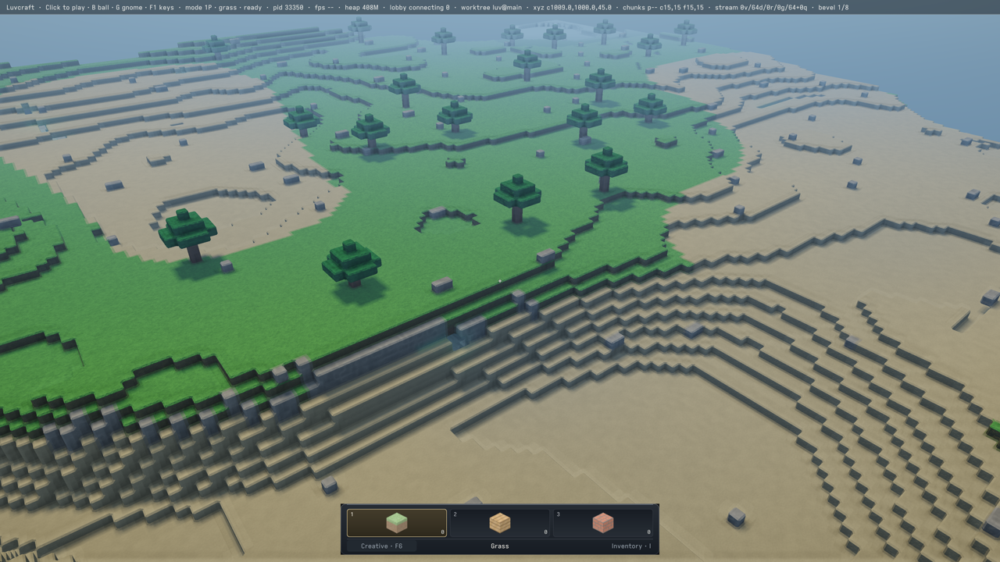
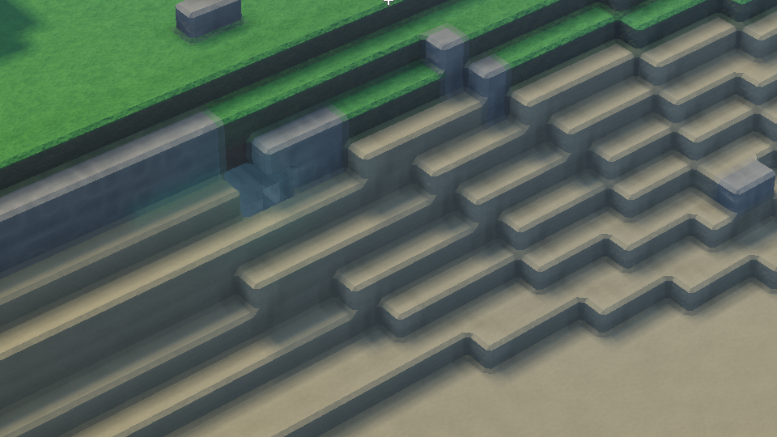
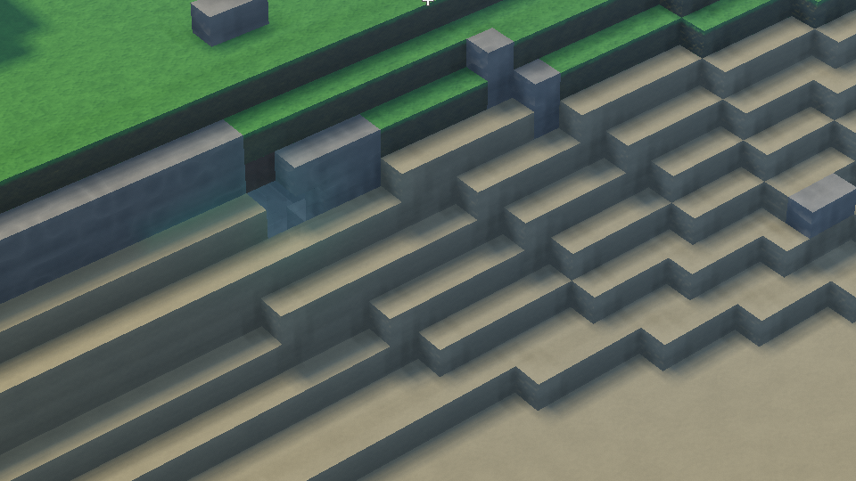

#+title: Scene-only bevel ablation: a large cost, with shadows held fixed

Yawl, Apple M5, macOS 27.2, Xcode 27.1, 2026-10-23 UTC. Figure #S5CFOO.
Recorded revision [[https://github.com/mbrock/luv/commit/e277814cf11bea2fce1813300652300a1df75472][e277814]], whose production renderer is unchanged from
[[https://github.com/mbrock/luv/commit/5ee6831477e047cc2565942072fc4a83777d0092][5ee6831]], plus this bundle and the =TERRAIN_SETUP= capture hook.
Thread: https://ampcode.com/threads/T-01a16a97-09d4-76c6-9fcf-75e9b42a2d08

* The result

Removing scene bevels, without changing shadow geometry or material shaders,
reduces GPU time about 49.8% in both adjacent-frame runtime comparisons.
Metal counter profiles independently show 60.4% fewer helper fragments and
83.0% fewer vertex invocations. Bevel geometry is a major cost in this view.
This is an ablation of ALL scene bevels, not a production optimization or
proof that distant/edge-on bevels alone recover the same gain.

| Runtime run | Frames per variant | Bevelled GPU ms | Flat GPU ms | Bevelled completion ms | Flat completion ms |
|-
| ABBA | 900 | 15.325 | 7.694 | 18.407 | 10.554 |
| BAAB | 900 | 15.270 | 7.673 | 18.403 | 10.595 |

GPU and completion improve in all 15 balanced 120-frame windows of each
run. GPU savings are 49.75–49.79%; serialized completion savings are
42.43–42.67%. The same sustained queue, targets, residents and ABBA/BAAB
method as #ZRQM38 keep adjacent variants under a shared governor. No GPU
profiler or second GPU workload ran during timing. Clocks were not pinned;
these are not displayed FPS or candidate-only operating points. Windows
contain correlated samples, not independent confidence intervals.

* Isolate the scene, not the global bevel toggle

The ordinary =*terrain-bevels-p*= switch also changes shadow construction
and disables the merged shadow path. Previous flat+compressed measurements
therefore did not isolate modern scene bevel cost. This probe keeps the
flag true and the existing merged shadow renderer intact.

=scene-only.lisp= combines flat scene vertices/normals/indices with the
original bevelled control's shadow vertices/indices and shadow range fields.
=run.lisp= uploads those flat scene tables once, then alternates only scene
tables/ranges and identical terrain pipelines. Existing per-variant binding
namespaces prevent stale buffer bindings. Residents and site populations
are shared. Some stars have no flat scene triangles; the existing encoder
naturally skips those empty ranges. The runtime captures restore the control
scene state before shared cleanup.

An independent table check compared all three scene arrays to the existing
flat generator, both shadow arrays to the control, and all four range fields
for all 256 stars. It passed; =table-validation.log= retains the result.
The captured shadow vertex shader has exactly 16 draw uses in both traces;
isolated shadow intervals remain approximately 0.07 ms vertex / 0.019 ms
fragment. No shadow simplification or shading ablation was added.

Both variants retain seed-7 live-alpine, camera =(1009,1000,45)=, yaw =0.9=,
pitch =-0.55=, FOV =0.85=, nine residents, native 1920×1080 output/internal,
1× samples, noon, exposure 0.45, no temporal reconstruction or dynamic
resolution. No render-distance, occlusion or visibility change. Changing
the bevel surface necessarily changes local normals, silhouettes and material
response; this is not image equivalence.

* Hardware counters support the fragment-waste hypothesis

Fresh warmed captures were replay-profiled once each, sequentially, with
=profile run --gpu-state high --exec overlapping=. These are Metal hardware
counters and isolated stage intervals, not new Xcode GUI source-cost samples.
CLI sampled shader weights still came back zero; source attribution was not
needed for this geometry question and no expression-level costs are claimed.
Both profiles say =max= but =Consistent state: no=; sampled cores were 5/10
and 8/10. Do not treat replay time as the unprofiled runtime result.

| Scene encoder, including sky | Bevelled | Flat |
|-
| Submitted primitives | 1,925,591 | 245,847 |
| Vertex invocations | 2,890,813 | 491,695 |
| Valid fragment invocations | 2,235,968 | 2,091,936 |
| Helper fragment invocations | 1,298,096 | 513,520 |
| Helper / (helper + valid) | 36.73% | 19.71% |
| Total fragment invocations | 3,534,064 | 2,605,456 |
| Isolated scene vertex ms | 3.2132 | 0.6120 |
| Isolated scene fragment ms | 4.2651 | 2.7742 |
| Whole replay GPU ms | 8.4659 | 4.3189 |
| Terrain fragment static instructions | 8,887 | 8,887 |
| Terrain fragment temporary registers | 106 | 106 |

Valid fragment work falls only 6.44%, but helper work falls 60.44%; total
fragment lanes fall 26.28%. This supports bevel-driven partial-quad waste.
Large vertex-work savings also contribute. Different surface normals and
material execution may matter too: do NOT attribute the entire 49.8%
runtime gain to helpers, or claim this identifies which bevel orientations
or distances account for them. Stage intervals overlap and are not additive.

=raw-profile-{control,flat}.json.gz= retain the exporter’s parsed final
responses for every query, including unavailable/zero fields. The raw text
helper-counter definition explains 2×2 derivative quads and uncovered lanes.
The original exported response files remain local under
=.amp/in/bevel-slivers/profile-{control,flat}/=. Sessions were terminated;
no replayer was left running. Captures remain local at
=.amp/in/artifacts/bevel-slivers/{control,flat}.gputrace=; their recursive
file hashes are archived, not the large captures themselves.

* Inspect the intended change

Overview PNGs are 1280×720 resamples of post-timing native 3840×2160 Retina
captures, not the 1920×1080 timed targets. Detail PNGs are unscaled 960×540
crops at (1440,1080). Both variants were inspected: faces, trees, terraces
and shadows remain, with sharp square edges and reduced bevel highlights
in the flat view. No gross missing faces, holes or malformed normals were
found. The HUD still says =bevel 1/8= because the production global flag
deliberately stays true; the scene table override, not the HUD, defines
the experiment. Tiny dark pixels and the old terrace boundary are not
independently diagnosed by these captures.

This is one stationary hilltop and intentionally removes near bevels too.
It does not accept a transition policy, motion/temporal behavior, silhouettes
at other viewpoints, editing or shared chunk boundaries. No production
renderer setting changed. Strict Parinfer, the table check, and =make test=
(35 production suites) passed after adding the scripts. The disposable
scripts themselves were checked by the actual runtime/capture runs, not
by those production suites.

* Next: projected feature size, not a shorter horizon

Keep near and silhouette-important bevels. Test retiring bevel geometry by
projected footprint, including foreshortening, with shared boundary decisions
and the original indexed-atlas reuse. Do not independently change chunk bevel
widths: earlier experiments opened cracks. Keep full terrain coverage and
charge selection, uploads, transition resources and memory to the candidate.
The all-flat result is the useful counterfactual, not permission to flatten
everything or a promise of a 2× production improvement.

* Reproduce

#+begin_src sh
BENCH_LIBRARY=1 BLOCK_LIBRARY=1 INTERLEAVED_LIBRARY=1 BENCH_MODE=native-1x \
BENCH_SIZES=1920x1080 BENCH_SCENES=live-alpine BENCH_REPEATS=1 \
BENCH_WARMUP=120 BENCH_FRAMES=1800 FRAGMENT_PROBE=control \
BLOCK_MODES=control,flat BLOCK_OUTPUT="$PWD/build/bevel-ab" \
BENCH_OUTPUT="$PWD/build/bevel-ab-final.sexp" \
./env sbcl --script wiki/measurements/yawl-bevel-slivers-5ee6831/run.lisp
#+end_src

Repeat with =BLOCK_MODES=flat,control= and distinct paths. Optional
=BEVEL_CAPTURE_DIR= saves each scene after all timed frames. Do not use
=PROBE_CAPTURE_DIR= here: its generic hook swaps shaders, not scene buffers.

For capture, use the existing #FIW26N helper and recipe, with
=SCENE_MERGE=0= and
=TERRAIN_SETUP=wiki/measurements/yawl-bevel-slivers-5ee6831/scene-only.lisp=.
Capture control with =BEVEL_FLAT= unset, flat with =BEVEL_FLAT=1=.
Keep 120 warmup frames and one uncaptured frame before capture. Inspect
encoder IDs before querying counters; =re1= was the scene encoder here.
The prior bundle's =export.py= extracts the counter groups and statistics.
Never load either disposable override into the durable Sly image.
