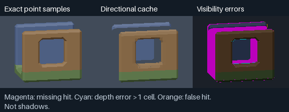
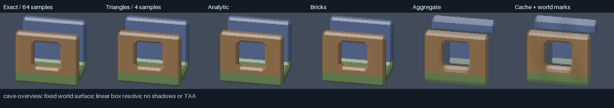
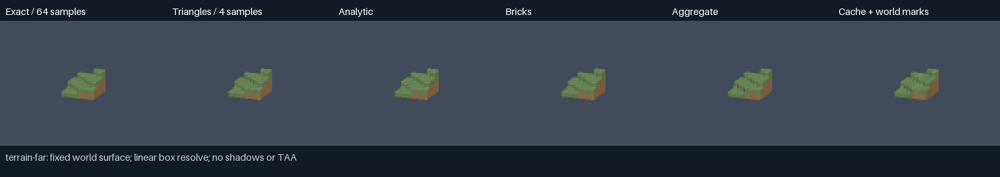

#+title: Fixed-surface far-field representation probes
#+startup: overview

* Question and scope

Can the same beveled cubical surface change drawing representation without
losing its diagonal lighting, cave openings, or first-hit depth? This is the
small information experiment requested by #BBFT2Q, before a panorama GPU trial.
It is not another bevel-shrinking policy or a production renderer change.

Source: [[https://github.com/mbrock/luv/commit/c0c7a8c8a325bc1aaf3465393ffea02244617814][Luft c0c7a8c]]. The scripts in this directory are the added experiment;
production source and the durable Lisp image are unchanged. The source atlas
is loaded into a disposable SBCL process. Python/NumPy implements independent
CPU representations so that information loss is separated from GPU scheduling,
helper-fragment costs, shader arithmetic and clocks. Python execution times
are preparation diagnostics, not evidence of GPU acceleration.

* Three hypotheses, with one reference

| Representation | Hypothesis | Main risk |
|-
| Analytic plane domains | Exact bounded polygons can retain bevels with fewer visibility primitives | Domain tests, proxy overdraw and late depth cost more than rasterized triangles |
| Masked surface bricks | Spatially bounded planes plus small coverage masks can replace tiny triangles | Quantization changes silhouettes and reveals hidden layers; records may cost more memory |
| Directional appearance cache | Visible normal/material mixtures can retain lighting with a softer carrier | Missing views, depth-sheet correspondence, cache switches and memory |

None is the full architecture its name might suggest. The analytic probe is
not analytic pixel-footprint integration. The brick probe is not a Nanite DAG
or an assertion about Epic's undocumented cell encoding. The cache is not a
complete painterly art direction or a production disocclusion solution.

All candidates receive identical owned atlas triangles. World-space bevel
width is fixed, not distance-dependent: one quarter-cell for the diagnostic
ridge, junction, checkerboard sheets and cave; the ordinary one-eighth-cell
atlas for a small stepped terrain patch. A second cave fixture adds one red
block in the aperture. Source ownership is applied before any representation
conversion. Fixture checks establish oriented chain closure and nondegenerate
triangles, not a general proof of manifoldness or nonintersection.

The matched material is deliberately simple: four scene-linear pigments,
diffuse/hemisphere response and a narrow specular lobe, with no shadows,
procedural relief, atmosphere, temporal history, streaming or exposure
adaptation. A triangle's pigment is the first occupied cell in its appearance
mask, not the production material/light interpolation. This keeps the
representation comparison controlled; it does not certify production shading.

=common.py= supplies an independent barycentric triangle z-buffer. Candidates
are baked from the mesh and must not query that reference during rendering.
The common camera is orthographic, Z-up. It models a bounded distant patch,
not perspective traversal through an entire world. All paths resolve linear
radiance before the same display shoulder and sRGB conversion. Normals and
front/back depth are never averaged as substitutes for visibility.

* Reproduce

From the repository root, after =make=:

#+begin_src sh
mkdir -p build/far-field
./env sbcl --script wiki/measurements/yawl-far-field-c0c7a8c/export.lisp \
  > build/far-field/meshes.json
uv run --with numpy --with pillow python \
  wiki/measurements/yawl-far-field-c0c7a8c/check.py \
  --meshes build/far-field/meshes.json --output build/far-field/check.json
uv run --with numpy --with pillow python \
  wiki/measurements/yawl-far-field-c0c7a8c/run.py \
  --meshes build/far-field/meshes.json --output build/far-field/run
uv run --with numpy --with pillow python \
  wiki/measurements/yawl-far-field-c0c7a8c/sweep.py \
  --meshes build/far-field/meshes.json --output build/far-field/sweep
#+end_src

The main run compares four spatial samples per output pixel against 64 exact
triangle samples, with a separate 64→256 reference convergence check. It
records equal-sample first-hit/depth/material disagreement separately from
error against the denser reference. An averaged-normal control uses the exact
visible samples but deliberately shades their mean normal: it isolates the
noncommutation of averaging and lighting without changing geometry.

Overview, grazing and distant views cover all six fixtures. Ridge/cave add
fixed-camera lighting changes and a camera orbit/scale sequence. The camera
sequence's change-error statistic subtracts the exact sequence's frame
difference; it is not motion-compensated temporal error or TAA acceptance.
The capacity sweep varies brick cell/mask resolution and cache resolution.
All images are small diagnostic renders enlarged with nearest filtering for
inspection, not screenshots of the running game.

* Results: exact domains survive; this directional cache does not

The retained [[file:results.json][main run]] has 22 still cases and two twelve-pose sequences,
at 128×96 output. [[file:sweep-results.json][Capacity sweeps]] use 96×72 output; [[file:diagnostics.json][visibility diagnostics]]
use 192×144 point samples. Environment: macOS 27.2 arm64, Python 3.13.16,
NumPy 2.5.4, Pillow 13.0.0. There were no GPU jobs or profiles.

| Fixture | Source triangles | Analytic domains | Analytic array bytes | Brick array bytes | Nine-view cache bytes |
|-
| Ridge | 776 | 26 | 23,088 | 11,176 | 269,208 |
| Junction | 212 | 44 | 14,784 | 5,280 | 579,384 |
| Checkerboard sheets | 200 | 104 | 23,712 | 7,464 | 660,744 |
| Cave | 3,624 | 84 | 94,160 | 47,432 | 756,216 |
| Terrain | 2,044 | 180 | 76,184 | 32,284 | 592,056 |
| Edited cave | 3,668 | 110 | 99,776 | 48,984 | 770,616 |

Bytes are the actual retained numeric-array payload, not total resident
memory or a production GPU layout. Analytic Python scalar/container overhead
is excluded; its tie-preserving boundary records are intentionally verbose.
Bricks use packed, unaligned records; a GPU format needs its own layout.
The current game instances a shared indexed atlas, so comparing these bytes
to an expanded triangle mesh would not establish a production memory saving.

** Analytic domains are an exact visibility reference, not a proven fast path

All 22 equal-sample still comparisons have zero hit/material disagreement;
the maximum depth difference is 7.11e-14 cells. Linear radiance agrees with
the four-sample triangle path. The independent [[file:checks.json][contract checks]] also cover
known front/back depth ordering, a nonlinear-normal witness, six closed
fixtures and another asymmetric camera. This validates the plane/domain
representation, not its performance on tiled GPU hardware.

The source has been merged into connected coplanar domains, with winding
tests retaining concavities and holes. Fewer domains do not imply fewer
expensive pixels: the previous coplanar-triangle experiment already warned
against that inference. A GPU implementation must price per-domain winding,
proxy overdraw and depth writes against the original indexed renderer.

** Surface masks retain character but have rare, consequential depth errors

At half-cell records with 8² masks, the largest hit-disagreement fraction
in the main still set is 0.083% of union-covered samples. Most common-hit
depths agree to floating-point precision, yet the worst mismatch is 2.09
cells: quantized support can select a different sheet. A low mean colour
error or depth p95 would conceal this tail. Mask resolution is a visibility
quality choice, not just an implementation detail.

At the selected cave sweep view, full-cell/8² and half-cell/4² masks yield
identical colour error but cost 14,580 versus 39,176 packed bytes. Their
tangent sampling pitch is the same. This exposes useful unnecessary
duplication in the initial spatial partition; smaller cells are not
automatically the better tradeoff. No edit-time incremental rebuild,
hierarchical level transition or GPU traversal has been validated.

** The directional cache fails before its artistic treatment can be judged

At -12° azimuth/elevation 0.22, the cache misses 3,420 of 15,235 exact covered
point samples (22.4%) and has 52 common-hit depth errors exceeding one cell.
A 0.002° turn across its 12.5° nearest-view boundary changes 3,435 coverage
samples; exact triangles change zero. These are not shadows: no shadow model
is present. The  marks missing hits in magenta.

Increasing the cave cache from 32² to 64² raises payload from 756,216 to
2,820,312 bytes, but reduces hit disagreement only from 22.5% to 21.7% in
the capacity-sweep view. Spatial resolution does not repair missing angular
visibility. Two sheets here partition /first hits across a texel/; they do
not retain hidden surfaces behind opaque hits. That distinction matters.

The ordinary  and [[file:cave-motion.mp4][slowed camera sequence]] can make lost coverage
look like dark shading. The added world-space sinusoidal marks neither
repair that coverage nor preserve mean colour exactly. They are a deliberately
separate appearance switch, not an accepted painterly design. The distant
terrain still can look coherent and softer, but that cannot override the
view-switch failure. Retain the negative result, not this cache as a default.

The overview reference's 64→256-sample convergence differences range from
0.00033 to 0.00090 mean absolute linear RGB over the covered union. The
64-sample image is a measured approximation, not exact footprint integration.
The averaged-normal witness independently produces more than 0.5 linear RGB
channel error under a narrow highlight despite identical visible samples.
This supports retaining a distribution of responses, not any particular
cache, brick or shading implementation.

To reproduce the targeted failure and slowed clip:

#+begin_src sh
uv run --with numpy --with pillow python \
  wiki/measurements/yawl-far-field-c0c7a8c/diagnostics.py \
  --meshes build/far-field/meshes.json --output build/far-field/diagnostics
./env ffmpeg -y -framerate 4 -i build/far-field/run/cave-motion-%02d.png \
  -c:v libx264 -pix_fmt yuv420p -crf 16 build/far-field/cave-motion.mp4
#+end_src

=make=, =make test= (35 suites), strict Parinfer and the probe's contract
checks passed. Selected stills, the diagnostic mask and the slowed sequence
were inspected. No production UI, shadow, procedural-material, temporal,
perspective, streaming or hilltop-performance claim is made by these checks.

* What Moppe and the literature actually supply

Moppe was inspected at [[https://github.com/mbrock/moppe/tree/a9285cb9388db97a5f02c842e482f3212e360756][a9285cb]], including current NHAL code, not just its
historical essays. Its [[https://github.com/mbrock/moppe/blob/a9285cb9388db97a5f02c842e482f3212e360756/docs/ensemble-continuity.md][ensemble-continuity note]] supplies the matching
conditions: mean light/colour, coverage, surviving texture and dynamics must
agree before a handoff; a long crossfade cannot make unrelated endpoints agree.

- Current [[https://github.com/mbrock/moppe/blob/a9285cb9388db97a5f02c842e482f3212e360756/moppe/game/terrain.cc#L302-L410][terrain LOD]] uses small near decision units and parent-triangle
  heightfield morphing. It cannot represent Luft's roof/floor pairs and does
  not preserve a fixed cubical bevel by itself.
- Current [[https://github.com/mbrock/moppe/blob/a9285cb9388db97a5f02c842e482f3212e360756/moppe/nhal/renderer/shaders/world.lisp#L2742-L2949][middle grass]] integrates density and a deterministic four-lobe
  directional response. This is an implemented precedent for aggregate
  appearance, not proof that two-sided foliage visibility suits opaque rock.
- The historical stand-volume renderer was deleted with the old renderer.
  Current forest uses individual-tree tiers and closure maps. Retained notes
  describing a stand volume must not be mistaken for current NHAL behavior.

The [[https://m.sheaf.less.rest/read/3CV92Z][Sheaf Moppe entry]] returned no contents; the local repository supplied
source evidence. Sheaf did supply the relevant Bruneton/Neyret paper sections:
[[https://m.sheaf.less.rest/read/6MAATG][depth-bearing z-fields]], [[https://m.sheaf.less.rest/read/6DMZ4P][visible/lit conditional radiance]], and
[[https://m.sheaf.less.rest/read/5KNTTV][matching the limits before a transition]]. Their statistical forest model
is not a universal visibility model for caves. In particular, identical area
histograms can describe different first-hit ordering and different openings.

[[https://dev.epicgames.com/documentation/unreal-engine/nanite-foliage?application_version=5.7][Epic's UE5.7 documentation]] describes up to 128 4³ bricks per voxel cluster,
a separate raster permutation, front-to-back depth buckets, and normal
distributions. Stochastic GBuffer normal selection is documented for that
version; direct distribution shading is described as a future path already
used in the Witcher 4 demo. The documentation does not disclose the exact
per-cell coverage/intersection encoding. These probes are independent
experiments informed by the precedent, not reproductions of Nanite.

* GPU follow-up remains conditional

The existing DSL already has storage buffers, bounded iteration, fragment
coordinates, discard and =:frag-depth=. MSL lowers the latter to
=[[depth(any)]]=; the other backends also lower it. A first analytic proxy
does not need ray-tracing APIs, mesh shaders or 64-bit atomic depth arbitration.
The isolated =terrain-factory= / =encode-terrain= boundary can substitute scene
drawing while preserving the current merged shadow pass.

A successful GPU trial must measure proxy overdraw, plane/mask reads, executed
shading, helpers, preparation/uploads and completion time, not just descriptor
count. The full fixed-resident hilltop, adjacent ABBA/reversed runtime runs,
native and independent-history temporal motion, and the existing Xcode export
workflow remain the performance/quality gate. Do not infer a speedup from this
CPU probe or port all candidates before their smallest failure modes are known.
