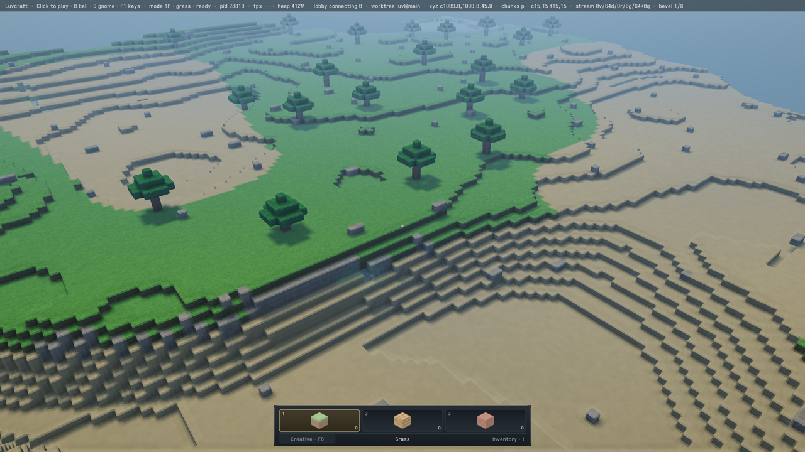
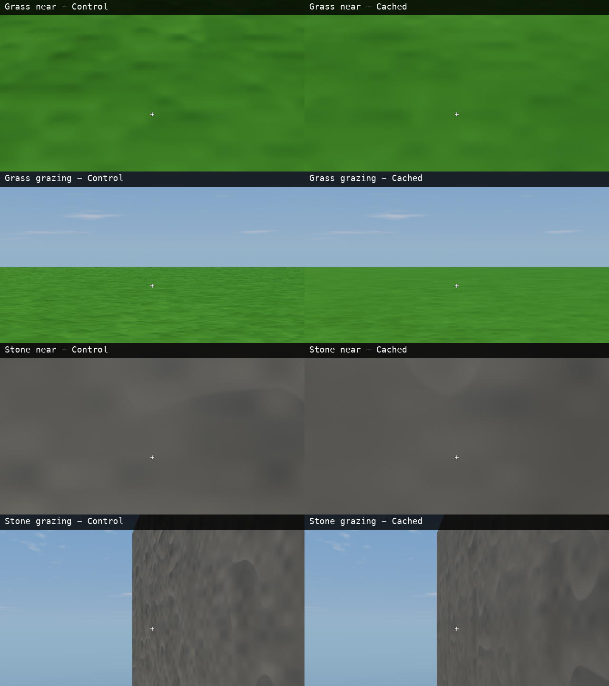

#+title: Grass/stone material cache: bounded prototype, not the default

Yawl, Apple M5, macOS 27.2, Xcode 27.1, 2026-10-23 UTC.
Base [[https://github.com/mbrock/luv/commit/5ee6831477e047cc2565942072fc4a83777d0092][5ee6831]], plus the source in this bundle and the load/inspection hooks
in =../yawl-runtime-f87a44f/interleaved.lisp=. Figure #FSOEGQ.
Thread: https://ampcode.com/threads/T-01a16a97-09d4-76c6-9fcf-75e9b42a2d08

* Result and decision

The first cache reduces whole-frame GPU time by 3.55–3.64% at unchanged
hilltop coverage. It also smooths near stone and grazing grass noticeably.
Keep the prototype, not a default renderer change. This is less promising
than the earlier 13.5–13.7% shared-relief result (#ZRQM38), whose own
close/grazing/motion quality remains unaccepted. The cache does not establish
the large shading-budget reduction sought by the campaign.

| Run | Frames per variant | Control GPU ms | Cached GPU ms | Control completion ms | Cached completion ms |
|-
| ABBA | 900 | 14.825 | 14.299 | 17.535 | 17.041 |
| BAAB | 900 | 14.926 | 14.383 | 17.680 | 17.164 |

Both GPU and serialized completion improve in all 15 balanced 120-frame
windows of each run. GPU savings range 0.403–0.664 ms across those windows.
Completion improves 2.82–2.92%. Windows contain correlated samples; these
are not independent confidence intervals. No profiler, power sampler,
build, or second benchmark ran alongside either timed run. Clocks were not
pinned. These are adjacent-frame comparisons under a shared governor, not
displayed FPS or candidate-only operating points. The previous bundle's
identical-shader A/A control found only 0.14% GPU difference; it was not
repeated here. Do not attribute this gain to any individual Xcode source line.

The timed workload is the same seed-7 live-alpine overview: camera
=(1009,1000,45)=, yaw =0.9=, pitch =-0.55=, vertical FOV =0.85=, nine
residents, native output/internal 1920×1080, 1× samples, no temporal
reconstruction or dynamic resolution, original indexed geometry, merged
shadows, exposure 0.45, noon. No distance or visibility change. The base
benchmark's watchdog sampling remains disabled only inside that benchmark.

Raw per-frame records are =adjacent-{ab,ba}.tsv=; configuration and aggregate
mixed-frame measurements are the matching =*-final.sexp= files. =summary.json=
is generated by the previous bundle's =analyze.py=. Logs record bake costs.

* What moved out of the fragment shader

=material-cache.lisp= retains Lisp procedural authoring. A disposable GPU
pass evaluates the original grass/stone =material-relief-height= functions
into two periodic normal+height tiles. Four translated field evaluations
blend with smoothstep weights to join a four-cell repeat. Central differences
at ±0.015 cells generate unit normals with the original 0.09 height scale.

Ten mip levels average normal vectors and height, without renormalizing
away unresolved normal variance. The candidate samples two adjacent levels,
using world-position derivatives to choose a conservative isotropic
footprint. Normal-length loss raises roughness approximately. Axis-aligned
faces normally sample one projection; bevels blend up to three world-space
projections with normal-to-the-fourth weights. The existing laid-pattern
finite difference is retained, predicting its raw-field offsets from the
sampled gradient rather than evaluating more procedural fields.

Only relief codes 1 and 2 change. Other materials, broad surface variation,
weathering, cloud visibility, lighting, shadows, geometry, bevels, atmosphere
and finishing remain. This is NOT a complete cached material response, and
it is NOT the same continuous 3D field: periodic planar slices and central
gradients replace nonperiodic 3D fields and forward differences. The small
whole-frame gain does not establish that baking the entire surface response
would be unhelpful, nor identify why this candidate's gain is small.

The HAL currently exposes single-mip 2D textures, so this experiment packs
levels and wrapped borders into one RGBA16F atlas instead of expanding the
HAL. That is a disposable expedient, not the preferred production interface:
native mip chains and filtering are appropriate HAL improvements when this
path warrants integration. At 512² per base tile it retains
1028×1043×8 = 8,577,632 bytes (8.18 MiB)
of texture payload plus a view and sampler. Two atlas textures coexist while
baking (16.36 MiB texture payload); temporary bake programs, bindings and
uniform buffers are destroyed after completion. The retained atlas belongs
to the terrain drawing. This excludes driver allocation padding/caches.

First observed 512-resolution generation+compilation+completion was 1.371 s;
subsequent fresh processes reported 120–138 ms with native compilation caches
warm. These are CPU wall intervals, not isolated GPU bake times. Generation
and pipeline compilation occur before timed warmup. No live-edit invalidation,
palette-wide cache, persistence format, native mip API or production ownership
interface is introduced.

* Appearance and numerical checks

The overview captures retain the timed camera and residents, but Retina
captures are native 3840×2160, not the 1920×1080 timed target. These inspected
1280×720 resamples show intact terrain, steps and shadows, without obvious
new holes or conspicuous tiling. The faint rectangular sandy boundary is
already present in the control, not diagnosed here.

An initial enclosed-cave run exercised all poses and both shaders, but its
low-contrast grass could not establish detail quality. The separate daylight
fixture has a 32×32 grass floor at height 3 and a stone north wall at heights
4–10, no roof, fixed noon and exposure. =QUALITY_ONLY= explicitly replaces
the benchmark's =cave= fixture slot; =inspection.sexp= identifies it as
=:daylight-material=. The top-level =:scene :cave= label is therefore not a
claim that these are ordinary cave captures. Its nominal frames/warmup fields
are unused: these are quality-only runs, not timings.

The exact poses are saved in the inspection records and =inspect.lisp=.
Both variants use the same pose and 0.025-cell X displacement per moving
frame, with no streaming advancement. The solid identity is asserted
unchanged. Each sequence renders 16 stationary frames, then 16 moving
frames; frame 0, frame 15 and every moving frame are saved. Temporal history
is explicitly reset between variants and poses, not between moving frames.
Native and temporal hosts are constructed separately. Capture extent is
1920×1080 for the 960×540 windows; temporal capture uses the normal default
reconstruction policy with fixed render scale 1.0, not gameplay's adaptive
scale. Sixteen stationary frames cover a jitter cycle, not assured convergence.

The contact sheet contains unscaled 960×540 source crops at (480,180),
then reduced to 640×360 for display. Control is left, cache right. Rows are
grass near, grass grazing, stone near, stone grazing. Individual full-size
comparison crops are retained beside this file. Labels overlay the top
32 display pixels of each contact-sheet panel; the source crops are unlabelled.

The cache is smoother, especially close stone ridges and grazing grass.
No obvious hard atlas/mip seam or gross corruption appeared. The short
native traversal showed less crawling but also less detail. Temporal motion
showed no obvious persistent ghosts or trails. These tiny traversals do not
accept fast turns, disocclusions, long-term repetition, all material/chunk
boundaries, live edits, or all materials. Bevel geometry is unchanged, but
the blended shading at every possible bevel orientation is not accepted.

=native-motion.mp4= and =temporal-motion.mp4= show control left/cache right,
grass above stone. Sixteen captured grazing frames are repeated four times
at 12 fps for inspection; the reset jump is an edit, not a renderer failure.
Frames are cropped to 1600×800 at (160,55) and reduced to 640×320 per panel.
These show the actual motion tests, not generated illustrations.

An independent scratch readback converted the actual GPU atlas to RGBA8
(normal RGB mapped from [-1,1] to [0,1], height in alpha). At all ten levels
and both materials, every wrapped border matched exactly in that readback;
every interior mip texel matched an independent 2×2 parent average within
one 8-bit count. =atlas-validation.json= retains the per-level numbers.
This validates packing/wrapping/downsampling to readback precision, not
analytic equivalence of the new field or its normal reconstruction.

=make test= passed all 35 suites after the experiment, and strict Parinfer
passed the prototype files. No production code changed. The durable Sly
image was not redefined and remained stopped-playing.

* Reproduce in disposable processes

Run =make= first. From the checkout root:

#+begin_src sh
BENCH_LIBRARY=1 BLOCK_LIBRARY=1 INTERLEAVED_LIBRARY=1 \
BENCH_MODE=native-1x BENCH_SIZES=1920x1080 BENCH_SCENES=live-alpine \
BENCH_REPEATS=1 BENCH_WARMUP=120 BENCH_FRAMES=1800 FRAGMENT_PROBE=control \
BLOCK_MODES=control,cached BLOCK_OUTPUT="$PWD/build/cache-ab" \
BENCH_OUTPUT="$PWD/build/cache-ab-final.sexp" \
./env sbcl --script wiki/measurements/yawl-material-cache-5ee6831/run.lisp
#+end_src

Repeat with =BLOCK_MODES=cached,control= and different output paths.
Optional =PROBE_CAPTURE_DIR= saves overviews after timing. Do not set
=CACHE_INSPECT= in the live-alpine timing run: that callback uses the
finite material fixture's poses.

For the two appearance hosts, once with =MODE=native-1x= and again with
=MODE=default=:

#+begin_src sh
MODE=native-1x
BENCH_LIBRARY=1 BLOCK_LIBRARY=1 INTERLEAVED_LIBRARY=1 BENCH_MODE="$MODE" \
BENCH_SIZES=960x540 BENCH_SCENES=cave BENCH_REPEATS=1 FRAGMENT_PROBE=control \
QUALITY_ONLY=1 CACHE_INSPECT="$PWD/build/cache-quality-$MODE/" \
BENCH_OUTPUT="$PWD/build/cache-quality-$MODE.sexp" \
./env sbcl --script wiki/measurements/yawl-material-cache-5ee6831/run.lisp
#+end_src

=MATERIAL_RESOLUTION= defaults to 512; changing it defines a different
candidate. Do not load these wrappers into the managed image. No source map,
new profiler collection, GPU clock policy or default material replacement
is part of this experiment.
