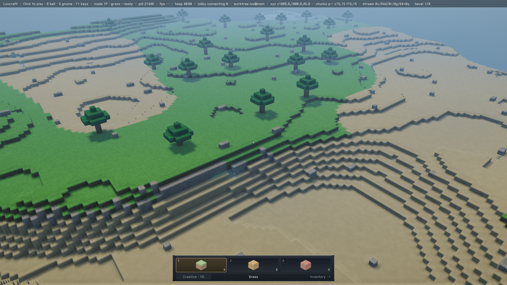
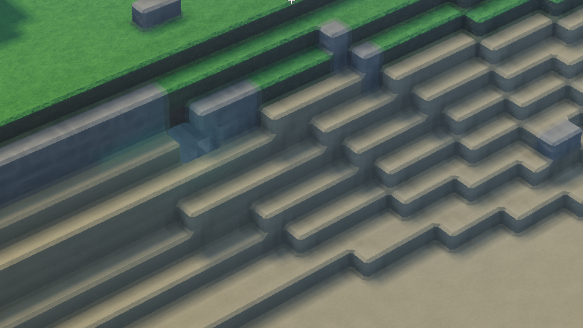

#+title: Runtime relief comparisons at fixed scene coverage

Collected on yawl, Apple M5 (10 GPU cores), macOS 27.2 build 26B118,
Xcode 27.1 build 27A9275, 2026-10-23 UTC. Campaign figures #ZRQM38 and
#XDZ78R. Thread: https://ampcode.com/threads/T-01a16a97-09d4-76c6-9fcf-75e9b42a2d08

* Result and decision

The renderer must afford an open hilltop view, not hide its cost by reducing
render distance. This experiment changes only terrain fragment shading.
The existing indexed geometry, visibility, nine resident chunks, camera,
shadows, lighting inputs, and output/internal extents remain fixed.

Adjacent-frame comparisons establish a runtime benefit from sharing relief
evaluation. Screen-gradient relief reduces mean GPU time by 13.5–13.7% and
serialized completion time by 11.5–11.7% across two fresh processes, with
opposite variant order. Both metrics improve in every 120-frame comparison
window (15 per run). No profile or power sampler ran alongside these tests.

| Run | Variant | Frames | GPU mean ms | Completion mean ms |
|-
| Relief 1 | control | 900 | 14.992 | 17.768 |
| Relief 1 | screen-gradient | 900 | 12.963 | 15.723 |
| Relief 2, reversed | control | 900 | 15.098 | 17.822 |
| Relief 2, reversed | screen-gradient | 900 | 13.024 | 15.735 |
| Large ablations | control | 600 | 15.628 | 18.951 |
| Large ablations | normal-off | 600 | 13.266 | 16.584 |
| Large ablations | relief-off | 600 | 12.250 | 15.561 |
| Null A/A | control | 600 | 14.274 | 16.928 |
| Null A/A | independently compiled control-copy | 600 | 14.293 | 16.928 |

The large ablations are diagnostic, not acceptable visual optimizations.
Both beat control in all 15 windows. The null control's difference is
0.019 ms GPU (0.14%) and -0.000015 ms completion. CPU encoding is similar
between relief variants; no CPU speedup is claimed.

This is a mixed-workload comparison under a shared governor state, not a
candidate-only sustained throughput result or a prediction of displayed FPS.
Clocks remain variable. Alternation also changes instruction-cache behavior
relative to a single shader. Reversed order and A/A guard against simple
order/label bias; they do not make the workload identical to gameplay.

Choose removal of repeated relief evaluation as the next production shading
bet. Keep screen derivatives experimental until near/grazing/motion/temporal
and material-boundary checks pass; consider shared value-and-gradient
evaluation if that approximation fails. This commit does not enable a new
terrain shader or geometry representation. The independent benchmark fix
below prevents unintended native sampling.

* Why multi-second blocks were not enough

=blocks.lisp= compiles the variants before timing and reuses the same settled
world. Each block has 30 warmup and 240 measured frames. It selects the
whole drawing program (layouts have identity), invalidates old bindings
outside timing, then lets warmup rebuild them. Three ABCCBA rounds retain
4,320 measured frames in =ablation-1.tsv= and summaries in =ablation-1.sexp=.
Per-block GPU means overlap substantially: control 11.76–14.05 ms,
normal-off 11.54–13.75 ms, relief-off 11.33–12.76 ms. One round even orders
the aggregate means opposite to the expected work reduction.

A separate run collected read-only =powermetrics= samples every 200 ms.
Within its first unchanged control block, consecutive 30-frame windows show:

| Frames | GPU mean ms | GPU active MHz | Thermal pressure |
|-
| 0–29 | 8.33 | 1,561 | Nominal |
| 60–89 | 11.47 | 1,139 | Nominal |
| 90–119 | 16.90 | 775 | Nominal |
| 210–239 | 15.43 | 834 | Nominal |

This establishes changing execution conditions in the failing comparison.
It does not diagnose the governor policy, retrospectively measure clocks in
the earlier thread's four runs, or identify every contributor to their times.
No system power setting was changed or GPU clock pinned.

The following controls did not stabilize the clocks, including in their first
control block before any later watchdog sampling:

- =BLOCK_PUMP_EVENTS=1=: service Cocoa via SDL between frames. Charge its
  work to simulation/completion rather than excluding it from the wall time.
- =BLOCK_USER_ACTIVITY=1=: scoped =NSActivityUserInitiatedAllowingIdleSystemSleep=,
  explicitly ended on exit; no latency-critical flag or sleep prevention.
- =BLOCK_USER_QOS=1=: main canvas thread's requested QoS set to user-initiated
  (25) for this disposable process. This is not a production recommendation.

=*-power.plist.gz= are the complete raw interval records; =*-power.tsv= are
the matching measured frames; =*-power-summary.json= are aligned 30-frame
windows. The GPU plist field called =freq_hz= actually reports MHz on this
OS, confirmed by text-mode output and its DVFM-state entries. CPU frequency
fields use Hz. =power.py= uses elapsed intervals and all whole-second dates
to bound the timestamp origin (about 1–7 ms here), then matches feedback
times to intervals. Each interval can contain several variants or desktop
GPU activity: do not interpret it as an isolated per-frame hardware counter.

* A real extra confound in the old runs: the watchdog profiler

The preserved =old-runtime-control-2.log= and
=old-runtime-screen-gradient-2.log= contain verbatim records of native
process sampling launched 6.2 / 6.1 seconds into their long canvas requests.
Their benchmark disabled the watchdog's fatal deadline, but not sampling.
Those two old runs were not genuinely uninstrumented. The first two archived
runs logged warnings but no sampling. No raw old result is removed or revised.

Two new diagnostic power runs (=pump-power= and =activity-power=) also
crossed that sampling threshold later in the run; their logs are retained.
They are not used for the headline A/B improvement. The plain power run
and QoS run contain no watchdog sample record. Clock instability is visible
before sampling, so removing the sampler alone is not a clock-stability fix.

The fixed =scripts/bench-gpu-fps.lisp= disables warnings and native sampling
for its deliberately long, isolated offscreen batches, retaining the bounded
600-second dispatch timeout. The production game's watchdog is unchanged.
The =watchdog-control= smoke reuses the old benchmark entry point with 120
warmup + 600 measured frames: all 600 GPU samples arrive, the request lasts
over six seconds, and its log contains no watchdog/native-sampling record.
Its 13.605 ms GPU mean is not an optimization speedup.

* Adjacent-frame method

=interleaved.lisp= uses the same =gpu-fps::measure= implementation and Metal
4 submission feedback as the existing serialized benchmark. Every frame
submits and waits for completion. There is no swapchain/presentation wait,
readback, profiler, or GPU frame overlap in the timed loop.

All variants are precompiled with the game's cloud/atmosphere hooks and the
same pipeline state. Only the terrain drawing program changes per frame.
Cached bindings include the variant identity so each program uses bindings
created for its layout, without repeated per-frame invalidation/allocation.
Serial completion still protects mutable camera buffers. Program selection
is charged to simulation/completion. Cleanup restores the original program
and releases variant bindings before their programs.

The original relief probe in =../yawl-fragment-a31fc0b/probe.lisp= supplies
all shader changes. =control-copy= reparses the same unchanged control into
a second program. The three-way order is ABCCBA and the two-way order ABBA;
each full sequence balances position around its midpoint. Warmup is 120
frames, followed by 1,800 measured frames (1,200 for A/A). There are no
dropped samples or outlier exclusions. The sustained request does not launch
the native watchdog sampler. The user's durable image is never modified.

Raw per-frame GPU, completion, CPU encode and feedback wall timestamps are
the =adjacent-*.tsv= files. Full scene/configuration metadata are in the
matching =*-final.sexp= files; these record the mixed-frame aggregate, not
the performance of the last selected shader. =summary.json= derives means
and balanced 120-frame windows directly from every TSV. Those windows are
comparisons over correlated samples, not independent confidence intervals.

* Appearance inspection, not production acceptance

The captures were made after all timed frames of relief run 1, at the
canvas's native 3840×2160 extent, NOT the timed 1920×1080 extent. They retain
the same stationary scene and coverage. =*-overview.png= are 1280×720
resamples; =*-detail.png= are unscaled 960×540 crops at x=1440, y=1080.
Both overviews and crops were inspected: terrain, steps, grass, and shadow
coverage are intact, with subtle relief differences and no gross new holes
or corrupted colors. A faint rectangular lighting/material boundary exists
in the control; this experiment does not diagnose or fix it.

These are not pixel-equivalent or evidence for close-range mortar, cloth,
grazing-angle filtering, camera-motion stability, temporal reconstruction,
caves, or all material/chunk boundaries. Large original PNGs remain local
under =.amp/in/artifacts/runtime-shading/=, deliberately not in Git.

* Reproduce

Run =make= first. From the checkout root, using a disposable SBCL process:

#+begin_src sh
BENCH_LIBRARY=1 BLOCK_LIBRARY=1 BENCH_MODE=native-1x \
BENCH_SIZES=1920x1080 BENCH_SCENES=live-alpine BENCH_REPEATS=1 \
BENCH_WARMUP=120 BENCH_FRAMES=1800 FRAGMENT_PROBE=control \
BLOCK_MODES=control,screen-gradient BLOCK_OUTPUT="$PWD/build/adjacent-relief" \
BENCH_OUTPUT="$PWD/build/adjacent-relief-final.sexp" \
./env sbcl --script wiki/measurements/yawl-runtime-f87a44f/interleaved.lisp
#+end_src

Reverse =BLOCK_MODES= for the second run. For large ablations use
=control,normal-off,relief-off=; for A/A use =control,control-copy= and
=BENCH_FRAMES=1200=. Optional =PROBE_CAPTURE_DIR= saves inspection PNGs only
after measurement. No =MTL_CAPTURE_ENABLED= or replay session is needed.

For coarse blocks, omit =BLOCK_LIBRARY=, run =blocks.lisp=, set
=BENCH_WARMUP=30 BENCH_FRAMES=240 BLOCK_ROUNDS=3= (one round for each power
diagnostic), and use =BLOCK_OUTPUT= and =BENCH_OUTPUT= prefixes as above.
The current benchmark no longer starts a watchdog sampler, unlike the
recorded earlier diagnostic failures.

For read-only telemetry, run =sudo powermetrics --samplers gpu_power,cpu_power,thermal
-i 200 -n 350 -f plist -o build/power.plist= alongside ONE diagnostic run,
not alongside the unprofiled headline comparisons. Ensure samples cover
the whole run. This does not change power policy.

#+begin_src sh
python3 wiki/measurements/yawl-runtime-f87a44f/analyze.py \
  wiki/measurements/yawl-runtime-f87a44f/*.tsv
python3 wiki/measurements/yawl-runtime-f87a44f/power.py \
  wiki/measurements/yawl-runtime-f87a44f/ablation-power.plist.gz \
  wiki/measurements/yawl-runtime-f87a44f/ablation-power.tsv
#+end_src

* Provenance and scope

Rendering source is =f87a44fefc809d57afa5c6aed0df78c2e3c1c391=, with the
existing experimental shader probe and the new measurement harness loaded
locally. All headline/diagnostic cohorts record benchmark blob
=e7a4c9b783f3efe601566e922efe0a942f577704=. Adjacent tests already suppressed
watchdog sampling locally; that setting was then moved into the benchmark.
The sampler-fix smoke records blob =aa5c64b20b2b420e817ea8338912672bcc2a912e=.
The final harness reuses the fixed benchmark rather than overriding it.

Seed 7, settled live-alpine, camera (1009,1000,45), yaw 0.9, pitch -0.55,
FOV 0.85, fixed exposure 0.45, nine residents, merged shadow rectangles,
original indexed/instanced scene geometry, native single sample, no temporal
reconstruction or dynamic resolution. The timed internal and output extents
are both 1920×1080 despite the dormant default scale value in metadata.
No source changes to default shaders, geometry, visibility, or render distance.

The 9 per-frame cohorts retain 16,680 measured frames, plus the independent
600-frame sampler-fix smoke. =files.sha256= identifies retained inputs,
scripts, images and summaries, excluding the manifest itself. Raw =.sexp=
printer output is preserved verbatim, including trailing whitespace.
Generated summaries validate full frame
coverage, ordering, counts and positive block timings. The harness also
checks raw GPU means against the original benchmark summaries.
