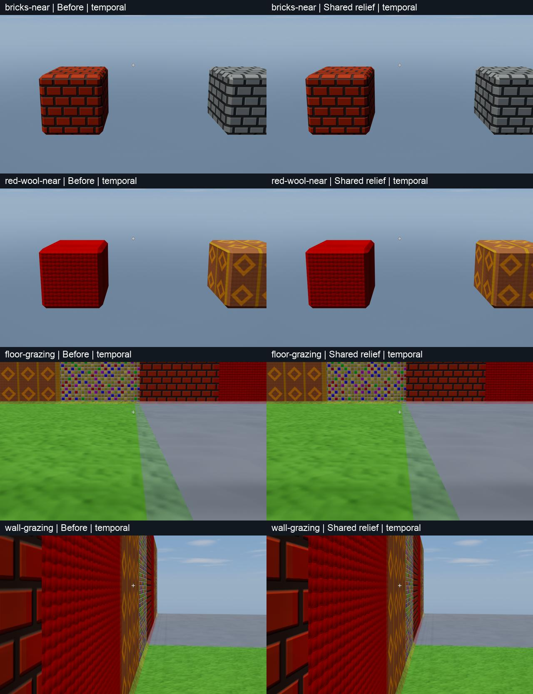
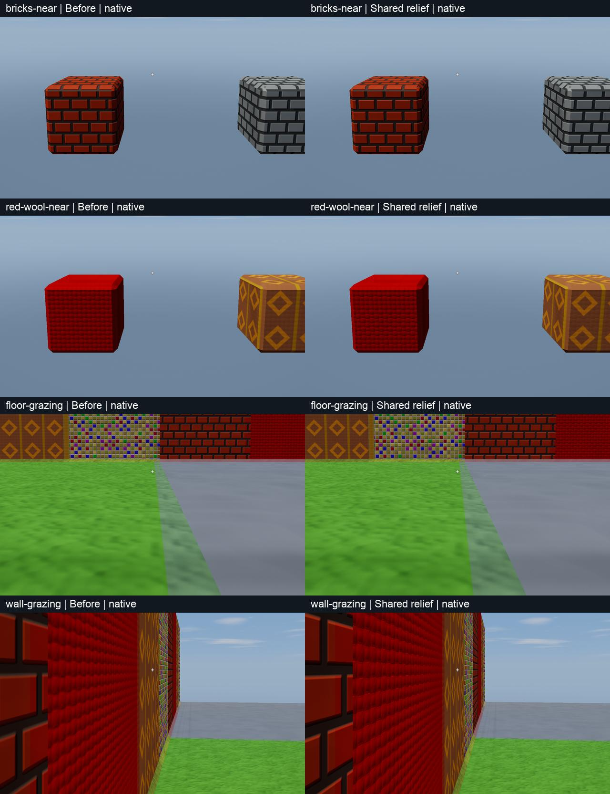
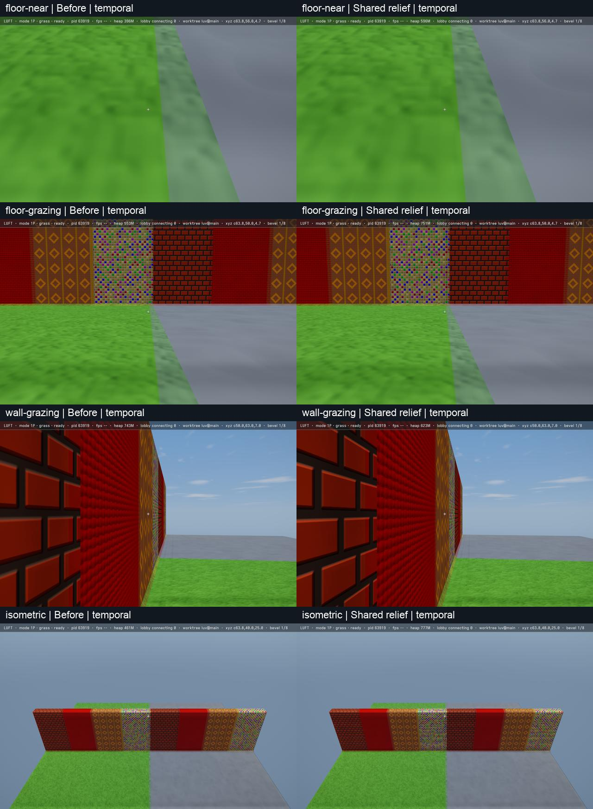
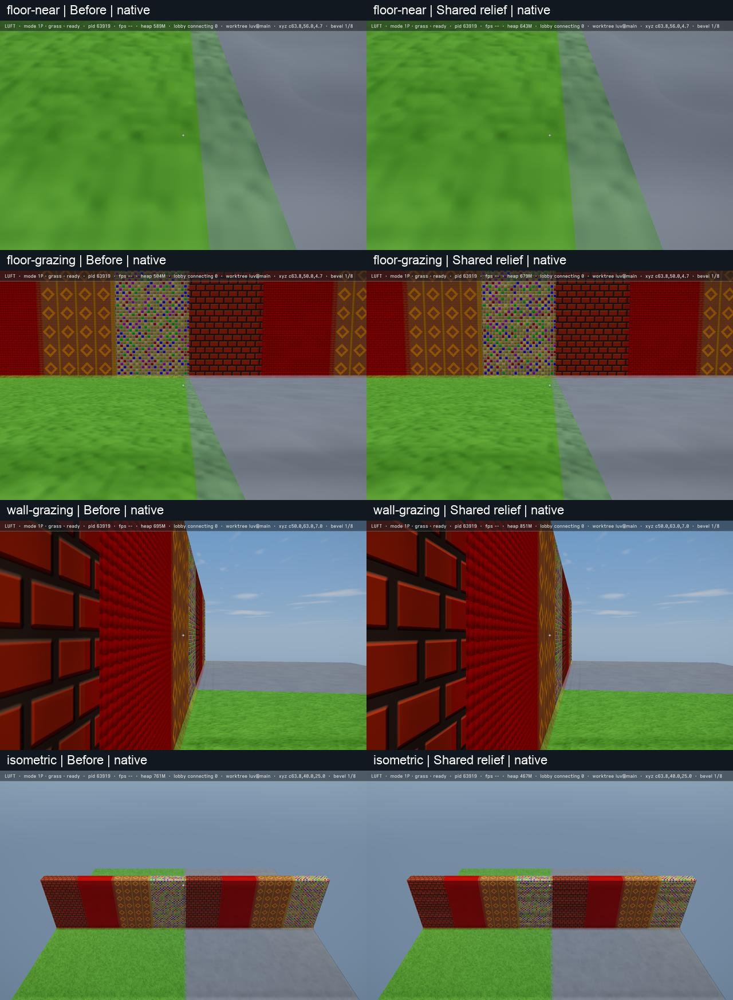

#+title: Adopt shared terrain relief after bounded quality validation

Evidence for #XDZ78R. Yawl, Apple M5, native Metal, macOS 27.2, 2026-10-24.
Baseline [[https://github.com/mbrock/luv/commit/dd41727401da02de924ec672549252382ef87425][dd41727]]; candidate is the production shader change accompanying this bundle.
Thread: https://ampcode.com/threads/T-01a16a97-09d4-76c6-9fcf-75e9b42a2d08

* Decision and scope

The production terrain fragment now evaluates its height once, sharing it
between tone and a screen-gradient normal. The two tangent-offset procedural
evaluations are gone. The signed determinant preserves orientation under
mirrored screen bases; a degenerate projection retains the geometric normal.
No new render option, material cache, geometry policy or HAL workaround is
introduced. Bevel shape, shadow geometry and view coverage are unchanged.

This is an approximation: quad differences replace fixed 0.015-cell forward
differences. It is not pixel-equivalent or a band-limited material filter.
The inspected fixtures pass the bounded adoption gate, not every possible
material, camera path or reconstruction implementation.

* Repeated ordinary runtime

Each fresh process uses the existing interleaved harness, but compiles the
actual baseline and integrated shader sources, not a fragment AST replacement.
Both use the game's atmosphere/cloud hooks. The same seed-7 live-alpine
hilltop has nine residents, native output/internal 1920x1080, one sample,
no temporal reconstruction, no dynamic resolution, original indexed scene
geometry and default merged shadows. There are 120 warmup and 1,800 timed
frames per process, 900 per variant. Order is ABBA, then BAAB in a fresh
process. No build, quality capture, GPU profiler or power sampler overlaps
timing. Optional hilltop PNGs were taken after run 1's timed frames.

| Run | Control GPU ms | Shared GPU ms | Control completion ms | Shared completion ms |
|-----+----------------+---------------+-----------------------+----------------------|
| ABBA | 15.1241 | 12.9514 | 17.8914 | 15.7143 |
| BAAB | 15.0300 | 12.8739 | 17.7564 | 15.6418 |

GPU savings are 14.35--14.37%; serialized completion savings 11.91--12.17%.
All fifteen balanced 120-frame windows per run improve both metrics. CPU
encoding does not establish an improvement. Clocks are not pinned and windows
are correlated: these are mixed-workload shared-governor comparisons, not
displayed FPS, candidate-only sustained operation, or source-line attribution.
No new Xcode profiling claim is made. Raw TSV, final metadata and summaries
are retained alongside this file.

* Appearance checks

=quality.lisp= reuses the material sampler's deterministic scene builder but
uses the game's photographic finishing/atmosphere and fixed exposure 0.45,
not the sampler's atelier finish/exposure 1.0. All 73 palette placements
appear on seven pages. Six pairs additionally have close and oblique views:
grass/stone, brick/stone-brick, wool/tapestry, wood/hay, iron/crystal, and
mosaic/half-timber. The finite block oblique views alone do not establish
grazing acceptance for large surfaces.

=boundaries.lisp= adds a 32x32 floor crossing both 64-cell chunk boundaries,
grass/stone meeting at x=64, and a wall at y=64 with brick, wool, tapestry
and mosaic strips. Near floor, shallow-pitch floor, shallow-yaw wall, and
isometric views exercise extended surfaces and material/chunk boundaries.

Each variant/mode/pose has a fresh host/history. Output is 1920x1200 native
canvas pixels: non-temporal internal 1920x1200, or MetalFX internal
1440x900 (0.75 scale). Each close/surface sequence saves the first captured
frame, the sixteenth stationary frame, then 32 consecutive frames translating camera X
by 0.025 cells/frame. No streaming advancement occurs between those captures.
This is a short 0.8-cell traverse, not a long gameplay or thermal test.

The palette sheets, close/oblique comparisons, extended-surface sheets and
selected native/MetalFX motion clips were inspected. Mortar, cloth weave,
wood/straw detail and bevel light bands remain readable. No new seam, gross
material corruption or objectionable motion artifact was observed. Fine
normal changes are real, and baseline native fine-pattern aliasing remains.
The quantitative image differences exclude the top 64 HUD rows but are not
an acceptance threshold or a proof of perceptual equivalence. Animated fixture
content is not a deterministic pixel oracle.

The hilltop inspection PNGs are 3840x2160 Retina captures, not timed-size
captures; retained overview JPEGs are 1280x720 resamples. Large originals,
frame sequences, remaining sheets and motion clips remain under this thread's
=.amp/in/artifacts/relief-integration/=. These are appearance evidence only.
No Vulkan runtime, portable temporal-resolve motion, or exhaustive editing
acceptance was performed. =make= and all 35 =make test= suites pass;
=make luft-shader-validate= validates all Luft SPIR-V, and
=make hlsl-validate= compiles all 113 shaders with DXC. Metal compiled and
rendered both variants in every native/MetalFX fixture above.

* Reproduce from the checkout root

These harnesses replace definitions; use disposable processes, never live Sly.

#+begin_src sh
git show dd41727401da02de924ec672549252382ef87425:luft/render/shaders.lisp > build/relief-baseline.lisp

# Repeat with BLOCK_MODES=shared,control and distinct output names.
BENCH_LIBRARY=1 BLOCK_LIBRARY=1 INTERLEAVED_LIBRARY=1 \
BENCH_MODE=native-1x BENCH_SIZES=1920x1080 BENCH_SCENES=live-alpine \
BENCH_REPEATS=1 BENCH_WARMUP=120 BENCH_FRAMES=1800 \
BLOCK_MODES=control,shared BLOCK_OUTPUT=build/relief-ab \
BENCH_OUTPUT=build/relief-ab.sexp \
./env sbcl --dynamic-space-size 8192 --script wiki/measurements/yawl-shared-relief-dd41727/runtime.lisp

./env sbcl --dynamic-space-size 8192 --script wiki/measurements/yawl-shared-relief-dd41727/quality.lisp
./env sbcl --dynamic-space-size 8192 --script wiki/measurements/yawl-shared-relief-dd41727/boundaries.lisp
./env uv run --with pillow --with numpy python wiki/measurements/yawl-shared-relief-dd41727/review.py
./env python3 wiki/measurements/yawl-runtime-f87a44f/analyze.py build/relief-ab.tsv build/relief-ba.tsv
#+end_src

=RELIEF_BASELINE= overrides the baseline pathname; =RELIEF_OUTPUT= overrides
the quality output directory (default =build/shared-relief-quality/=).
The review script uses macOS Arial and the environment's ffmpeg. Run both
quality scripts before it. The archived harnesses differ from the measured
scratch copies only in configurable baseline/output paths; capture and
timing code is unchanged.
